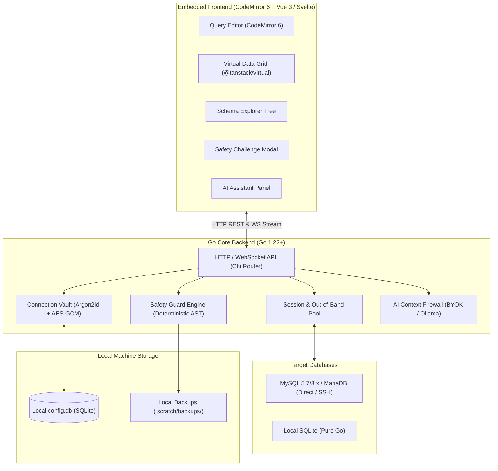
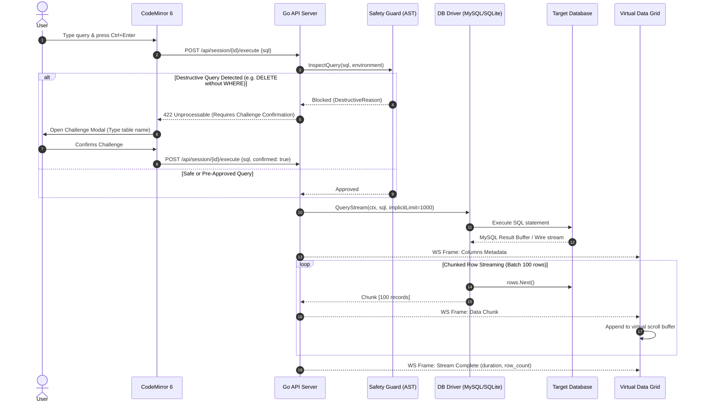
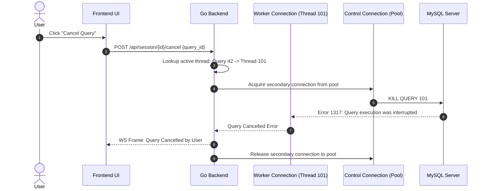

# SqlFox Architecture Specification

System architecture, component boundaries, and execution flows for SqlFox.

## 1. High-Level System Architecture

SqlFox is designed as a **single-binary local application** with an embedded reactive web application. It operates under a strict memory ceiling (<100MB RAM) with sub-second startup time (<1s).



---

## 2. End-to-End Query Execution Lifecycle

The following sequence details how arbitrary SQL queries flow from the editor through Safety Guard to execution and streaming:



---

## 3. Out-of-Band Query Cancellation Flow

To prevent socket tearing and orphaned background execution on the database server, SqlFox executes cancellations out-of-band:



---

## 4. Driver Interface & Extensibility Contract

To allow clean additions of PostgreSQL, ClickHouse, or MongoDB in future releases without modifying core routing or safety logic:

```go
package driver

import (
    "context"
    "io"
)

// Driver manages connection lifecycle and dialers
type Driver interface {
    Connect(ctx context.Context, cfg ConnectionConfig) (Session, error)
}

// Session represents an active connection context
type Session interface {
    // Stream-based query for arbitrary SELECTs
    QueryStream(ctx context.Context, sql string, limit int) (RowStream, error)
    
    // Mutation execution for DML/DDL
    Exec(ctx context.Context, sql string) (ExecResult, error)
    
    // Schema introspection
    InspectSchema(ctx context.Context, schemaName string) (*SchemaMetadata, error)
    GetTableDDL(ctx context.Context, tableName string) (string, error)
    GetTableEstimate(ctx context.Context, tableName string) (TableEstimate, error)
    
    // Query plan & optimization
    Explain(ctx context.Context, sql string) (*ExplainPlan, error)
    
    // Interruption
    CancelQuery(ctx context.Context, queryID string) error
    
    io.Closer
}

// RowStream yields chunked data without loading entire resultsets into RAM
type RowStream interface {
    Columns() []ColumnDefinition
    NextChunk(batchSize int) ([][]any, error)
    TotalRows() int64
    io.Closer
}
```

---

## 5. Directory & Package Structure

```
sqlfox/
├── cmd/
│   └── sqlfox/
│       └── main.go                 # Entry point: flags, localhost listener, browser launcher
├── internal/
│   ├── app/                        # Application container & dependency wiring
│   ├── vault/                      # SQLite config storage & AES-256-GCM credential encryption
│   │   ├── vault.go
│   │   ├── crypto.go               # Argon2id key derivation & AES-GCM
│   │   └── export.go               # .sqlfox-vault portable archive export/import
│   ├── driver/                     # Database driver abstraction
│   │   ├── driver.go               # Core interfaces (Driver, Session, RowStream)
│   │   ├── mysql/                  # go-sql-driver/mysql implementation + SSH tunnel dialer
│   │   └── sqlite/                 # modernc.org/sqlite pure-Go implementation
│   ├── safety/                     # Safety Guard engine
│   │   ├── guard.go                # Safety policy orchestrator
│   │   ├── parser.go               # TiDB SQL AST parser integration
│   │   ├── rules.go                # Destructive pattern evaluators
│   │   └── backup.go               # Smart tiered pre-DDL backup manager
│   ├── ai/                         # AI Assistant integration
│   │   ├── client.go               # Generic client (OpenAI, Claude, Gemini, Ollama)
│   │   ├── firewall.go             # Schema filter, data masking & prompt builder
│   │   └── prompts.go              # Structured prompts for explain, plan, optimize
│   └── server/                     # HTTP and WebSocket transport
│       ├── server.go               # Chi router setup & static file embedding
│       ├── handlers_connection.go  # Connection CRUD & test
│       ├── handlers_query.go       # Query execution & WS streaming
│       ├── handlers_schema.go      # Schema tree & DDL retrieval
│       ├── handlers_ai.go          # AI chat & explanation endpoints
│       └── ws.go                   # WebSocket streaming hub
├── web/                            # Frontend source (Svelte / Vue 3 + Tailwind)
│   ├── src/
│   │   ├── components/
│   │   │   ├── editor/             # CodeMirror 6 SQL editor & autocompleter
│   │   │   ├── grid/               # Virtualized data grid with inline edit
│   │   │   ├── schema/             # Database tree viewer
│   │   │   ├── modal/              # Challenge modals & impact previews
│   │   │   └── ai/                 # AI chat sidebar
│   │   ├── stores/                 # State management (tabs, active connection)
│   │   └── App.vue / App.svelte
│   ├── dist/                       # Compiled assets embedded via //go:embed
│   ├── embed.go                    # //go:embed dist/*
│   └── package.json
├── docs/
│   ├── adr/                        # Architectural Decision Records
│   └── agents/                     # Agent workflow documentation
├── CONTEXT.md                      # Ubiquitous domain language
├── ARCHITECTURE.md                 # System architecture (this document)
├── SECURITY.md                     # Security & privacy specification
├── UX_DESIGN.md                    # Interface wireframes & design tokens
├── MILESTONES.md                   # Delivery roadmap & MVPs
└── go.mod
```
