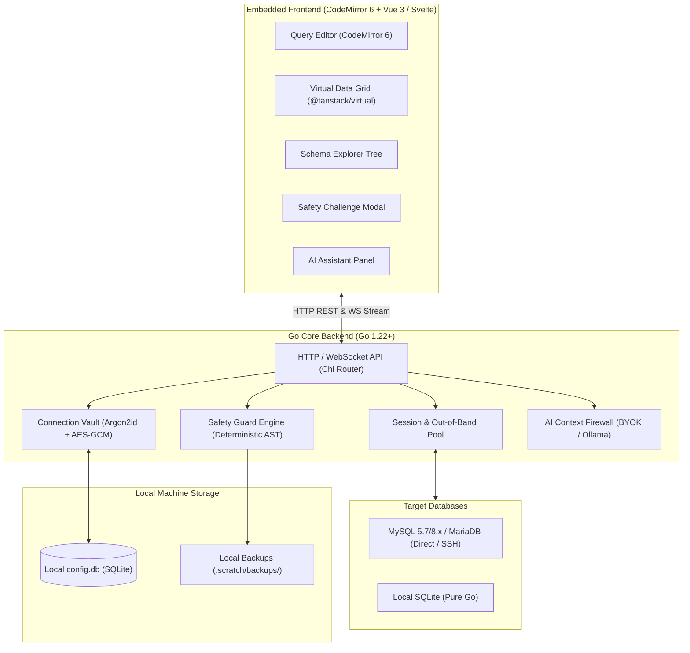
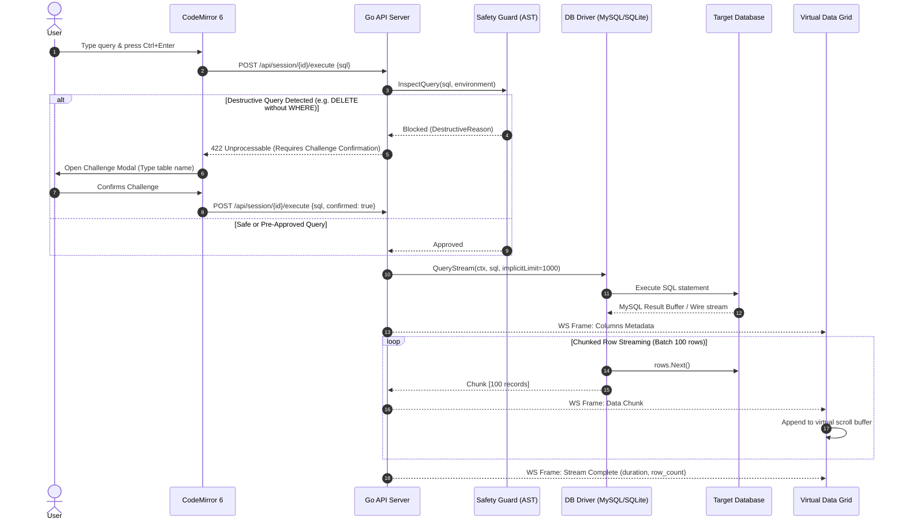
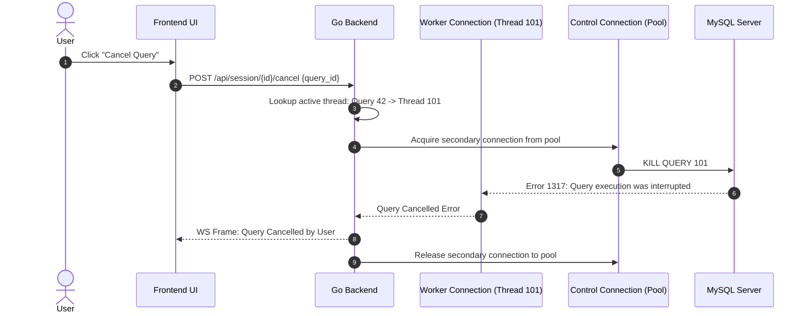
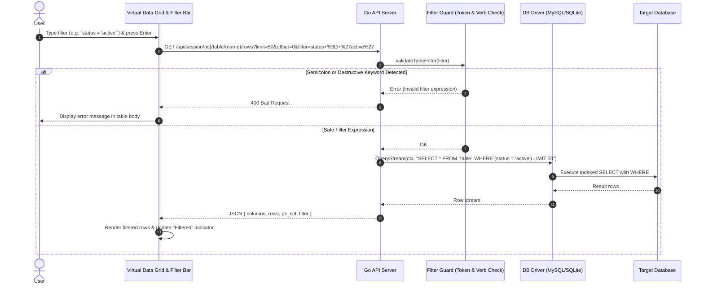
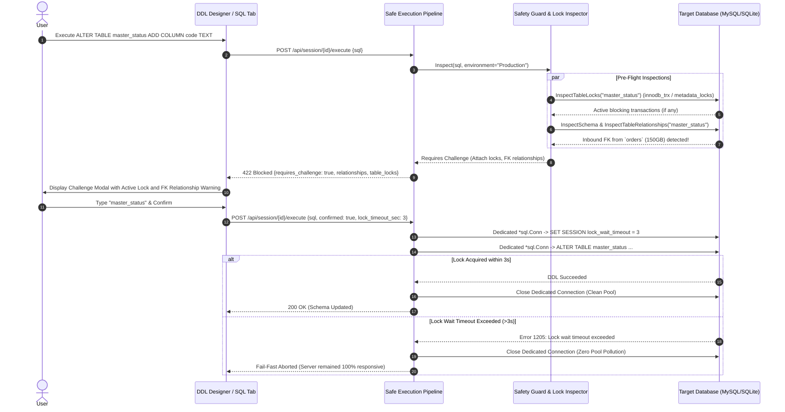
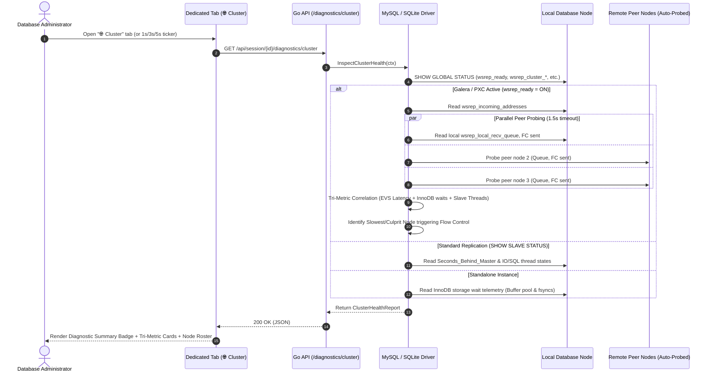
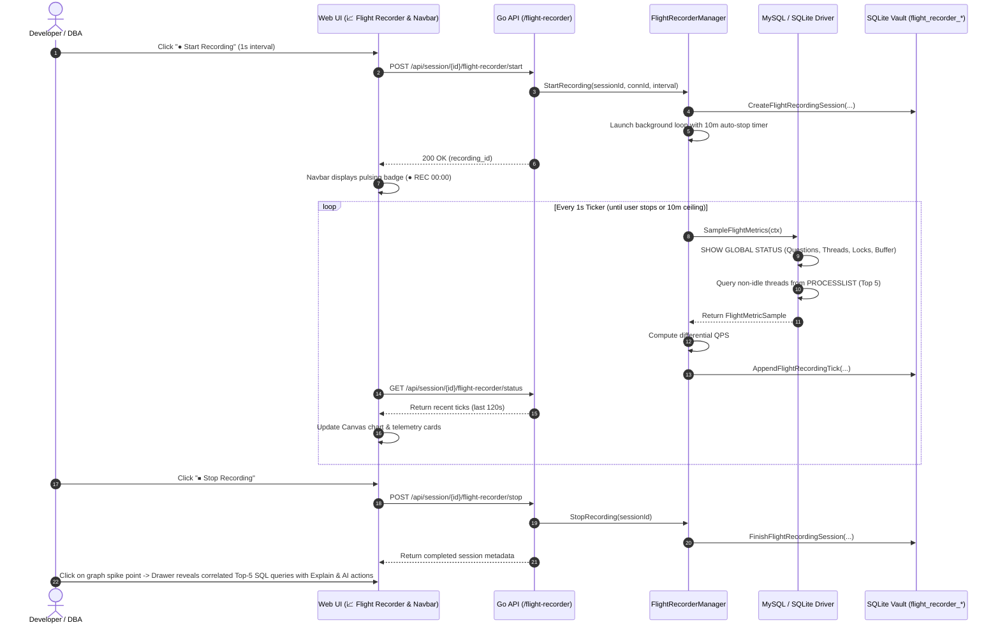

# SqlFox Architecture Specification

System architecture, component boundaries, and execution flows for SqlFox.

## 1. High-Level System Architecture

SqlFox is designed as a **single-binary local application** with an embedded reactive web application. It operates under a strict memory ceiling (<100MB RAM) with sub-second startup time (<1s).



---

## 2. End-to-End Query Execution Lifecycle

The following sequence details how arbitrary SQL queries flow from the editor through Safety Guard to execution and streaming:



---

## 3. Out-of-Band Query Cancellation Flow

To prevent socket tearing and orphaned background execution on the database server, SqlFox executes cancellations out-of-band:



---

## 4. Driver Interface & Extensibility Contract

To allow clean additions of PostgreSQL, ClickHouse, or MongoDB in future releases without modifying core routing or safety logic:

```go
package driver

import (
    "context"
    "io"
)

// Driver manages connection lifecycle and dialers
type Driver interface {
    Connect(ctx context.Context, cfg ConnectionConfig) (Session, error)
}

// Session represents an active connection context
type Session interface {
    // Stream-based query for arbitrary SELECTs
    QueryStream(ctx context.Context, sql string, limit int) (RowStream, error)
    
    // Mutation execution for DML/DDL
    Exec(ctx context.Context, sql string) (ExecResult, error)
    
    // Schema introspection
    InspectSchema(ctx context.Context, schemaName string) (*SchemaMetadata, error)
    GetTableDDL(ctx context.Context, tableName string) (string, error)
    GetTableEstimate(ctx context.Context, tableName string) (TableEstimate, error)
    
    // Lock inspection & Safe DDL execution
    InspectTableLocks(ctx context.Context, database, table string) ([]TableLockInfo, error)
    ExecSafeDDL(ctx context.Context, sql string, lockTimeoutSec int) (*ExecResult, error)
    
    // Cluster & Replication diagnostics
    InspectClusterHealth(ctx context.Context) (*ClusterHealthReport, error)

    // Query plan & optimization
    Explain(ctx context.Context, sql string) (*ExplainPlan, error)
    
    // Interruption
    CancelQuery(ctx context.Context, queryID string) error
    
    io.Closer
}

// RowStream yields chunked data without loading entire resultsets into RAM
type RowStream interface {
    Columns() []ColumnDefinition
    NextChunk(batchSize int) ([][]any, error)
    TotalRows() int64
    io.Closer
}
```

---

## 5. Table Viewer Inline Filtering & Pushdown Flow



---

## 6. Safe DDL & Lock Contention Prevention Pipeline

To eliminate Metadata Lock (MDL) queues, application pool exhaustion, and deadlock cascades on massive datasets (e.g. 500GB tables and small master tables referenced by high-traffic transactional child tables):



---

## 7. Cluster & Replication Inspector Pipeline

The Cluster & Replication Inspector provides zero-daemon, dynamic clustering and replication telemetry for Percona XtraDB Cluster (PXC 5.7/8.0), Galera Cluster, MariaDB, and MySQL Source-Replica setups.



---

## 8. Performance Flight Recorder & Correlated Query Pipeline

The Performance Flight Recorder provides on-demand, time-bounded telemetry and thread snapshotting to isolate transient latency spikes and root-cause queries without running heavy 24/7 APM daemons.



---

## 9. Directory & Package Structure

```
sqlfox/
├── cmd/
│   └── sqlfox/
│       ├── main.go                 # Entry point: flags, localhost listener, port hunting, browser launcher
│       └── main_test.go
├── internal/
│   ├── vault/                      # SQLite config storage & AES-256-GCM credential encryption
│   │   ├── vault.go                # Connections, master password, audit log, flight recorder schema
│   │   ├── crypto.go               # Argon2id key derivation & AES-256-GCM
│   │   ├── snippets.go             # Parameterized SQL snippets
│   │   ├── notes.go                # Table documentation notes
│   │   ├── export.go               # .sqlfox-vault portable archive export/import
│   │   └── flight_recorder.go      # Performance flight recorder sessions & tick persistence with 24h purge
│   ├── driver/                     # Database driver abstraction
│   │   ├── driver.go               # Core interfaces (Driver, Session, RowStream, SafeDDL, OSC, Cluster, FlightRecorder)
│   │   ├── rowstream.go            # Canonical chunked row streaming
│   │   ├── redundant_index.go      # Shadowed / duplicate index detection
│   │   ├── mysql/                  # MySQL 5.7/8.x, PXC, MariaDB with Galera cluster inspection & fail-fast DDL
│   │   │   ├── mysql.go
│   │   │   └── cluster_test.go     # Tri-metric cluster bottleneck heuristics test
│   │   └── sqlite/                 # modernc.org/sqlite CGo-free pure-Go driver with FK inspection
│   ├── safety/                     # Safety Guard engine
│   │   ├── guard.go                # AST inspection & destructive operation detection with DDL guards
│   │   └── backup.go               # Smart tiered pre-destruction table snapshotting (pure function)
│   ├── ai/                         # AI Assistant integration
│   │   ├── client.go               # Pure stdlib client (OpenAI, Claude, Gemini, Ollama)
│   │   ├── firewall.go             # Zero-leakage schema pruner & data masking (pure function)
│   │   └── prompts.go              # Structured prompts for explain, optimize, NL-to-SQL
│   ├── dataimport/                 # CSV Ingestion Engine
│   │   └── importer.go             # Delimiter sniffing, column mapping, batched streaming
│   └── server/                     # HTTP transport & handlers
│       ├── server.go               # HTTP routing & SPA static file serving
│       ├── auth.go                 # Remote Access Guard & LAN tablet token auth
│       ├── session_manager.go      # Active database connection pool & session state with Safe DDL execution
│       ├── flight_recorder.go      # Flight recorder background controller & auto-stop lifecycle
│       ├── handlers_flight_recorder.go # Flight recorder REST API endpoints
│       ├── handlers_connections.go # Connection CRUD & live testing
│       ├── handlers_query.go       # SQL execution & cancellation
│       ├── handlers_schema.go      # Schema tree, DDL, preflight DDL, pushdown filtering
│       ├── handlers_dba.go         # Processlist, cluster health, diagnostics, privilege matrix
│       ├── handlers_snippets.go    # Snippet management
│       ├── handlers_import.go      # CSV upload & import endpoints
│       └── handlers_ai.go          # AI chat & assistance streaming
├── web/                            # Single-file zero-build SPA embedded into binary
│   ├── dist/                       # index.html + vendor assets (CodeMirror, Tailwind)
│   │   ├── vendor/
│   │   └── index.html
│   └── embed.go                    # //go:embed dist/*
├── docs/
│   ├── adr/                        # Architectural Decision Records (0001 - 0026)
│   ├── playbooks/                  # Production operational playbooks (large-scale database management)
│   └── agents/                     # Agent workflow documentation
├── CONTEXT.md                      # Ubiquitous domain language
├── ARCHITECTURE.md                 # System architecture (this document)
├── SECURITY.md                     # Security & privacy specification
├── UX_DESIGN.md                    # Interface wireframes & design tokens
├── MILESTONES.md                   # Delivery roadmap & milestones (1 - 19)
└── go.mod
```
