# SqlFox Architecture Specification

System architecture, component boundaries, and execution flows for SqlFox.

## 1. High-Level System Architecture

SqlFox is designed as a **single-binary local application** with an embedded reactive web application. It operates under a strict memory ceiling (<100MB RAM) with sub-second startup time (<1s).

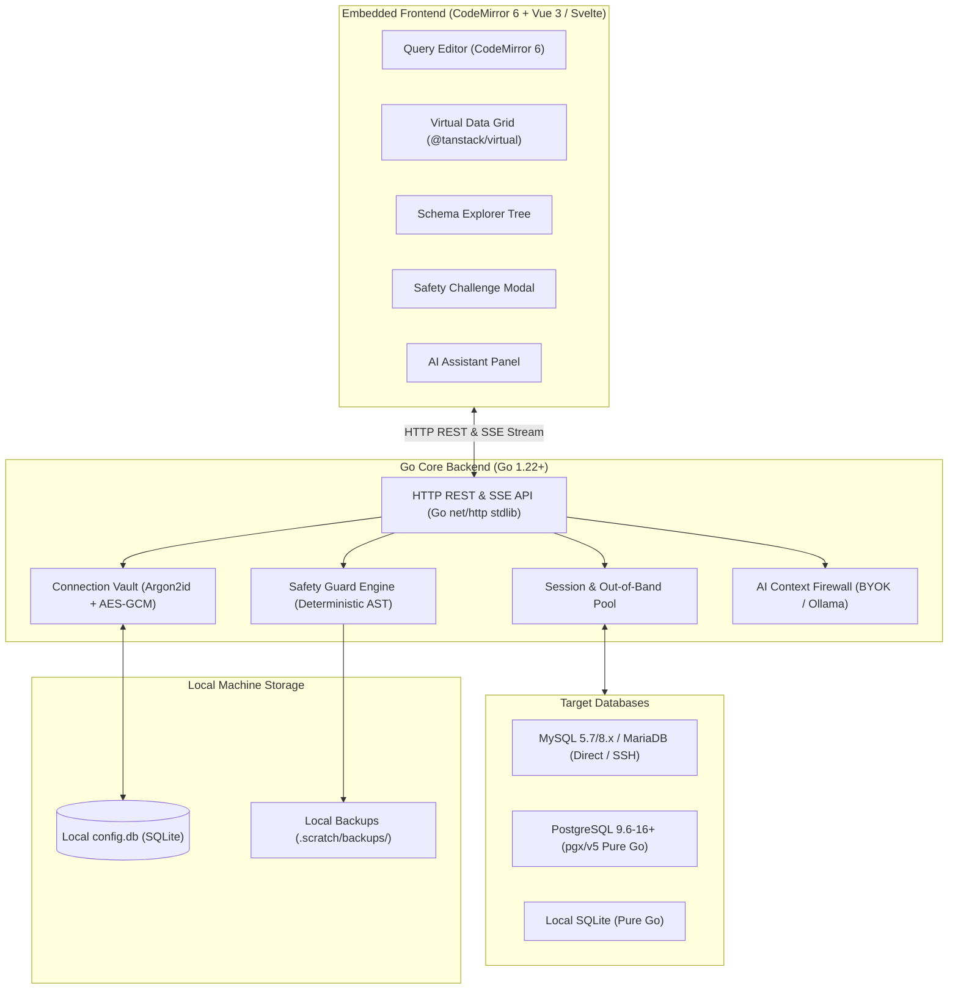

---

## 2. End-to-End Query Execution Lifecycle

The following sequence details how arbitrary SQL queries flow from the editor through Safety Guard to execution and streaming:

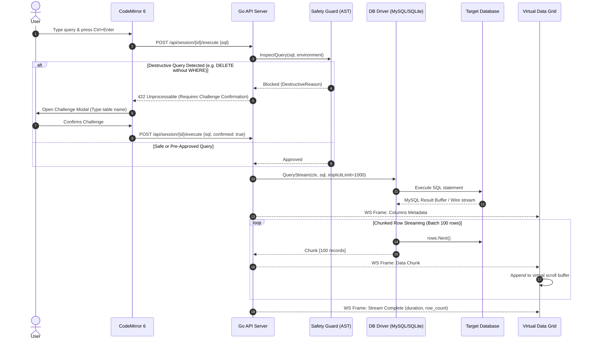

---

## 3. Out-of-Band Query Cancellation Flow

To prevent socket tearing and orphaned background execution on the database server, SqlFox executes cancellations out-of-band:

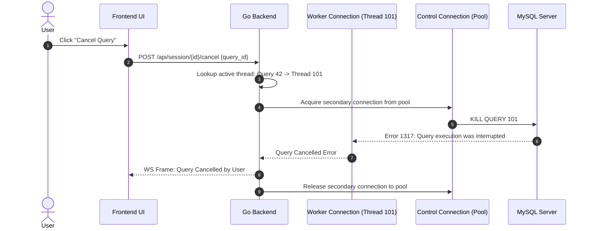

---

## 4. Driver Interface & Extensibility Contract

To allow clean additions of PostgreSQL, ClickHouse, or MongoDB in future releases without modifying core routing or safety logic:

```go
package driver

import (
    "context"
    "io"
)

// Driver manages connection lifecycle and dialers
type Driver interface {
    Connect(ctx context.Context, cfg ConnectionConfig) (Session, error)
}

// Session represents an active connection context
type Session interface {
    // Stream-based query for arbitrary SELECTs
    QueryStream(ctx context.Context, sql string, limit int) (RowStream, error)
    
    // Mutation execution for DML/DDL
    Exec(ctx context.Context, sql string) (ExecResult, error)
    
    // Schema introspection
    InspectSchema(ctx context.Context, schemaName string) (*SchemaMetadata, error)
    GetTableDDL(ctx context.Context, tableName string) (string, error)
    GetTableEstimate(ctx context.Context, tableName string) (TableEstimate, error)
    
    // Lock inspection & Safe DDL execution
    InspectTableLocks(ctx context.Context, database, table string) ([]TableLockInfo, error)
    ExecSafeDDL(ctx context.Context, sql string, lockTimeoutSec int) (*ExecResult, error)
    
    // Cluster & Replication diagnostics
    InspectClusterHealth(ctx context.Context) (*ClusterHealthReport, error)

    // Query plan & optimization
    Explain(ctx context.Context, sql string) (*ExplainPlan, error)
    
    // Interruption
    CancelQuery(ctx context.Context, queryID string) error
    
    io.Closer
}

// RowStream yields chunked data without loading entire resultsets into RAM
type RowStream interface {
    Columns() []ColumnDefinition
    NextChunk(batchSize int) ([][]any, error)
    TotalRows() int64
    io.Closer
}
```

---

## 5. Table Viewer Inline Filtering & Pushdown Flow

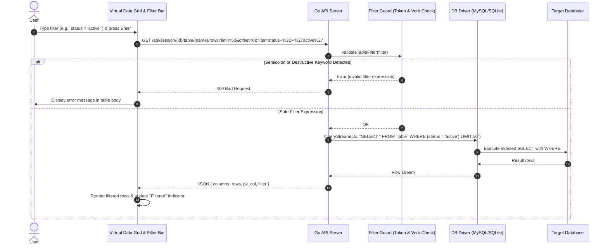

---

## 6. Safe DDL & Lock Contention Prevention Pipeline

To eliminate Metadata Lock (MDL) queues, application pool exhaustion, and deadlock cascades on massive datasets (e.g. 500GB tables and small master tables referenced by high-traffic transactional child tables):

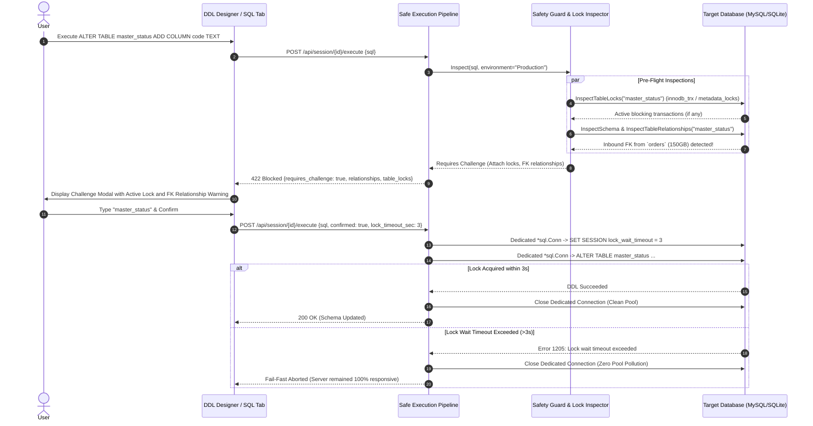

---

## 7. Cluster & Replication Inspector Pipeline

The Cluster & Replication Inspector provides zero-daemon, dynamic clustering and replication telemetry for Percona XtraDB Cluster (PXC 5.7/8.0), Galera Cluster, MariaDB, and MySQL Source-Replica setups.

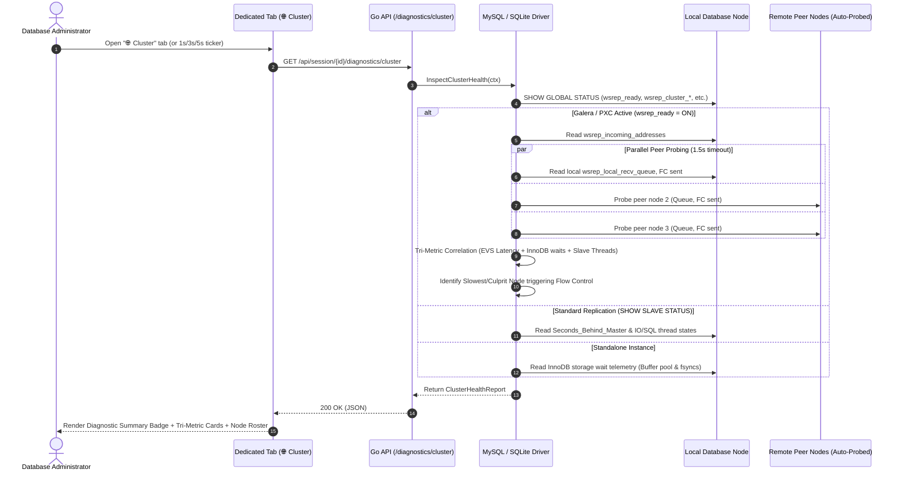

---

## 8. Performance Flight Recorder & Correlated Query Pipeline

The Performance Flight Recorder provides on-demand, time-bounded telemetry and thread snapshotting to isolate transient latency spikes and root-cause queries without running heavy 24/7 APM daemons.

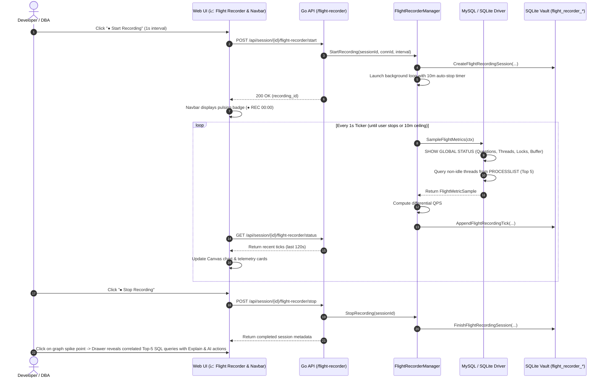

---

## 9. Data Synchronization & Transfer Pipeline

SqlFox provides direct database-to-database schema and data synchronization without intermediary disk files, bounded to <50MB RAM:

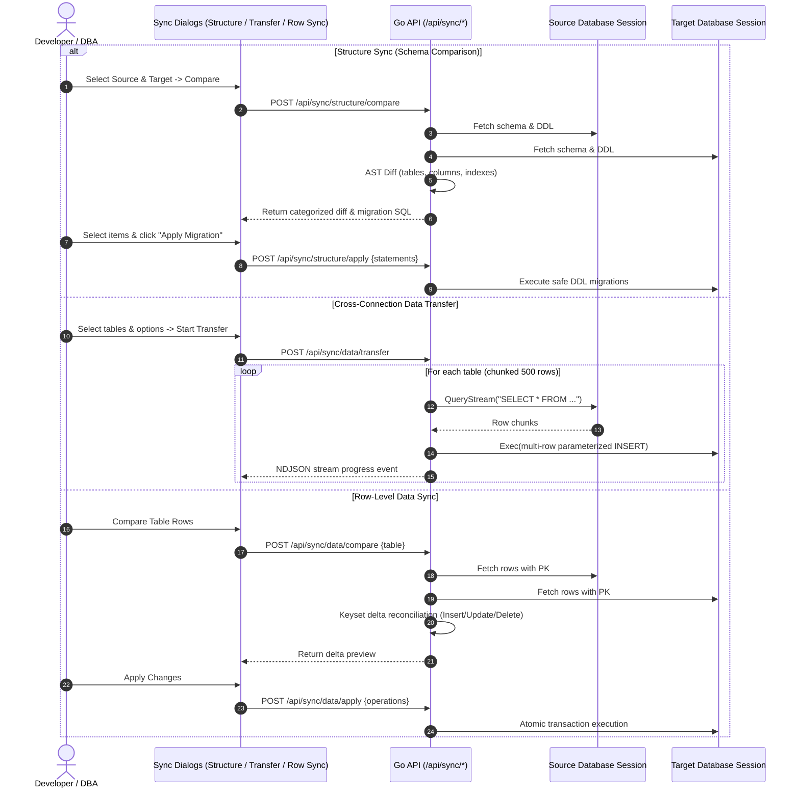

---

## 10. Visual ERD Interactive Canvas Architecture

The Visual ERD Canvas delivers zero-dependency, pure-frontend database schema visualization:

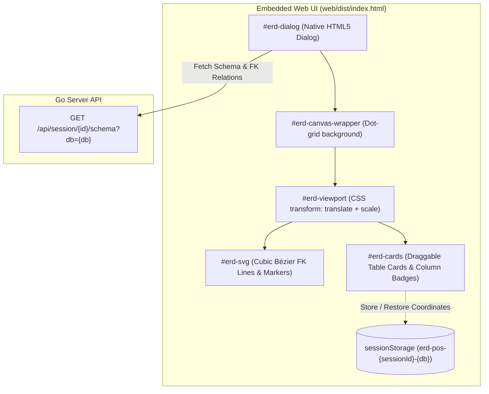

1. **SVG & DOM Layer Separation**: Relationship connectors are rendered as SVG `<path>` elements using cubic Bézier curves (`M x1,y1 C cx1,y1 cx2,y2 x2,y2`) behind draggable HTML table cards.
2. **Auto-Layout & Viewport Transform**: Simple square-root grid positioning algorithm eliminates card overlaps; `erdFitAll()` calculates card bounding boxes and scales/pans `#erd-viewport` to fit all tables within the viewport.
3. **Session Cache**: Coordinates are preserved in `sessionStorage` per session and database, surviving modal toggles while discarding stale coordinates upon browser close.

---

## 11. Directory & Package Structure

```
sqlfox/
├── cmd/
│   └── sqlfox/
│       ├── main.go                 # Entry point: flags, localhost listener, port hunting, browser launcher
│       └── main_test.go
├── internal/
│   ├── cli/                        # Headless CLI suite for CI/CD automation & scheduled jobs
│   │   ├── runner.go               # Subcommand dispatcher, DSN parser, delimiter splitting
│   │   ├── query.go                # sqlfox query: table, json, ndjson, csv streaming & fail-closed safety
│   │   ├── transfer.go             # sqlfox transfer: cross-connection streaming with per-table atomicity
│   │   ├── job.go                  # sqlfox job: declarative task runner, dump generator & retention rotation
│   │   ├── job_test.go             # End-to-end task runner & rotation tests
│   │   └── cli_test.go             # End-to-end CLI integration tests
│   ├── vault/                      # SQLite config storage & AES-256-GCM credential encryption
│   │   ├── vault.go                # Connections, master password, audit log, flight recorder schema
│   │   ├── crypto.go               # Argon2id key derivation & AES-256-GCM
│   │   ├── snippets.go             # Parameterized SQL snippets
│   │   ├── notes.go                # Table documentation notes
│   │   ├── export.go               # .sqlfox-vault portable archive export/import
│   │   └── flight_recorder.go      # Performance flight recorder sessions & tick persistence with 24h purge
│   ├── driver/                     # Database driver abstraction
│   │   ├── driver.go               # Core interfaces (Driver, Session, RowStream, SafeDDL, OSC, Cluster, FlightRecorder)
│   │   ├── rowstream.go            # Canonical chunked row streaming
│   │   ├── redundant_index.go      # Shadowed / duplicate index detection
│   │   ├── benchmark_test.go       # Large schema benchmark suite (1,000 tables, 50k columns, 1M rows streaming)
│   │   ├── mysql/                  # MySQL 5.7/8.x, PXC, MariaDB with Galera cluster inspection & fail-fast DDL
│   │   │   ├── mysql.go
│   │   │   └── cluster_test.go     # Tri-metric cluster bottleneck heuristics test
│   │   ├── postgres/               # PostgreSQL 9.6-16+ pure-Go native driver (pgx/v5)
│   │   │   ├── postgres.go
│   │   │   └── postgres_test.go
│   │   └── sqlite/                 # modernc.org/sqlite CGo-free pure-Go driver with FK inspection
│   ├── mock/                       # FK-aware synthetic mock data generator
│   │   ├── generator.go            # Relational closure, topological sort, FK pool sampling
│   │   └── generator_test.go
│   ├── safety/                     # Safety Guard engine
│   │   ├── guard.go                # AST inspection & destructive operation detection with DDL guards
│   │   └── backup.go               # Smart tiered pre-destruction table snapshotting (pure function)
│   ├── ai/                         # AI Assistant integration
│   │   ├── client.go               # Pure stdlib client (OpenAI, Claude, Gemini, Ollama)
│   │   ├── firewall.go             # Zero-leakage schema pruner & data masking (pure function)
│   │   └── prompts.go              # Structured prompts for explain, optimize, NL-to-SQL
│   ├── dataimport/                 # CSV Ingestion Engine
│   │   └── importer.go             # Delimiter sniffing, column mapping, batched streaming
│   └── server/                     # HTTP transport & handlers
│       ├── server.go               # HTTP routing & SPA static file serving
│       ├── auth.go                 # Remote Access Guard & LAN tablet token auth
│       ├── session_manager.go      # Active database connection pool & session state with Safe DDL execution
│       ├── pprof.go                # Loopback-guarded net/http/pprof diagnostic endpoints (SQLFOX_PPROF=1)
│       ├── pprof_test.go           # pprof access & loopback security unit tests
│       ├── flight_recorder.go      # Flight recorder background controller & auto-stop lifecycle
│       ├── handlers_flight_recorder.go # Flight recorder REST API endpoints
│       ├── handlers_connections.go # Connection CRUD & live testing
│       ├── handlers_query.go       # SQL execution & cancellation with 3s fail-fast pool guard
│       ├── handlers_schema.go      # Schema tree, DDL, preflight DDL, pushdown filtering
│       ├── handlers_crud.go        # Table spreadsheet CRUD (insert draft, batch delete)
│       ├── handlers_dump.go        # Streaming SQL dump export, smart seed exporter, large script runner
│       ├── handlers_sync.go        # Structure sync, cross-connection data transfer, row data sync
│       ├── handlers_dba.go         # Processlist, cluster health, diagnostics, privilege matrix
│       ├── handlers_snippets.go    # Snippet management
│       ├── handlers_import.go      # CSV upload & import endpoints
│       └── handlers_ai.go          # AI chat & assistance streaming
├── web/                            # Single-file zero-build SPA embedded into binary
│   ├── dist/                       # index.html + vendor assets (CodeMirror, Tailwind)
│   │   ├── vendor/
│   │   └── index.html              # Content visibility virtualization & global network error boundary
│   └── embed.go                    # //go:embed dist/*
├── docs/
│   ├── adr/                        # Architectural Decision Records (0001 - 0039)
│   ├── playbooks/                  # Production operational playbooks (large-scale database management)
│   └── agents/                     # Agent workflow documentation
├── CONTEXT.md                      # Ubiquitous domain language
├── ARCHITECTURE.md                 # System architecture (this document)
├── SECURITY.md                     # Security & privacy specification
├── UX_DESIGN.md                    # Interface wireframes & design tokens
├── MILESTONES.md                   # Delivery roadmap & milestones (1 - 22)
└── go.mod
```

---

## 12. Headless CLI Suite & Automation Pipeline

The headless CLI suite (`cmd/sqlfox/main.go` -> `internal/cli`) provides scriptable database access without the embedded HTTP server:

1. **Subcommand Dispatch**: Inspects `os.Args[1]`. If `query`, `transfer`, `job`, or `advise`, execution delegates directly to `cli.RunQuery()`, `cli.RunTransfer()`, `cli.RunJob()`, or `cli.RunAdvise()`. If empty or containing server flags (`-port`, `-host`), the desktop HTTP daemon launches normally.
2. **Dual Target Resolution**: Resolves connection profiles either from the encrypted SQLite vault (`--conn`) or directly from URI/DSN connection strings (`--dsn`), auto-detecting drivers (MySQL/SQLite/PostgreSQL) for zero-config CI/CD runners.
3. **Stream Pipeline & Output Formats**: Emits structured data exclusively to `stdout` (`table`, `json`, `ndjson`, `csv`), with diagnostics and transfer progress routed to `stderr`. `ndjson` streams row-by-row with $O(1)$ memory consumption (<20MB RAM).
4. **Fail-Closed Safety Policy**: High-risk destructive statements (`DROP`, `TRUNCATE`, unqualified `DELETE`/`UPDATE`) trigger an immediate halt with exit code `2` unless explicitly bypassed with `--force`.
5. **Per-Table Atomicity**: `sqlfox transfer` partitions transactions per table on the target database, preventing lock contention cascades and transaction rollback deadlocks.
6. **Declarative Task Runner (`sqlfox job run`)**: Executes structured JSON automation pipelines (`sqlfox-job.json`) sequentially across `health-check`, `dump`, `transfer`, and `query` tasks with fail-fast error handling and environment variable expansion (`$VAR`/`${VAR}`).
7. **Automated Dump Rotation & Retention**: The `dump` task automatically prunes expired backup files based on `keep_last` count and `max_age` duration using prefix pattern matching, preventing disk exhaustion without running a daemon.
8. **Pre-Flight Job Check (`sqlfox job check`)**: Non-destructive dry-run inspection validating job syntax, target connectivity, script file existence, and output directory writability before cron deployment.

---

## 13. Large-Scale Hardening, Memory Ceiling & Resilience Engine

To ensure unwavering reliability when operating against massive production databases (1,000+ tables, 50,000+ columns, and multi-gigabyte datasets), SqlFox enforces strict systemic boundaries:

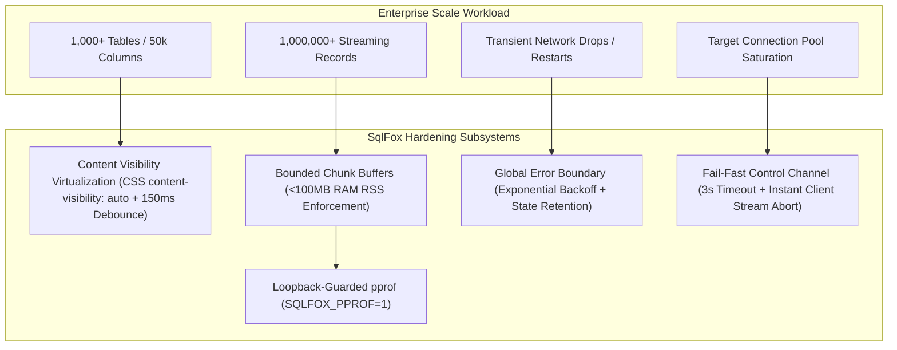

1. **Synthetic Schema Benchmark Suite (`internal/driver/benchmark_test.go`)**:
   - Tiered regression harness testing 100 tables / 5,000 columns in standard unit tests (<200ms) and 1,000 tables / 50,000 columns with FK cycles in `BenchmarkLargeSchema` (~25ms/op, 2 allocs/op).
   - `BenchmarkMemoryCeilingStreaming` verifies that streaming 1,000,000 rows through chunked buffers strictly preserves the <100MB RAM budget.
2. **Browser-Native Content Visibility Virtualization (`web/dist/index.html`)**:
   - Table and view elements utilize native CSS `content-visibility: auto; contain-intrinsic-size: 0 28px;` to skip layout and paint phases for off-screen objects.
   - Schema search input (`filterSchemaTree`) is wrapped in a 150ms debounce timer to prevent DOM churn on rapid typing.
3. **Loopback-Guarded pprof Profiling (`internal/server/pprof.go`)**:
   - Diagnostic endpoints (`/debug/pprof/*`) are mounted dynamically only when `SQLFOX_PPROF=1` is exported.
   - All profiling requests are gated by `isLoopback()`, returning `403 Forbidden` to non-loopback clients.
4. **Fail-Fast Control Channel (`internal/driver/`, `internal/server/handlers_query.go`)**:
   - Out-of-band cancellation (`KILL QUERY` / `pg_cancel_backend`) executes with a strict 3-second context timeout.
   - If target connection slots are saturated, client-side RowStream reading aborts immediately, and the API returns `504 Gateway Timeout` with clear pool exhaustion diagnostics.
5. **Global Web UI Error Boundary (`web/dist/index.html`)**:
   - Captures network and server drop events during API fetches and displays a non-blocking floating banner (`#global-reconnect-banner`).
   - Automatically polls `/api/auth/status` using exponential backoff (1s, 2s, 4s, 8s) and recovers seamlessly while preserving active editor tabs, unsaved queries, and staged grid edits.
6. **Ponytail Zero-Regression Pruning**:
   - Single release binary size verified at **18MB** (stripped with `-ldflags="-s -w"`), well below the 25MB ceiling.
   - Startup time benchmarks at **0.008s (8ms)**, fulfilling the sub-second launch promise.

---

## 14. Heuristic Index Advisor & Query Tuning Engine (`internal/advisor/`)

The Index Advisor provides deterministic, zero-dependency index recommendations formulated from SQL query predicates, catalog index metadata, and EXPLAIN plans without invoking external LLMs or third-party query optimizers:

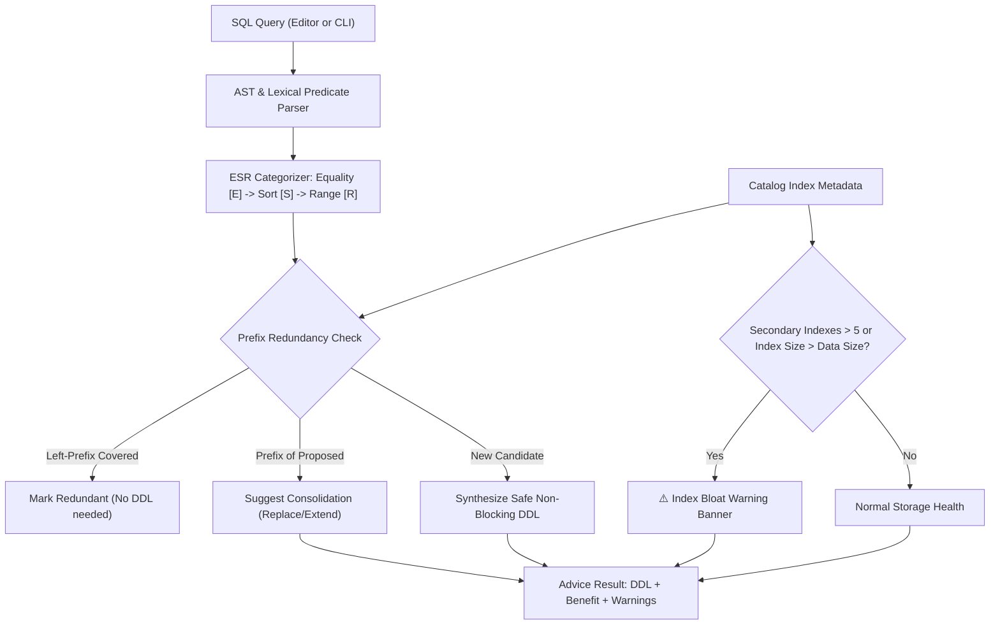

1. **Deterministic ESR Sequencing Engine**:
   - `internal/advisor/parser.go` maps predicates to tables using Vitess `sqlparser` with lexical fallback.
   - Equality predicates (`=`, `<=>`, `IS NULL`, and JOIN conditions) are placed first to narrow candidate rows immediately.
   - Sort and group columns (`ORDER BY`, `GROUP BY`) are placed second to allow the storage engine (InnoDB / Postgres B-Tree) to traverse the index without filesort overhead.
   - Range predicates (`>`, `<`, `BETWEEN`, `LIKE 'prefix%'`) are placed last, as B-Tree scans cannot utilize index columns following an inequality.
   - Candidate composite indexes are strictly capped at 4 columns to avoid excessive index write maintenance overhead.
2. **Index Bloat Guard**:
   - Inspects existing table index counts and storage sizes from `driver.TableMetadata`.
   - When a table exceeds 5 secondary indexes, an amber **Index Bloat Warning** is generated explaining the write latency overhead on `INSERT`/`UPDATE` operations, while explicitly retaining candidate recommendations.
   - Recommends merging existing narrow indexes into the proposed composite index (`ReplaceSuggestion`) to curb index sprawl.
3. **Safe Non-Blocking DDL Generation**:
   - **MySQL 5.7 & 8.0**: Generates `ALTER TABLE tbl ADD INDEX idx (...) ALGORITHM=INPLACE, LOCK=NONE;` respecting 5.7 prefix limitations and 3s lock wait timeouts.
   - **PostgreSQL**: Generates `CREATE INDEX CONCURRENTLY IF NOT EXISTS idx ON tbl (...);`.
   - **SQLite**: Generates `CREATE INDEX IF NOT EXISTS idx ON tbl (...);`.
4. **Dual-Surface Delivery**:
   - **Visual EXPLAIN Modal**: Integrated into `#impact-preview-modal` under the `💡 Advisor` tab with dynamic count badges, ESR tag pills, 1-click clipboard copy, and editor injection.
   - **Headless CLI Command**: `sqlfox advise --dsn ... --sql "..."` with human-readable colored output and `--format json` streaming.

---

## 15. In-App Self-Update Engine & Release Distribution (`internal/server/update.go`)

The In-App Self-Update Engine enables users to check, inspect changelogs, and upgrade their single-binary installation directly within the web workspace without third-party package managers or external daemons:

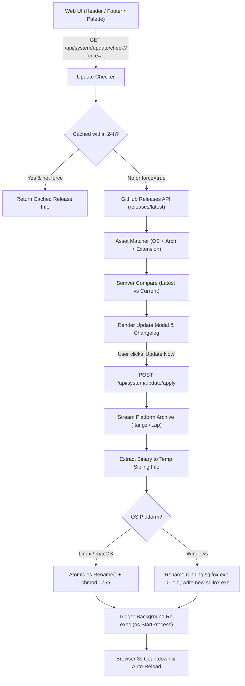

1. **GitHub Releases Polling & Rate-Limit Guard**:
   - `GET /api/system/update/check` fetches metadata from `api.github.com/repos/herliansyah/sqlfox/releases/latest`.
   - Responses are cached in memory for 24 hours to stay well below GitHub's 60 req/hour unauthenticated IP rate limit.
   - Explicit user actions (`Check for Updates` or clicking version tag) supply `?force=true` to bypass the cache.
2. **Platform-Aware Binary Asset Matching**:
   - Target assets are resolved against `runtime.GOOS` and `runtime.GOARCH` (`sqlfox-{TAG}-{GOOS}-{GOARCH}.(tar.gz|zip)`).
   - Zero external compression dependencies: extraction uses stdlib `archive/tar`, `compress/gzip`, and `archive/zip` exclusively.
3. **Atomic Replacement & Windows Locking Workaround**:
   - The new binary is staged in a sibling temporary file in the same directory (`filepath.Dir(exePath)`) to guarantee same-filesystem atomic moves.
   - On Linux/macOS, `os.Rename` replaces the running inode atomically.
   - On Windows, where executing binaries cannot be overwritten in place, the running executable is renamed to `sqlfox.exe.old`, the replacement is moved into place, and cleanup is scheduled.
4. **Graceful Re-exec Restart**:
   - Dispatches a background goroutine spawning the updated binary with original command-line arguments via `exec.Command` / `os.StartProcess`.
   - Frontend initiates a 3-second countdown before auto-refreshing to seamlessly reconnect.

---

## 16. Canonical Brand Mark & Cross-Platform Icon System

SqlFox maintains a unified visual brand across all operating systems, browser surfaces, and desktop environments:

1. **Master Vector Geometry**: The canonical front-facing geometric fox head (`docs/assets/logo.svg` and `web/dist/assets/logo.svg`) defines 100% symmetrical polygon facets centered along `x = 256` within a `512x512` viewBox.
2. **Deterministic Icon Pipeline**: An offline Python generator (`scripts/generate-icons.py`) uses 4x supersampling anti-aliasing to render multi-resolution PNGs (`apple-touch-icon.png`, `icon-192.png`, `icon-512.png`), vector SVGs (`favicon.svg`), and multi-layer ICOs (`favicon.ico`, `icon.ico`).
3. **Pre-Compiled PE Embedding**: Windows COFF resource objects (`cmd/sqlfox/rsrc_windows_amd64.syso` and `rsrc_windows_arm64.syso`) embed the Brand Mark directly into `sqlfox.exe` during standard Go compilation with zero external CGO or toolchain dependencies.

---

## 17. Grid Edit Presets & Universal Mutation Audit Architecture

### PK-Less Row Mutations & Criteria Synthesis
For tables lacking primary keys, the backend accepts `row_criteria: Record<string, any>` representing the complete pre-mutation state of the row:
- Constructs parameterized equality predicates: `WHERE col1 = ? AND col2 = ? ... LIMIT 1`.
- Protects against ambiguous matches by asserting that affected row counts equal exactly 1.
- Provides multi-driver live schema fallback (`SHOW KEYS`, `pg_index`, `PRAGMA table_info`) when primary key metadata is omitted.

### Universal Mutation Audit Pipeline
Every mutating operation across the application is recorded to the local SQLite vault `audit_logs` table with canonical origin attribution (`source`):
- **Sources**: `editor`, `grid_cell_edit`, `grid_insert`, `grid_delete`, `script_runner`, `csv_import`, `mock_data`, `sync_transfer`, `schema_sync`.
- **Non-Blocking Dispatch**: Handled via `ActiveSession.RecordAudit(...)` in non-blocking background goroutines.
- **Filtering & Compliance**: Query parameter filtering via `GET /api/session/{id}/audit-logs?source=...` and dedicated source badging in the UI with CSV export.

---

## 18. Diagnostic Logging & Request Observability Suite (`internal/logger`)

SqlFox embeds a production-grade structured logging and request telemetry pipeline designed around the Go standard library `log/slog` (Go 1.21+):

```mermaid
flowchart TD
    Config["CLI Flags / Env Vars / sqlfox.env"] --> Init["logger.Init(Config)"]
    
    Init --> SinkRouter{"Sink Configuration"}
    
    SinkRouter -->|Stderr Only| StderrSink["Console Handler (Text / JSON)"]
    SinkRouter -->|File Only| FileSink["os.OpenFile (O_CREATE|O_APPEND|O_WRONLY)"]
    SinkRouter -->|Console + File| TeeSink["Multi-Handler Tee Sink"]
    SinkRouter -->|Silent / -q| SilentSink["io.Discard (File logging retained if set)"]
    
    TeeSink --> SlogDefault["slog.SetDefault(Logger)"]
    StderrSink --> SlogDefault
    FileSink --> SlogDefault
    SilentSink --> SlogDefault
    
    Req["HTTP Requests"] --> Middleware["HTTPLogger Middleware"]
    Middleware --> FilterStatic{"Path is Static Asset?"}
    FilterStatic -->|Yes (.js, .css, .ico, /static)| SkipLog["Skip (No telemetry spam)"]
    FilterStatic -->|No (/api/*)| MaskAudit{"Is Auth / Connection Payload?"}
    MaskAudit -->|Yes (/api/auth/unlock, /api/connections)| MaskCreds["Mask Sensitive JSON Bodies"]
    MaskAudit -->|No| LogTrace["slog.Info('HTTP request', method, path, status, latency)"]
```

1. **Zero-Dependency `log/slog` Architecture**:
   - Strictly built upon Go standard library `log/slog` with zero third-party logging frameworks (no zap, logrus, or zerolog), preserving binary minimalism and instantaneous startup.
   - Global standard logger delegation ensures all Go subsystems, internal drivers, and server handlers output through a unified structured channel.
2. **Multi-Sink Pipeline & Atomic File Writes**:
   - **Console Sink**: Configurable as human-readable formatted `text` or structured machine-parseable `json`.
   - **Persistent File Sink (`-log-file`)**: Atomic appending via `os.OpenFile(path, os.O_CREATE|os.O_APPEND|os.O_WRONLY, 0644)`.
   - **Dual-Stream Tee Sink**: When both console and file are configured, log entries are broadcast synchronously to both sinks.
   - **Silent Mode (`-silent`, `-q`)**: Routes console output to `io.Discard` while preserving persistent file logging when `-log-file` is configured.
3. **HTTP Request Telemetry & Credential Masking**:
   - `HTTPLogger` middleware measures end-to-end request latency, response HTTP status codes, and payload bytes written.
   - High-frequency static assets (`/static/`, `/assets/`, `favicon.ico`, `manifest.webmanifest`) are silently bypassed to keep diagnostic logs focused on real database actions.
   - Security-sensitive endpoints (`/api/auth/unlock`, `/api/connections`) have sensitive payload bodies masked to prevent master PIN, vault master password, or database credentials from leaking into log files.
4. **Ergonomic Environment Loader (`sqlfox.env`)**:
   - Windows double-click and daemon environments cannot easily pass CLI flags. SqlFox's `loadEnvFiles()` cascades configuration search across:
     1. Directory containing the running executable (`filepath.Dir(exePath)/sqlfox.env`).
     2. Current working directory (`./sqlfox.env`).
     3. User home configuration directory (`~/.sqlfox/sqlfox.env`).

---

## 19. Multi-Engine Feature Parity & Dialect Resilience Architecture

SqlFox enforces complete feature parity across MySQL (5.7, 8.0, 8.4 LTS, 9.x), MariaDB (10.3 - 11.x), PostgreSQL (9.6 - 16+), and SQLite:

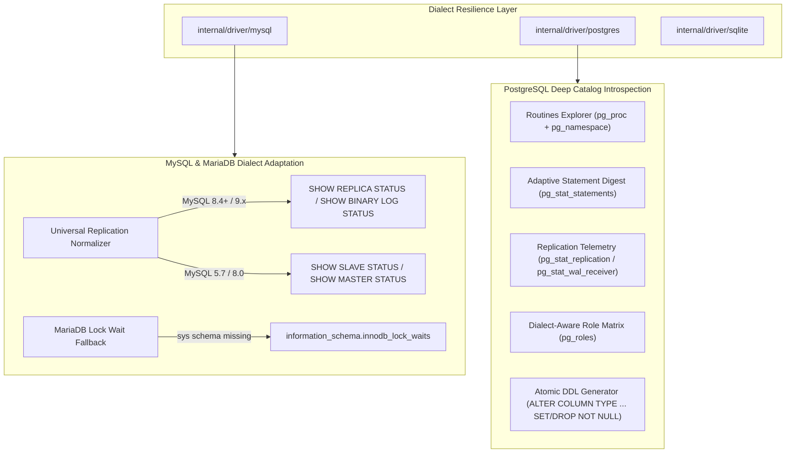

1. **Universal Replication Normalizer (MySQL 8.4 LTS & 9.x Parity)**:
   - MySQL 8.4 LTS and 9.x completely deprecate and remove legacy `SHOW SLAVE STATUS` and `SHOW MASTER STATUS` statements, causing syntax errors in standard database tools.
   - SqlFox probes modern syntax (`SHOW REPLICA STATUS` and `SHOW BINARY LOG STATUS`) first; upon syntax errors or unsupported commands, it smoothly falls back to legacy commands.
   - Key normalization ensures unified frontend telemetry across all MySQL engine generations (`replica_io_running` $\leftrightarrow$ `slave_io_running`, `seconds_behind_source` $\leftrightarrow$ `seconds_behind_master`).
2. **MariaDB Sys Schema Fallback**:
   - MariaDB installations often omit the `sys` schema by default. SqlFox's lock wait telemetry detects missing `sys.innodb_lock_waits` and falls back directly to `information_schema.innodb_lock_waits`, preventing silent monitoring crashes.
3. **PostgreSQL Deep Catalog Introspection**:
   - **Routines Explorer**: Introspects `pg_proc` joined with `pg_namespace`, extracting argument type signatures to distinguish overloaded functions (`calc(int)` vs `calc(text)`), and recovers full definitions via `pg_catalog.pg_get_functiondef`.
   - **Adaptive Statement Digest**: Safely probes `pg_stat_statements` for execution metrics, average latencies, and total calls. If the extension is not active, it surfaces a non-disruptive 1-click guide (`CREATE EXTENSION pg_stat_statements;`) without breaking the Processlist dashboard.
   - **Replication Telemetry**: Introspects `pg_stat_replication` on primary instances and `pg_stat_wal_receiver` on standbys to report real-time replication lag, WAL flush states, and connection modes.
   - **Role & Privilege Matrix**: Introspects `pg_roles` to extract boolean attributes (`SUPERUSER`, `CREATEDB`, `CREATEROLE`, `REPLICATION`, `BYPASSRLS`, `LOGIN`) and parses `MEMBER OF` role inheritance.
4. **Dialect-Specific DDL in Structure Sync**:
   - PostgreSQL does not support MySQL's monolithic `MODIFY COLUMN col type attributes` clause.
   - SqlFox generates dialect-specific DDL: for PostgreSQL, it decomposes column mutations into atomic statements (`ALTER TABLE tbl ALTER COLUMN col TYPE ...; ALTER TABLE tbl ALTER COLUMN col SET NOT NULL;`), ensuring seamless schema synchronizations across heterogeneous environments.


