# SqlFox Architecture Specification

System architecture, component boundaries, and execution flows for SqlFox.

## 1. High-Level System Architecture

SqlFox is designed as a **single-binary local application** with an embedded reactive web application. It operates under a strict memory ceiling (<100MB RAM) with sub-second startup time (<1s).

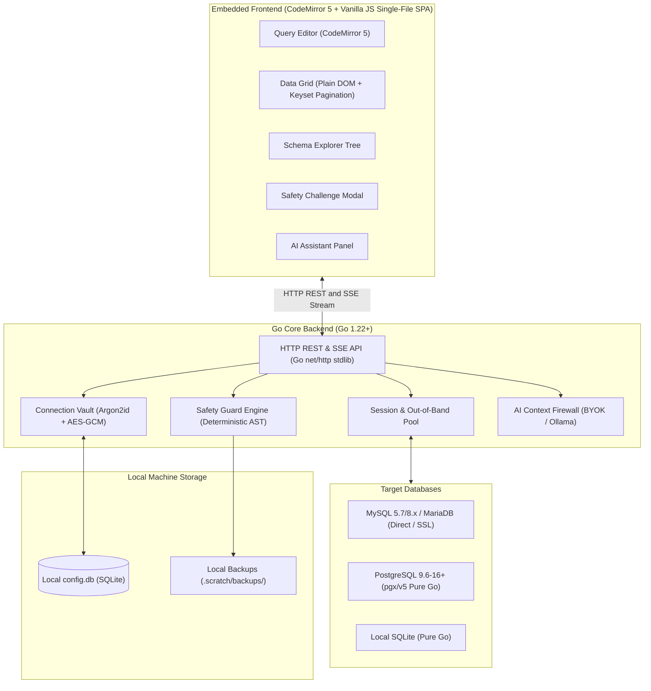

---

## 2. End-to-End Query Execution Lifecycle

The following sequence details how arbitrary SQL queries flow from the editor through Safety Guard to execution and streaming:

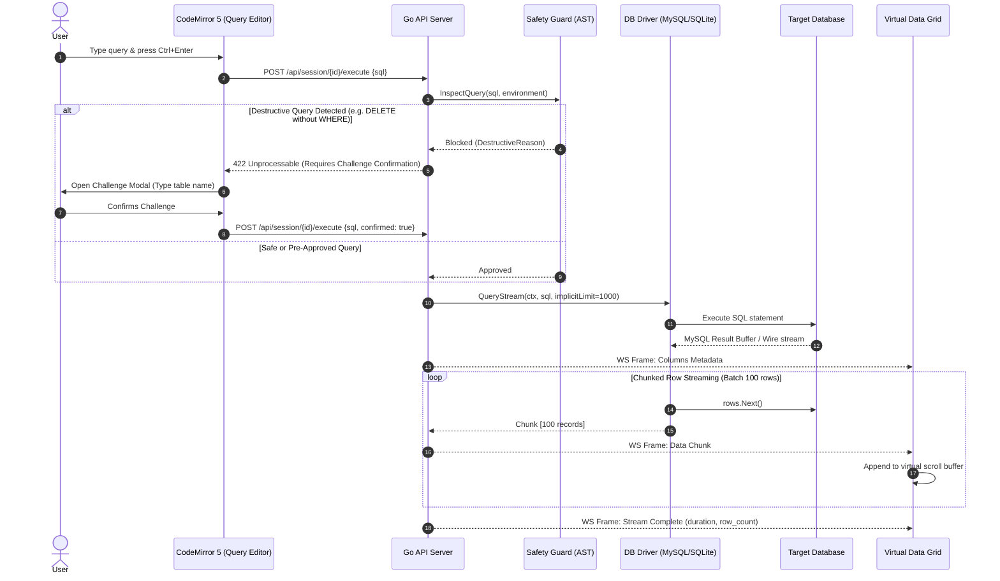

---

## 3. Out-of-Band Query Cancellation Flow

To prevent socket tearing and orphaned background execution on the database server, SqlFox executes cancellations out-of-band:

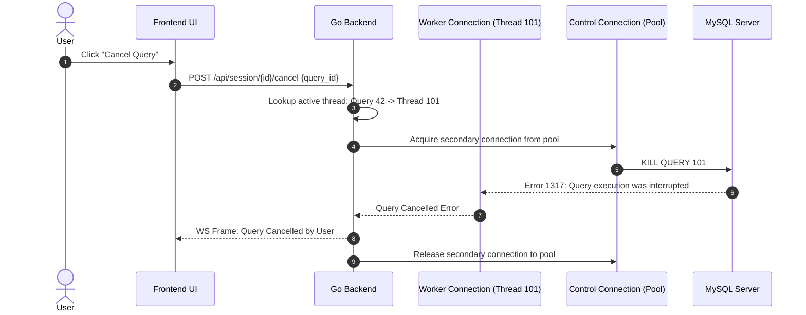

---

## 4. Driver Interface & Extensibility Contract

To allow clean additions of PostgreSQL, ClickHouse, or MongoDB in future releases without modifying core routing or safety logic:

```go
package driver

import (
    "context"
    "io"
)

// Driver manages connection lifecycle and dialers
type Driver interface {
    Connect(ctx context.Context, cfg ConnectionConfig) (Session, error)
}

// Session represents an active connection context
type Session interface {
    // Stream-based query for arbitrary SELECTs
    QueryStream(ctx context.Context, sql string, limit int) (RowStream, error)
    
    // Mutation execution for DML/DDL
    Exec(ctx context.Context, sql string) (ExecResult, error)
    
    // Schema introspection
    InspectSchema(ctx context.Context, schemaName string) (*SchemaMetadata, error)
    InspectFastCatalog(ctx context.Context) (map[string][]TableMetadata, error)
    GetTableDDL(ctx context.Context, tableName string) (string, error)
    GetTableEstimate(ctx context.Context, tableName string) (TableEstimate, error)
    
    // Lock inspection & Safe DDL execution
    InspectTableLocks(ctx context.Context, database, table string) ([]TableLockInfo, error)
    ExecSafeDDL(ctx context.Context, sql string, lockTimeoutSec int) (*ExecResult, error)
    
    // Cluster & Replication diagnostics
    InspectClusterHealth(ctx context.Context) (*ClusterHealthReport, error)

    // Query plan & optimization
    Explain(ctx context.Context, sql string) (*ExplainPlan, error)
    
    // Interruption
    CancelQuery(ctx context.Context, queryID string) error
    
    io.Closer
}

// RowStream yields chunked data without loading entire resultsets into RAM
type RowStream interface {
    Columns() []ColumnDefinition
    NextChunk(batchSize int) ([][]any, error)
    TotalRows() int64
    io.Closer
}
```

---

## 5. Table Viewer Inline Filtering & Pushdown Flow

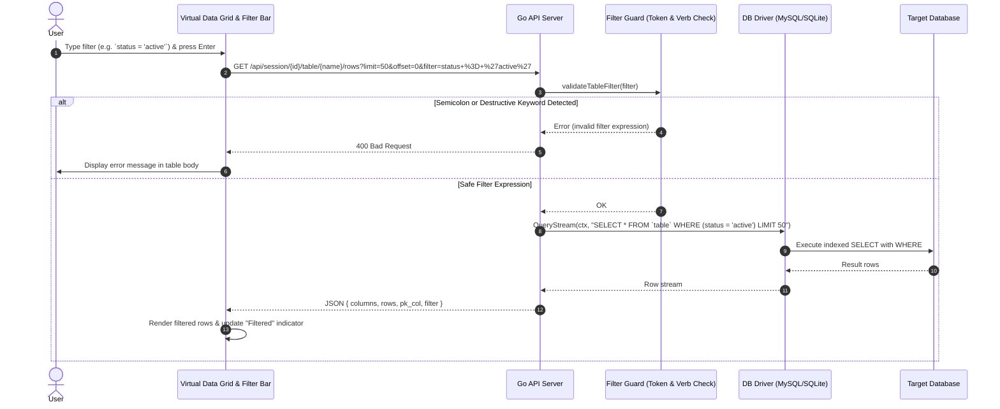

---

## 6. Safe DDL & Lock Contention Prevention Pipeline

To eliminate Metadata Lock (MDL) queues, application pool exhaustion, and deadlock cascades on massive datasets (e.g. 500GB tables and small master tables referenced by high-traffic transactional child tables):

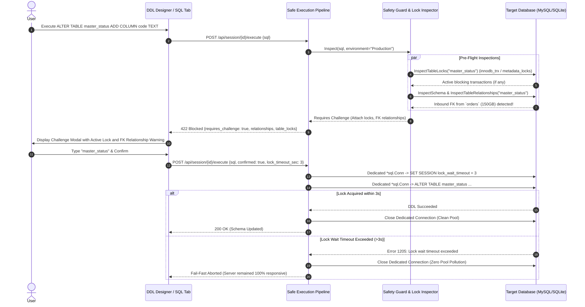

---

## 7. Cluster & Replication Inspector Pipeline

The Cluster & Replication Inspector provides zero-daemon, dynamic clustering and replication telemetry for Percona XtraDB Cluster (PXC 5.7/8.0), Galera Cluster, MariaDB, and MySQL Source-Replica setups.

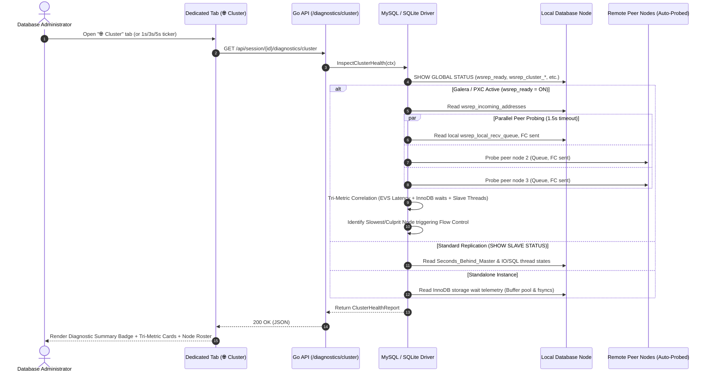

---

## 8. Performance Flight Recorder & Correlated Query Pipeline

The Performance Flight Recorder provides on-demand, time-bounded telemetry and thread snapshotting to isolate transient latency spikes and root-cause queries without running heavy 24/7 APM daemons.

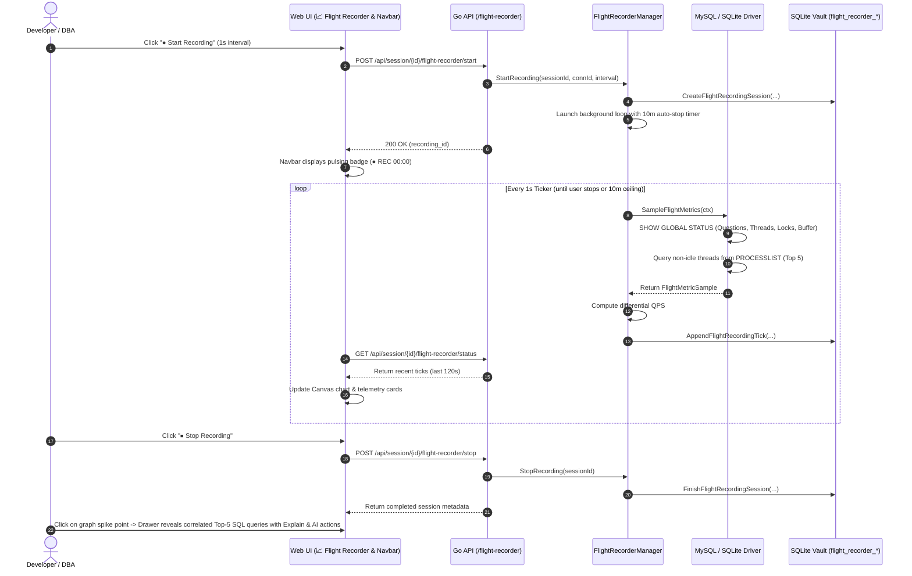

---

## 9. Data Synchronization & Transfer Pipeline

SqlFox provides direct database-to-database schema and data synchronization without intermediary disk files, bounded to <50MB RAM:

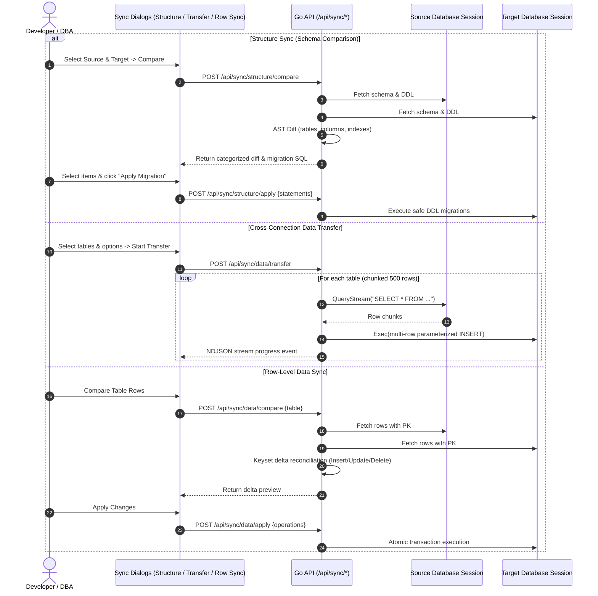

---

## 10. Visual ERD Interactive Canvas Architecture

The Visual ERD Canvas delivers zero-dependency, pure-frontend database schema visualization:

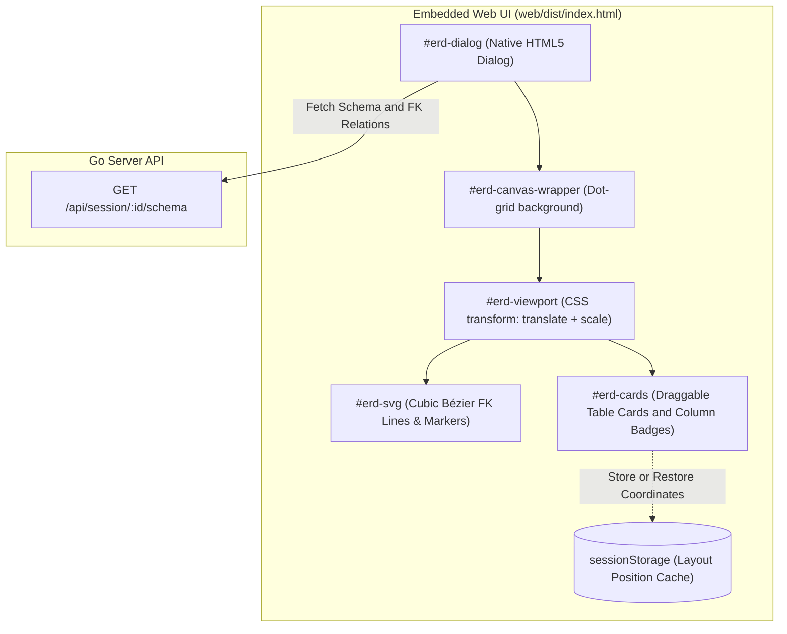

1. **SVG & DOM Layer Separation**: Relationship connectors are rendered as SVG `<path>` elements using cubic Bézier curves (`M x1,y1 C cx1,y1 cx2,y2 x2,y2`) behind draggable HTML table cards.
2. **Auto-Layout & Viewport Transform**: Simple square-root grid positioning algorithm eliminates card overlaps; `erdFitAll()` calculates card bounding boxes and scales/pans `#erd-viewport` to fit all tables within the viewport.
3. **Session Cache**: Coordinates are preserved in `sessionStorage` per session and database, surviving modal toggles while discarding stale coordinates upon browser close.

---

## 11. Directory & Package Structure

```
sqlfox/
├── cmd/
│   └── sqlfox/
│       ├── main.go                 # Entry point: flags, localhost listener, port hunting, browser launcher
│       └── main_test.go
├── internal/
│   ├── cli/                        # Headless CLI suite for CI/CD automation & scheduled jobs
│   │   ├── runner.go               # Subcommand dispatcher, DSN parser, delimiter splitting
│   │   ├── query.go                # sqlfox query: table, json, ndjson, csv streaming & fail-closed safety
│   │   ├── transfer.go             # sqlfox transfer: cross-connection streaming with per-table atomicity
│   │   ├── job.go                  # sqlfox job: declarative task runner, dump generator & retention rotation
│   │   ├── job_test.go             # End-to-end task runner & rotation tests
│   │   └── cli_test.go             # End-to-end CLI integration tests
│   ├── vault/                      # SQLite config storage & AES-256-GCM credential encryption
│   │   ├── vault.go                # Connections, master password, audit log, flight recorder schema
│   │   ├── crypto.go               # Argon2id key derivation & AES-256-GCM
│   │   ├── snippets.go             # Parameterized SQL snippets
│   │   ├── notes.go                # Table documentation notes (legacy table_notes bridge)
│   │   ├── operational_notes.go    # Unified Operational Notes Inbox, object tagging, reminders & follow-up lifecycle
│   │   ├── export.go               # .sqlfox-vault portable archive export/import
│   │   └── flight_recorder.go      # Performance flight recorder sessions & tick persistence with 24h purge
│   ├── driver/                     # Database driver abstraction
│   │   ├── driver.go               # Core interfaces (Driver, Session, RowStream, SafeDDL, OSC, Cluster, FlightRecorder)
│   │   ├── rowstream.go            # Canonical chunked row streaming
│   │   ├── redundant_index.go      # Shadowed / duplicate index detection
│   │   ├── benchmark_test.go       # Large schema benchmark suite (1,000 tables, 50k columns, 1M rows streaming)
│   │   ├── mysql/                  # MySQL 5.7/8.x, PXC, MariaDB with Galera cluster inspection & fail-fast DDL
│   │   │   ├── mysql.go
│   │   │   └── cluster_test.go     # Tri-metric cluster bottleneck heuristics test
│   │   ├── postgres/               # PostgreSQL 9.6-16+ pure-Go native driver (pgx/v5)
│   │   │   ├── postgres.go
│   │   │   └── postgres_test.go
│   │   └── sqlite/                 # modernc.org/sqlite CGo-free pure-Go driver with FK inspection
│   ├── mock/                       # FK-aware synthetic mock data generator
│   │   ├── generator.go            # Relational closure, topological sort, FK pool sampling
│   │   └── generator_test.go
│   ├── safety/                     # Safety Guard engine
│   │   ├── guard.go                # AST inspection & destructive operation detection with DDL guards
│   │   └── backup.go               # Smart tiered pre-destruction table snapshotting (pure function)
│   ├── ai/                         # AI Assistant integration
│   │   ├── client.go               # Pure stdlib client (OpenAI, Claude, Gemini, Ollama)
│   │   ├── firewall.go             # Zero-leakage schema pruner & data masking (pure function)
│   │   └── prompts.go              # Structured prompts for explain, optimize, NL-to-SQL
│   ├── dataimport/                 # CSV Ingestion Engine
│   │   └── importer.go             # Delimiter sniffing, column mapping, batched streaming
│   └── server/                     # HTTP transport & handlers
│       ├── server.go               # HTTP routing & SPA static file serving
│       ├── auth.go                 # Remote Access Guard & LAN tablet token auth
│       ├── session_manager.go      # Active database connection pool & session state with Safe DDL execution
│       ├── pprof.go                # Loopback-guarded net/http/pprof diagnostic endpoints (SQLFOX_PPROF=1)
│       ├── pprof_test.go           # pprof access & loopback security unit tests
│       ├── flight_recorder.go      # Flight recorder background controller & auto-stop lifecycle
│       ├── handlers_flight_recorder.go # Flight recorder REST API endpoints
│       ├── handlers_connections.go # Connection CRUD & live testing
│       ├── handlers_query.go       # SQL execution & cancellation with 3s fail-fast pool guard
│       ├── handlers_schema.go      # Schema tree, DDL, preflight DDL, pushdown filtering
│       ├── handlers_crud.go        # Table spreadsheet CRUD (insert draft, batch delete)
│       ├── handlers_dump.go        # Streaming SQL dump export, smart seed exporter, Safety-Guard-gated large script runner
│       ├── handlers_sync.go        # Structure sync, cross-connection data transfer, row data sync
│       ├── handlers_dba.go         # Processlist, cluster health, diagnostics, privilege matrix
│       ├── handlers_snippets.go    # Snippet management
│       ├── handlers_notes.go       # Operational notes inbox, alarms, snooze, resolve REST endpoints
│       ├── handlers_import.go      # CSV upload & import endpoints
│       ├── tls.go                   # Self-signed ECDSA P-256 certificate generator & TLS configuration
│       ├── tls_test.go              # TLS certificate SANs, expiration & lifecycle tests
│       └── handlers_ai.go          # AI chat & assistance streaming
├── web/                            # Frontend assets & build pipeline
│   ├── src/                        # Modular frontend source tree
│   │   ├── index.html              # Core HTML structure & modal shells
│   │   └── js/                     # 15 domain JavaScript modules (state, grid, tabs, dba, erd, etc.)
│   ├── dist/                       # Compiled production bundle embedded into binary
│   │   ├── vendor/                 # Offline dependencies (CodeMirror 6, precompiled Tailwind CSS)
│   │   └── index.html              # Generated single-file distribution (assembled via build_web.js)
│   └── embed.go                    # //go:embed dist/*
├── scripts/
│   ├── build_web.js                # Web build pipeline (Tailwind compilation, JS assembly & syntax validation)
│   ├── build_codemirror.js         # esbuild CodeMirror 6 bundle pipeline
│   ├── codemirror6_entry.js        # CodeMirror 6 bundle entry point with dynamic SQL dialect & dark theme
│   ├── tailwind.config.js          # Tailwind CSS purge & token configuration
│   └── release.sh                  # Release automation pipeline (version bump, tests, changelog)
├── docs/
│   ├── adr/                        # Architectural Decision Records (0001 - 0062)
│   ├── playbooks/                  # Production operational playbooks (large-scale database management)
│   └── agents/                     # Agent workflow documentation
├── CONTEXT.md                      # Ubiquitous domain language
├── ARCHITECTURE.md                 # System architecture (this document)
├── SECURITY.md                     # Security & privacy specification
├── UX_DESIGN.md                    # Interface wireframes & design tokens
├── MILESTONES.md                   # Delivery roadmap & milestones (1 - 50)
└── go.mod
```

---

## 12. Headless CLI Suite & Automation Pipeline

The headless CLI suite (`cmd/sqlfox/main.go` -> `internal/cli`) provides scriptable database access without the embedded HTTP server:

1. **Subcommand Dispatch**: Inspects `os.Args[1]`. If `query`, `transfer`, `job`, or `advise`, execution delegates directly to `cli.RunQuery()`, `cli.RunTransfer()`, `cli.RunJob()`, or `cli.RunAdvise()`. If empty or containing server flags (`-port`, `-host`), the desktop HTTP daemon launches normally.
2. **Dual Target Resolution**: Resolves connection profiles either from the encrypted SQLite vault (`--conn`) or directly from URI/DSN connection strings (`--dsn`), auto-detecting drivers (MySQL/SQLite/PostgreSQL) for zero-config CI/CD runners.
3. **Stream Pipeline & Output Formats**: Emits structured data exclusively to `stdout` (`table`, `json`, `ndjson`, `csv`), with diagnostics and transfer progress routed to `stderr`. `ndjson` streams row-by-row with $O(1)$ memory consumption (<20MB RAM).
4. **Fail-Closed Safety Policy**: High-risk destructive statements (`DROP`, `TRUNCATE`, unqualified `DELETE`/`UPDATE`) trigger an immediate halt with exit code `2` unless explicitly bypassed with `--force`.
5. **Per-Table Atomicity**: `sqlfox transfer` partitions transactions per table on the target database, preventing lock contention cascades and transaction rollback deadlocks.
6. **Declarative Task Runner (`sqlfox job run`)**: Executes structured JSON automation pipelines (`sqlfox-job.json`) sequentially across `health-check`, `dump`, `transfer`, and `query` tasks with fail-fast error handling and environment variable expansion (`$VAR`/`${VAR}`).
7. **Automated Dump Rotation & Retention**: The `dump` task automatically prunes expired backup files based on `keep_last` count and `max_age` duration using prefix pattern matching, preventing disk exhaustion without running a daemon.
8. **Pre-Flight Job Check (`sqlfox job check`)**: Non-destructive dry-run inspection validating job syntax, target connectivity, script file existence, and output directory writability before cron deployment.

---

## 13. Large-Scale Hardening, Memory Ceiling & Resilience Engine

To ensure unwavering reliability when operating against massive production databases (1,000+ tables, 50,000+ columns, and multi-gigabyte datasets), SqlFox enforces strict systemic boundaries:

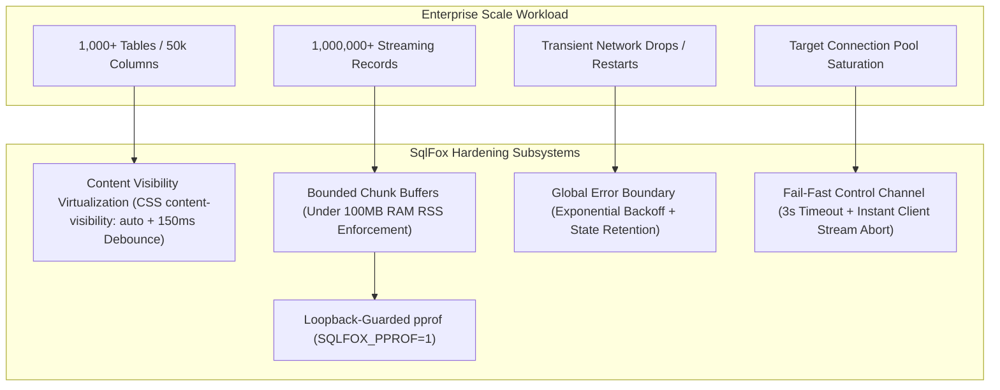

1. **Synthetic Schema Benchmark Suite (`internal/driver/benchmark_test.go`)**:
   - Tiered regression harness testing 100 tables / 5,000 columns in standard unit tests (<200ms) and 1,000 tables / 50,000 columns with FK cycles in `BenchmarkLargeSchema` (~25ms/op, 2 allocs/op).
   - `BenchmarkMemoryCeilingStreaming` verifies that streaming 1,000,000 rows through chunked buffers strictly preserves the <100MB RAM budget.
2. **Browser-Native Content Visibility Virtualization (`web/dist/index.html`)**:
   - Table and view elements utilize native CSS `content-visibility: auto; contain-intrinsic-size: 0 28px;` to skip layout and paint phases for off-screen objects.
   - Schema search input (`filterSchemaTree`) is wrapped in a 150ms debounce timer to prevent DOM churn on rapid typing.
3. **Loopback-Guarded pprof Profiling (`internal/server/pprof.go`)**:
   - Diagnostic endpoints (`/debug/pprof/*`) are mounted dynamically only when `SQLFOX_PPROF=1` is exported.
   - All profiling requests are gated by `isLoopback()`, returning `403 Forbidden` to non-loopback clients.
4. **Fail-Fast Control Channel (`internal/driver/`, `internal/server/handlers_query.go`)**:
   - Out-of-band cancellation (`KILL QUERY` / `pg_cancel_backend`) executes with a strict 3-second context timeout.
   - If target connection slots are saturated, client-side RowStream reading aborts immediately, and the API returns `504 Gateway Timeout` with clear pool exhaustion diagnostics.
5. **Global Web UI Error Boundary (`web/dist/index.html`)**:
   - Captures network and server drop events during API fetches and displays a non-blocking floating banner (`#global-reconnect-banner`).
   - Automatically polls `/api/auth/status` using exponential backoff (1s, 2s, 4s, 8s) and recovers seamlessly while preserving active editor tabs, unsaved queries, and staged grid edits.
6. **Ponytail Zero-Regression Pruning**:
   - Single release binary size verified at **18MB** (stripped with `-ldflags="-s -w"`), well below the 25MB ceiling.
   - Startup time benchmarks at **0.008s (8ms)**, fulfilling the sub-second launch promise.

---

## 14. Heuristic Index Advisor & Query Tuning Engine (`internal/advisor/`)

The Index Advisor provides deterministic, zero-dependency index recommendations formulated from SQL query predicates, catalog index metadata, and EXPLAIN plans without invoking external LLMs or third-party query optimizers:

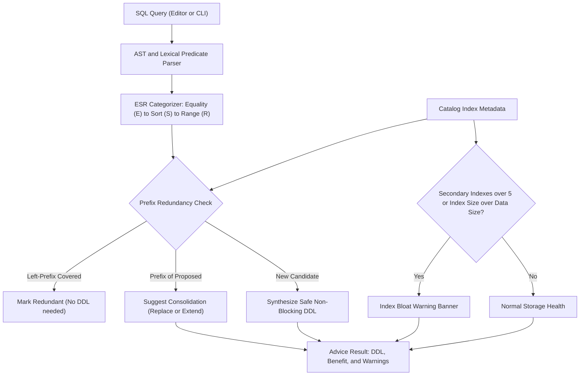

1. **Deterministic ESR Sequencing Engine**:
   - `internal/advisor/parser.go` maps predicates to tables using Vitess `sqlparser` with lexical fallback.
   - Equality predicates (`=`, `<=>`, `IS NULL`, and JOIN conditions) are placed first to narrow candidate rows immediately.
   - Sort and group columns (`ORDER BY`, `GROUP BY`) are placed second to allow the storage engine (InnoDB / Postgres B-Tree) to traverse the index without filesort overhead.
   - Range predicates (`>`, `<`, `BETWEEN`, `LIKE 'prefix%'`) are placed last, as B-Tree scans cannot utilize index columns following an inequality.
   - Candidate composite indexes are strictly capped at 4 columns to avoid excessive index write maintenance overhead.
2. **Index Bloat Guard**:
   - Inspects existing table index counts and storage sizes from `driver.TableMetadata`.
   - When a table exceeds 5 secondary indexes, an amber **Index Bloat Warning** is generated explaining the write latency overhead on `INSERT`/`UPDATE` operations, while explicitly retaining candidate recommendations.
   - Recommends merging existing narrow indexes into the proposed composite index (`ReplaceSuggestion`) to curb index sprawl.
3. **Safe Non-Blocking DDL Generation**:
   - **MySQL 5.7 & 8.0**: Generates `ALTER TABLE tbl ADD INDEX idx (...) ALGORITHM=INPLACE, LOCK=NONE;` respecting 5.7 prefix limitations and 3s lock wait timeouts.
   - **PostgreSQL**: Generates `CREATE INDEX CONCURRENTLY IF NOT EXISTS idx ON tbl (...);`.
   - **SQLite**: Generates `CREATE INDEX IF NOT EXISTS idx ON tbl (...);`.
4. **Dual-Surface Delivery**:
   - **Visual EXPLAIN Modal**: Integrated into `#impact-preview-modal` under the `💡 Advisor` tab with dynamic count badges, ESR tag pills, 1-click clipboard copy, and editor injection.
   - **Headless CLI Command**: `sqlfox advise --dsn ... --sql "..."` with human-readable colored output and `--format json` streaming.

---

## 15. In-App Self-Update Engine & Release Distribution (`internal/server/update.go`)

The In-App Self-Update Engine enables users to check, inspect changelogs, and upgrade their single-binary installation directly within the web workspace without third-party package managers or external daemons:

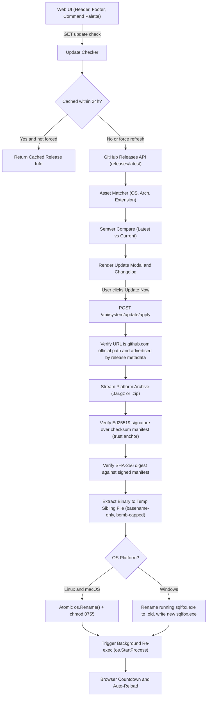

1. **GitHub Releases Polling & Rate-Limit Guard**:
   - `GET /api/system/update/check` fetches metadata from `api.github.com/repos/herliansyah/sqlfox/releases/latest`.
   - Responses are cached in memory for 24 hours to stay well below GitHub's 60 req/hour unauthenticated IP rate limit.
   - Explicit user actions (`Check for Updates` or clicking version tag) supply `?force=true` to bypass the cache.
2. **Platform-Aware Binary Asset Matching**:
   - Target assets are resolved against `runtime.GOOS` and `runtime.GOARCH` (`sqlfox-{TAG}-{GOOS}-{GOARCH}.(tar.gz|zip)`).
   - Zero external compression dependencies: extraction uses stdlib `archive/tar`, `compress/gzip`, and `archive/zip` exclusively.
3. **Layered Supply-Chain Verification (fail-closed, ADR 0060)**:
   - **Origin allowlist**: the asset URL must be an `https://github.com/herliansyah/sqlfox/releases/download/*` path with no traversal/userinfo/query tricks (`isAllowedAssetURL`).
   - **Advertised-asset binding**: the URL must be byte-for-byte one the official release metadata advertises, binding the download to a release GitHub actually published.
   - **Signed manifest trust anchor**: when the binary embeds a public key (`manifestSigningPublicKeyB64`), the detached Ed25519 signature `checksums.txt.sig` must verify over the checksum manifest before any checksum is trusted. Unprovisioned builds fall back to checksum-only.
   - **SHA-256 digest**: the downloaded archive is matched against the signed manifest with a constant-time comparison.
   - **Safe extraction**: only the `sqlfox`/`sqlfox.exe` entry is selected by basename (no archive-controlled paths → no zip-slip) and every copy is size-bounded against decompression bombs. TLS verification is always enforced.
   - Any failure aborts the update and leaves the running executable untouched.
4. **Atomic Replacement & Windows Locking Workaround**:
   - The new binary is staged in a sibling temporary file in the same directory (`filepath.Dir(exePath)`) to guarantee same-filesystem atomic moves.
   - On Linux/macOS, `os.Rename` replaces the running inode atomically.
   - On Windows, where executing binaries cannot be overwritten in place, the running executable is renamed to `sqlfox.exe.old`, the replacement is moved into place, and cleanup is scheduled.
5. **Graceful Re-exec Restart**:
   - Dispatches a background goroutine spawning the updated binary with original command-line arguments via `exec.Command` / `os.StartProcess`.
   - Frontend initiates a 3-second countdown before auto-refreshing to seamlessly reconnect.

> Release-side signing is performed by the CGO-free helper `scripts/sign-manifest.go`, wired into `.github/workflows/release.yml`. Key provisioning: `docs/playbooks/release-signing-key-provisioning.md`.

---

## 16. Canonical Brand Mark & Cross-Platform Icon System

SqlFox maintains a unified visual brand across all operating systems, browser surfaces, and desktop environments:

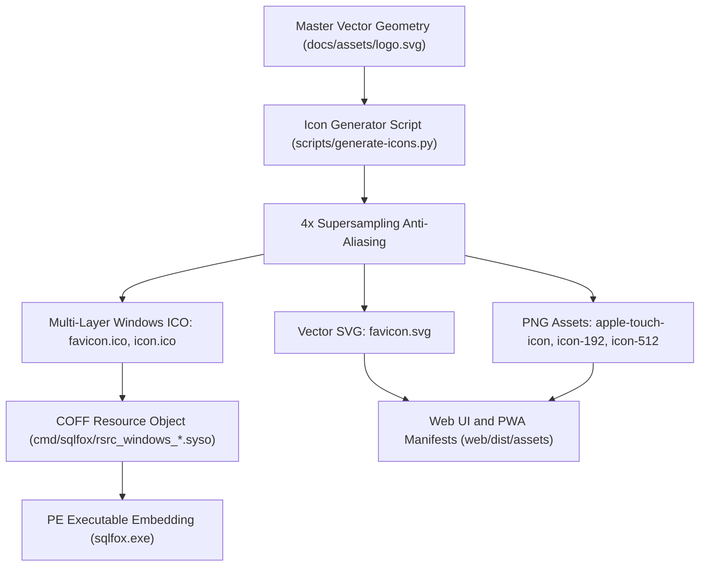

1. **Master Vector Geometry**: The canonical front-facing geometric fox head (`docs/assets/logo.svg` and `web/dist/assets/logo.svg`) defines 100% symmetrical polygon facets centered along `x = 256` within a `512x512` viewBox.
2. **Deterministic Icon Pipeline**: An offline Python generator (`scripts/generate-icons.py`) uses 4x supersampling anti-aliasing to render multi-resolution PNGs (`apple-touch-icon.png`, `icon-192.png`, `icon-512.png`), vector SVGs (`favicon.svg`), and multi-layer ICOs (`favicon.ico`, `icon.ico`).
3. **Pre-Compiled PE Embedding**: Windows COFF resource objects (`cmd/sqlfox/rsrc_windows_amd64.syso` and `rsrc_windows_arm64.syso`) embed the Brand Mark directly into `sqlfox.exe` during standard Go compilation with zero external CGO or toolchain dependencies.

---

## 17. Grid Edit Presets & Universal Mutation Audit Architecture

### PK-Less Row Mutations & Criteria Synthesis
For tables lacking primary keys, the backend accepts `row_criteria: Record<string, any>` representing the complete pre-mutation state of the row:
- Constructs parameterized equality predicates: `WHERE col1 = ? AND col2 = ? ... LIMIT 1`.
- Protects against ambiguous matches by asserting that affected row counts equal exactly 1.
- Provides multi-driver live schema fallback (`SHOW KEYS`, `pg_index`, `PRAGMA table_info`) when primary key metadata is omitted.

### Universal Mutation Audit Pipeline
Every mutating operation across the application is recorded to the local SQLite vault `audit_logs` table with canonical origin attribution (`source`):
- **Sources**: `editor`, `grid_cell_edit`, `grid_insert`, `grid_delete`, `script_runner`, `csv_import`, `mock_data`, `sync_transfer`, `schema_sync`.
- **Non-Blocking Dispatch**: Handled via `ActiveSession.RecordAudit(...)` in non-blocking background goroutines.
- **Filtering & Compliance**: Query parameter filtering via `GET /api/session/{id}/audit-logs?source=...` and dedicated source badging in the UI with CSV export.

---

## 18. Diagnostic Logging & Request Observability Suite (`internal/logger`)

SqlFox embeds a production-grade structured logging and request telemetry pipeline designed around the Go standard library `log/slog` (Go 1.21+):

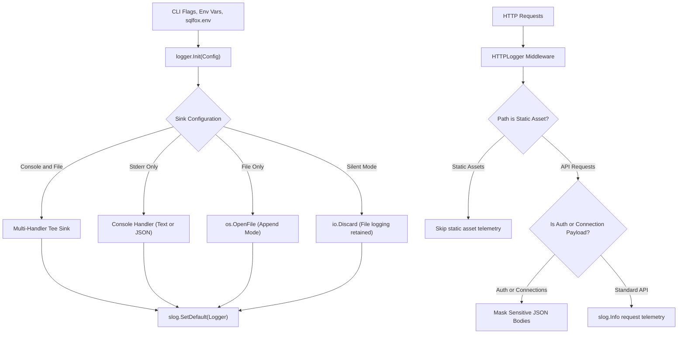

1. **Zero-Dependency `log/slog` Architecture**:
   - Strictly built upon Go standard library `log/slog` with zero third-party logging frameworks (no zap, logrus, or zerolog), preserving binary minimalism and instantaneous startup.
   - Global standard logger delegation ensures all Go subsystems, internal drivers, and server handlers output through a unified structured channel.
2. **Multi-Sink Pipeline & Atomic File Writes**:
   - **Console Sink**: Configurable as human-readable formatted `text` or structured machine-parseable `json`.
   - **Persistent File Sink (`-log-file`)**: Atomic appending via `os.OpenFile(path, os.O_CREATE|os.O_APPEND|os.O_WRONLY, 0644)`.
   - **Dual-Stream Tee Sink**: When both console and file are configured, log entries are broadcast synchronously to both sinks.
   - **Silent Mode (`-silent`, `-q`)**: Routes console output to `io.Discard` while preserving persistent file logging when `-log-file` is configured.
3. **HTTP Request Telemetry & Credential Masking**:
   - `HTTPLogger` middleware measures end-to-end request latency, response HTTP status codes, and payload bytes written.
   - High-frequency static assets (`/static/`, `/assets/`, `favicon.ico`, `manifest.webmanifest`) are silently bypassed to keep diagnostic logs focused on real database actions.
   - Security-sensitive endpoints (`/api/auth/unlock`, `/api/connections`) have sensitive payload bodies masked to prevent master PIN, vault master password, or database credentials from leaking into log files.
4. **Ergonomic Environment Loader (`sqlfox.env`)**:
   - Windows double-click and daemon environments cannot easily pass CLI flags. SqlFox's `loadEnvFiles()` cascades configuration search across:
     1. Directory containing the running executable (`filepath.Dir(exePath)/sqlfox.env`).
     2. Current working directory (`./sqlfox.env`).
     3. User home configuration directory (`~/.sqlfox/sqlfox.env`).
5. **Live Event Stream & In-App Activity Console (`/api/logs/stream`)**:
   - **Broadcaster & Telemetry Ring Buffer**: In-memory fixed-capacity ring buffer (100 records) capturing structured runtime events across subsystems. Emits non-blocking fan-out channel events to connected HTTP clients without stalling database threads.
   - **Server-Sent Events (SSE)**: Powered entirely by Go standard library `http.Flusher` delivering unidirectional real-time event frames (`data: <json>\n\n`) to the browser's native `EventSource`.
   - **Frontend Ergonomics**: Collapsible bottom-docked Activity Console with smart auto-scroll detection, client-side FIFO buffer (1,000 items), level filtering, keyword search, and instantaneous `.log` / `.json` export.

---

## 19. Multi-Engine Feature Parity & Dialect Resilience Architecture

SqlFox enforces complete feature parity across MySQL (5.7, 8.0, 8.4 LTS, 9.x), MariaDB (10.3 - 11.x), PostgreSQL (9.6 - 16+), and SQLite:

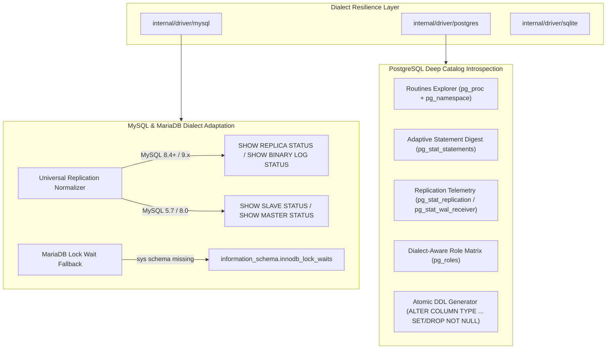

1. **Universal Replication Normalizer (MySQL 8.4 LTS & 9.x Parity)**:
   - MySQL 8.4 LTS and 9.x completely deprecate and remove legacy `SHOW SLAVE STATUS` and `SHOW MASTER STATUS` statements, causing syntax errors in standard database tools.
   - SqlFox probes modern syntax (`SHOW REPLICA STATUS` and `SHOW BINARY LOG STATUS`) first; upon syntax errors or unsupported commands, it smoothly falls back to legacy commands.
   - Key normalization ensures unified frontend telemetry across all MySQL engine generations (`replica_io_running` $\leftrightarrow$ `slave_io_running`, `seconds_behind_source` $\leftrightarrow$ `seconds_behind_master`).
2. **MariaDB Sys Schema Fallback**:
   - MariaDB installations often omit the `sys` schema by default. SqlFox's lock wait telemetry detects missing `sys.innodb_lock_waits` and falls back directly to `information_schema.innodb_lock_waits`, preventing silent monitoring crashes.
3. **PostgreSQL Deep Catalog Introspection**:
   - **Routines Explorer**: Introspects `pg_proc` joined with `pg_namespace`, extracting argument type signatures to distinguish overloaded functions (`calc(int)` vs `calc(text)`), and recovers full definitions via `pg_catalog.pg_get_functiondef`.
   - **Adaptive Statement Digest**: Safely probes `pg_stat_statements` for execution metrics, average latencies, and total calls. If the extension is not active, it surfaces a non-disruptive 1-click guide (`CREATE EXTENSION pg_stat_statements;`) without breaking the Processlist dashboard.
   - **Replication Telemetry**: Introspects `pg_stat_replication` on primary instances and `pg_stat_wal_receiver` on standbys to report real-time replication lag, WAL flush states, and connection modes.
   - **Role & Privilege Matrix**: Introspects `pg_roles` to extract boolean attributes (`SUPERUSER`, `CREATEDB`, `CREATEROLE`, `REPLICATION`, `BYPASSRLS`, `LOGIN`) and parses `MEMBER OF` role inheritance.
4. **Dialect-Specific DDL in Structure Sync**:
   - PostgreSQL does not support MySQL's monolithic `MODIFY COLUMN col type attributes` clause.
   - SqlFox generates dialect-specific DDL: for PostgreSQL, it decomposes column mutations into atomic statements (`ALTER TABLE tbl ALTER COLUMN col TYPE ...; ALTER TABLE tbl ALTER COLUMN col SET NOT NULL;`), ensuring seamless schema synchronizations across heterogeneous environments.

---

## 20. Unified Operational Notes Inbox & Follow-up Architecture

SqlFox unifies ad-hoc table annotations, diagnostic snapshots, and developer runbooks into a persistent operational inbox with scheduled follow-up reminders.

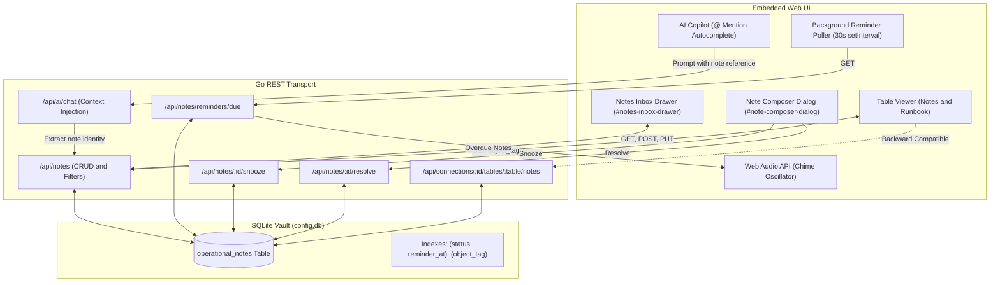

### Key Architectural Characteristics

1. **Vault Persistence (`internal/vault/operational_notes.go`)**:
   - Stored in the encrypted SQLite vault `config.db` under the `operational_notes` table.
   - Captures metadata (`id`, `title`, `status`, `pinned`), categorization (`tags`, `object_tag` soft-link URI `db://conn/db/table`), developer markdown notes (`notes`), raw snapshot (`snapshot` with `sql` and `ai_explanation`), and reminder lifecycle (`reminder_at`, `snoozed_until`, `created_at`, `updated_at`).
   - Indexed on `(status, reminder_at)` for sub-millisecond due-reminder polling and `(object_tag)` for instantaneous table runbook lookups.
2. **Scheduled Reminder Engine**:
   - The frontend evaluates `/api/notes/reminders/due` on a non-blocking 30-second polling interval.
   - When an active reminder's timestamp elapses, SqlFox plays a distinctive pleasant chime via the native **Web Audio API** (`AudioContext` exponential ramp from 587.33 Hz [D5] to 880.00 Hz [A5]) without requesting or loading external audio files.
   - Non-blocking notification toasts permit 1-click **Open Note**, **Snooze 10m**, or **Done** resolution.
3. **AI Copilot Context Injection (`internal/ai/assistant.go`, `internal/server/handlers_ai.go`)**:
   - Recognizes `@note:<id>` or `[@note:<title>]` reference tokens in prompt inputs.
   - Fetches the referenced operational note and injects an isolated `=== REFERENCED OPERATIONAL NOTES ===` section into the AI system prompt before execution, providing full historical context (SQL snippet, diagnostic snapshot, and human developer notes) without manual copy-pasting.

---

## 21. Fast Schema Catalog Synchronization & Root Blocker Incident Triage Architecture

### 1. Fast Catalog Sweeping (`InspectFastCatalog`)

Standard schema introspection queries foreign key constraints (`KEY_COLUMN_USAGE`), indexes, and comments per table. On instances with hundreds of databases and thousands of tables, this can introduce metadata lock contention.

To support rapid client-side autocomplete (`dbname.tablename.colname`) and global Schema Search (`Ctrl+P`), `InspectFastCatalog` extracts table names and column definitions in a single sweep:
- **MySQL**: Two queries against `information_schema.tables` and `information_schema.columns` across all non-system databases (`information_schema`, `mysql`, `performance_schema`, `sys`).
- **PostgreSQL**: Queries non-system schemas (excluding `pg_catalog`, `information_schema`, and `pg_toast%`).
- **SQLite**: Reads all tables and columns from the `main` schema.

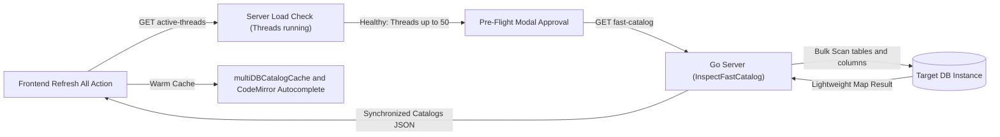

### 2. Active Thread Safety Probe (`GET /api/session/{id}/active-threads`)

Before executing wide catalog sweeps, the client queries live server concurrency:
- **MySQL**: `SHOW GLOBAL STATUS LIKE 'Threads_running'` mapped to `ServerInfo.ActiveThreads`.
- **PostgreSQL**: `SELECT count(*) FROM pg_stat_activity WHERE state = 'active' AND pid <> pg_backend_pid()`.
- **Pre-Flight Modal (`#refresh-all-dialog`)**: Displays server status pills:
  - `> 100 threads`: Critical warning (red), recommends waiting for off-peak windows.
  - `> 50 threads`: Caution warning (amber), advises caution under concurrent traffic.
  - `<= 50 threads`: Normal state (emerald), safe to execute immediately.

### 3. Root Blocker Incident Triage Architecture

In production lock storms, the Lock Contention Inspector (`#lock-dialog`) visualizes the blocking chain:
- **Root Blocker Identification**: Isolates the head blocking thread (`is_root_blocker = true`), user, lock mode held, and locked resource.
- **Scrollable Full SQL Container**: Full query text rendered in `max-h-48 overflow-y-auto font-mono text-[13px]` syntax container.
- **Dual Out-of-Band Mitigations**:
  - `Kill Query`: Sends `KILL QUERY <thread_id>` or `pg_cancel_backend(<pid>)` without dropping the client connection.
  - `Kill Blocker`: Sends `KILL CONNECTION <thread_id>` or `pg_terminate_backend(<pid>)` to immediately relieve cascaded contention.
- **Blocked Sessions Hierarchy**: Shows all waiting threads with elapsed waiting duration in seconds (`waiting 45s for lock`) and waiting SQL statements.

---

## 22. Processlist Batch Operations & Two-Tier Responsive Toolbar Architecture

To handle server lock storms and massive connection leaks where terminating threads individually is too slow:

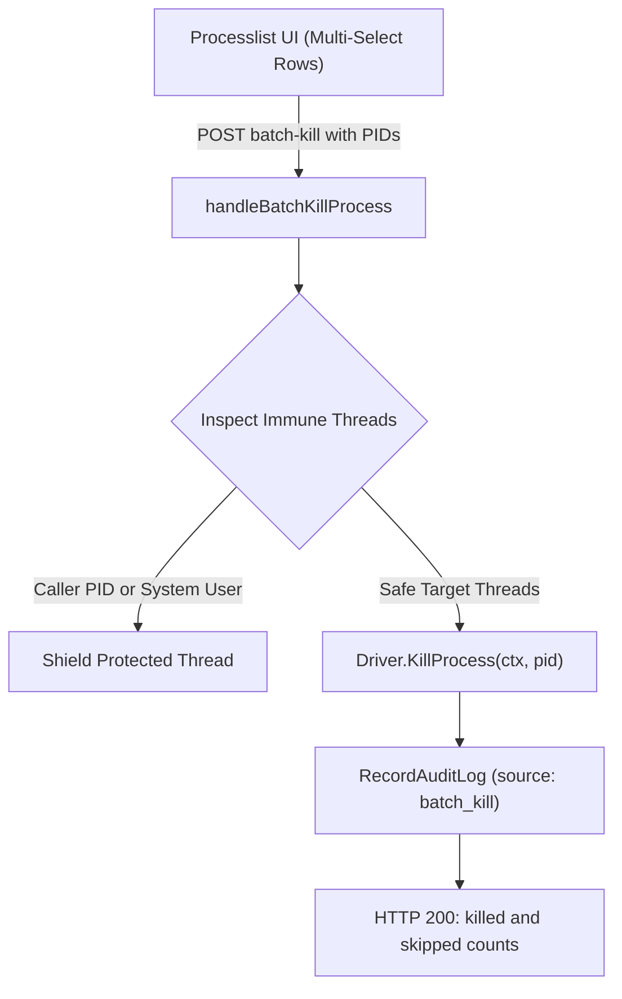

1. **Immune Thread Guardrails**:
   - Compares candidate thread IDs against the caller's connection thread (`@@pseudo_thread_id` on MySQL, `pg_backend_pid()` on PostgreSQL) and background worker usernames (`system user`, `event_scheduler`, `binlog_dump`).
   - Immune threads are automatically shielded to prevent self-termination.
2. **Two-Tier Responsive Toolbar**:
   - **Primary Action Tier**: Houses global actions (Refresh, auto-refresh intervals, batch kill triggers, and search filter).
   - **Contextual Filter Tier**: Dedicated secondary row containing dropdown filter pills for Command/State, User, Database, and Minimum Elapsed Time (`Time > N`), eliminating control wrapping across compact displays.
3. **Column Visibility Picker**:
   - Persistent dropdown customization (`localStorage`) for toggling table columns (`ID`, `User`, `Host`, `DB`, `Command`, `Time`, `State`, `Info`, `Memory`, `Locks`).
   - Sticky locks guarantee core diagnostic identifiers cannot be hidden.

---

## 23. Tab Database Scope & DDL Target Affirmation Architecture

Decouples query tab execution context from global sidebar selection and enforces strict schema target verification:

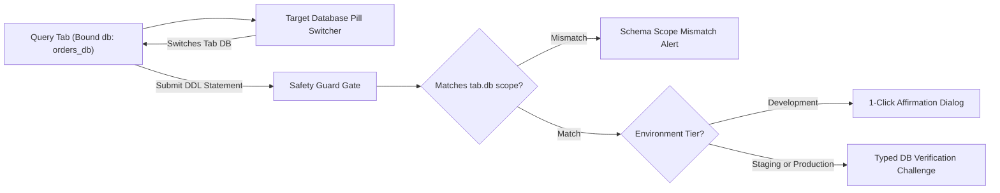

1. **Tab-Scoped Database Execution**:
   - Every workspace query tab maintains its own database context (`tab.db`), completely decoupled from the sidebar database picker.
   - Executing `USE target_db;` updates the active tab's bound database context bidirectionally.
2. **Schema Scope Mismatch Guard**:
   - Inspects SQL ASTs for qualified table references (e.g. `UPDATE analytics.logs ...`). If the target database differs from the tab's bound database scope, execution is intercepted with a mismatch warning.
3. **Environment-Tiered DDL Target Affirmation**:
   - Development environments present a quick 1-click confirmation dialog.
   - Staging and Production require typing the exact database name into the confirmation modal before DDL statements are executed.

---

## 24. Relational Table Designer & In-Place Constraint Builders Architecture

Delivers sub-millisecond, focused table designing without DOM recreation:

1. **In-Place DOM Focus Retention**:
   - Attribute inputs (`name`, `type`, `length`, `nullable`, `default_value`, `primary_key`) update internal state models in-place without calling full-table `innerHTML` redraws, preserving keyboard focus and cursor position continuously.
2. **Floating ENUM / SET Value Builder**:
   - Popover editor with interactive tag chips, smart paste splitting for comma-separated or quoted values, duplicate prevention, and automatic injection into Default Value presets.
3. **Visual Composite Index Builder**:
   - Drag-and-drop and numbered column badges (#1, #2, #3...) for ordering multi-column composite indexes, supporting `INDEX`, `UNIQUE`, `FULLTEXT`, and `SPATIAL` types.
4. **Cascading Foreign Key Selector & Type Guard**:
   - Dynamic catalog lookup linking child columns to parent tables.
   - Pre-flight DataType Compatibility checks detect mismatches (e.g., `INT UNSIGNED` child referencing `BIGINT` parent) and display warnings before DDL generation to prevent MySQL `errno 150` errors.

---

## 25. Pre-Execution Mutation Estimation & Tiered Safety Guard Pipeline

Pre-flight inspection prevents catastrophic mass updates or deletes:

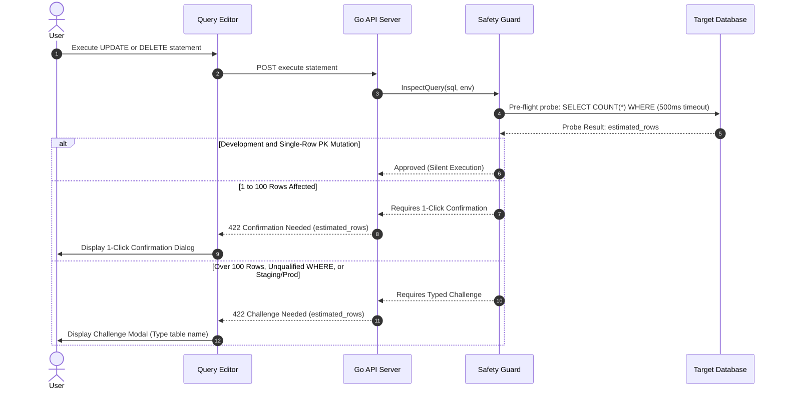

1. **Pre-Flight DML Inspection**:
   - Rewrites `UPDATE` and `DELETE` queries into bounded `SELECT COUNT(*)` queries with a 500ms timeout before execution.
2. **Tiered Affirmation Policy**:
   - **Silent Mode**: Permitted exclusively in Development for single-row mutations targeting Primary Keys.
   - **1-Click Affirmation**: For mutations affecting 1–100 rows in Development.
   - **Typed Challenge Modal**: Required for mutations affecting >100 rows, queries lacking a `WHERE` clause, or **any** mutation in Staging and Production.

---

## 26. Virtual Data Grid & NDJSON Micro-Chunk Streaming Architecture

Engineered for massive datasets with strict memory ceilings:

```mermaid
flowchart TD
    Client["Browser Virtual Data Grid"] -->|POST execute-stream| Endpoint["Query Stream Endpoint"]
    Endpoint --> Driver["Database Driver (rows.Next)"]
    Driver --> FirstChunk{"First 20 Rows Ready?"}
    FirstChunk -->|Yes: Fast TTFR under 50ms| Flush["Immediate Flush Chunk (NDJSON)"]
    Flush --> Stream["NDJSON Line-by-Line Stream"]
    Stream --> Reader["Browser ReadableStream + AbortController"]
    Reader --> Buffer["Client Data Buffer (In-Memory)"]
    Buffer --> DOM["Virtual Row Window (32px uniform, under 500 DOM Nodes)"]
    Buffer --> Drawer["Persistent Cell Inspector Drawer (JSON and Multiline)"]
    Buffer --> BottomBar["Sticky Bottom Pagination Bar (Page Jump and Sizing)"]
```

1. **Fixed-Height DOM Row Windowing**:
   - Uniform 32px row height keeping total rendered DOM elements strictly below 500 nodes regardless of dataset size (100,000+ rows).
   - Full keyboard arrow navigation across cells.
2. **NDJSON Micro-Chunk Streaming (`/api/session/{id}/execute-stream`)**:
   - Immediately flushes the initial micro-chunk (first 20 rows) for sub-50ms Time to First Row (TTFR).
   - Subsequent rows stream line-by-line via NDJSON, cancellable at any instant via native `AbortController`.
3. **Unified Sticky Bottom Pagination Bar**:
   - Direct page jump input, first/previous/next/last navigation buttons (`⏮️`, `◀`, `▶`, `⏭️`), configurable page sizes (25, 50, 100, 200), on-demand accurate total count calculation, and smart wildcard auto-wrapping for `LIKE`/`NOT LIKE`.
4. **Persistent Cell Inspector Drawer**:
   - Keyboard-synchronized drawer live-rendering formatted JSON, multiline text, and raw payloads of the focused cell without opening blocking modals.

---

## 27. Systemic Security Hardening & Concurrency Reliability Architecture

1. **Client SSL Private Key Encryption at Rest (`internal/vault`)**:
   - Encrypts client SSL private keys (`SSLKey`) with AES-256-GCM using versioned envelope markers (`enc:v1:`), with additional authenticated data (AAD) bound to each secret's `(connection id, field)` identity to prevent ciphertext relocation (ADR 0060).
2. **Strict Same-Origin Ingress Guard (`internal/server/auth`)**:
   - Validates that state-mutating HTTP requests contain an `Origin` host matching the request `Host` byte-for-byte, blocking cross-port CSRF from malicious local web servers (e.g. `localhost:3000` targeting `localhost:8080`).
3. **MySQL Executable Comment Unwrapping (`internal/safety`)**:
   - `StripLeadingComments` unwraps MySQL executable comments (`/*! ... */`) into raw executable SQL, eliminating comment-cloaking evasion vectors.
4. **Fail-Closed Processlist Batch Termination (`internal/server/handlers_dba`)**:
   - Enforces HTTP 503 if live server processlist cannot be verified, safeguarding immune threads.
5. **Singleflight Connection Deduplication & Lazy Schema Inspection (`internal/server/session_manager`)**:
   - Uses `singleflight.Group` to coalesce concurrent connection requests for the same connection ID into a single physical connection routine, preventing reconnect stampedes.
   - Defers heavy schema and catalog introspection to lazy on-demand requests, preventing metadata lock contention during connect.
6. **Tab Bar Overflow Dropdown & Enhanced Close Guard (`web/dist/index.html`)**:
   - Dynamically activates `#tab-bar-overflow-btn` and `#tab-bar-overflow-menu` when tab count exceeds the visible container width.
   - Enforces confirmation guards before closing unsaved non-empty queries or non-query tabs.

---

## 28. Visual Programmability & Object Lifecycle Architecture

1. **Structured Object Dialogs & Parameter Grids (`web/dist/index.html`)**:
   - Provides native modal designers for Views, Stored Procedures, Functions, Triggers, and Scheduled Events.
   - Parameter builders serialize typed signatures and return modes without requiring manual DDL concatenation.
2. **Definer Sanitization & Single-Line Comment Preservation (`web/dist/index.html`)**:
   - Strips user/host definers using horizontal whitespace collapsing, preserving vertical formatting and preventing inline SQL comments (`-- comment`) from corrupting subsequent statements.
3. **Multi-Statement Sequential Execution & Multi-Result Tabs (`internal/server/session_manager.go`)**:
   - Executes multi-statement SQL scripts in topological sequence, returning discrete result sets streamed via `#tab-results-bar` with per-statement timing and row counters.
4. **Pre-Flight Database Dump Confirmation Guard (`web/dist/index.html`)**:
   - Intercepts full database dumps with target verification, schema vs data checkboxes, and lock warning banners to prevent unexpected I/O saturation on multi-gigabyte production clusters.

---

## 29. Query Result Mutations & Context Menu Architecture

1. **Single-Table Resolved Primary Key Mutation Engine (`web/dist/index.html`)**:
   - Evaluates query result sets; if the statement targets a single table and includes all primary key columns in the projection list, cell inline editing, row duplication, draft insertion, and deletion actions are enabled.
   - Staged mutations link into the global `stagedEdits` transaction tracker and execute via AST Safety Guard.
2. **Submenu Grouping & Viewport Collision Clamping (`web/dist/index.html`)**:
   - Hierarchically groups context menu actions into nested submenus (`Quick Filter`, `Insert Value`, `Mutations`, `Copy / Export`).
   - Dynamically evaluates viewport boundaries and flips menu orientation (leftwards/upwards) when approaching screen edges, preventing overflow clipping.

---

## 30. Standalone Native Desktop Application & OS Launcher Architecture

```mermaid
flowchart TD
    CLI["CLI Command (sqlfox)"] --> Mode{"-browser flag set?"}
    Mode -->|Yes| Browser["Spawn Default OS Browser Tab"]
    Mode -->|No| Detector{"Chromium / Edge / Chrome Available?"}
    Detector -->|Found| AppWindow["Spawn Frameless Window (--app=http://...)"]
    Detector -->|None| Fallback["Fallback to System Browser"]
    CLI --> Launcher{"sqlfox desktop install"}
    Launcher --> DesktopFile["Generate ~/.local/share/applications/sqlfox.desktop"]
    Launcher --> Icon["Install 512x512 PNG to hicolor icon theme"]
    CLI --> Stop{"sqlfox stop"}
    Stop --> ReadLock["Read ~/.sqlfox/sqlfox.lock PID"]
    Stop --> Graceful["Signal Process & Terminate Cleanly"]
```

1. **Zero-Electron Native Windowing (`cmd/sqlfox/browser*.go`)**:
   - Employs Chromium/Edge `--app=http://<host>:<port>` argument to provide an isolated, frameless desktop window experience without distributing hundreds of megabytes of bundled browser runtime.
2. **Cross-Platform Launcher Integration (`cmd/sqlfox/desktop*.go`)**:
   - `sqlfox desktop install` registers Freedesktop `.desktop` files and 512x512 application icons into standard system directories on Linux.
3. **Deterministic Instance Locking & Graceful Shutdown (`cmd/sqlfox/instance.go`)**:
   - Manages PID locks in `~/.sqlfox/sqlfox.lock`, enabling single-instance detection, port hunting, and remote shutdown via `sqlfox stop` or `/api/system/shutdown`.

---

## 31. Supply-Chain Signing & Audit Hardening Architecture (ADR 0060)

A pre-release enterprise security audit extended ADR 0059 with supply-chain, execution-safety, ingress, and at-rest hardening:

1. **Ed25519 Signed Checksum Manifest (`internal/server/update.go`, `scripts/sign-manifest.go`)**:
   - `verifyAssetChecksum` calls `verifyManifestSignature` before trusting any checksum. When a build embeds `manifestSigningPublicKeyB64` (injected via `-ldflags` at release), the detached Ed25519 signature `checksums.txt.sig` must verify over the exact manifest bytes; otherwise the update is rejected (fail-closed). Unprovisioned builds retain checksum-only behavior.
   - The release workflow signs the manifest with a CI-secret private key via the CGO-free, stdlib-only helper `scripts/sign-manifest.go` (build-tagged `ignore`, never compiled into the binary).
2. **Script Runner Safety Guard Parity (`internal/server/handlers_dump.go`, `internal/server/session_manager.go`)**:
   - `handleRunSQLScript` inspects every statement via `ActiveSession.InspectScriptStatements`; any Challenge-requiring statement blocks the run with `HTTP 409` unless `confirm=true`. Each confirmed `DROP`/`TRUNCATE TABLE` triggers a pre-DDL Smart Tiered Backup through `ActiveSession.BackupBeforeDestructive`.
3. **Production-Clean Test Flags (`internal/server/auth.go`, `internal/server/update.go`)**:
   - The `testing` package is no longer linked into production; the httptest `example.com` DNS-rebinding bypass is gated behind `allowDefaultTestHost`, and the `updateAPIURL` asset-host allowance behind `allowUpdateAPIHostAssets` — both false in release builds, flipped true only by the test harness's `init`.
4. **LAN-Scoped DNS Rebinding Guard (`internal/server/auth.go`)**:
   - `isAllowedLANHostIP` restricts IP-literal `Host` headers in LAN mode to the detected LAN IP plus loopback/RFC 1918/RFC 4193/link-local ranges; routable public IPs are rejected as rebinding signals.
5. **Keyset Marker Trust-Boundary Validation (`internal/server/handlers_schema.go`)**:
   - The `last_key` seek marker is rejected if it contains a NUL byte or exceeds 4096 bytes, in addition to dialect-correct escaping (the `QueryStream` interface intentionally stays unchanged).
6. **Per-Field AAD Binding for Vault Secrets (`internal/vault/crypto.go`, `internal/vault/vault.go`)**:
   - `EncryptWithAAD`/`DecryptWithAAD` bind AES-256-GCM additional authenticated data to each secret's `(connection id, field)` identity, so a relocated ciphertext fails authentication. Legacy nil-AAD values decrypt via fallback and are re-sealed on next save.

---

## 32. In-App Self-Update Process Replacement & Port Lifecycle Architecture

Self-updating an active server daemon on localhost without port collisions or orphaned processes requires deterministic platform-specific lifecycle coordination:

```mermaid
sequenceDiagram
    autonumber
    actor User
    participant Web as Web Frontend
    participant Server as Active SqlFox Daemon
    participant OS as Operating System Kernel
    participant Disk as Local Executable File

    User->>Web: Click "Update & Restart"
    Web->>Server: POST /api/system/update {asset_url}
    Server->>Server: Download, verify Ed25519 signature & SHA-256 digest
    Server->>Disk: Atomic executable replacement (.new -> binary)
    Server-->>Web: 200 OK {status: "restarting"}
    Web->>Web: Show restart modal & poll /api/auth/status

    alt POSIX (Linux, macOS, BSD)
        Server->>Server: Close HTTP listener socket
        Server->>OS: syscall.Exec(binary, [args..., "--no-browser"], environ)
        Note over OS: Replaces process image in-place (PID preserved, zero port collision)
    else Windows
        Server->>Server: Close HTTP listener socket & release instance lock
        Server->>OS: exec.Command(binary, [args..., "--no-browser"]).Start()
        Server->>OS: os.Exit(0)
    end

    loop Frontend Status Polling
        Web->>Server: GET /api/auth/status
        Server-->>Web: 200 OK (New version active)
    end
    Web->>Web: Smooth workspace reload
```

1. **POSIX In-Place Process Replacement (`cmd/sqlfox/restart_posix.go`)**:
   - On Unix-like systems, the server executes `syscall.Exec` replacing the process image within the same process table slot (preserving the original PID).
   - Because the original PID is retained, existing PID lock files (`~/.sqlfox/sqlfox.lock`) remain continuously valid without file-lock acquire/release race windows.
   - The HTTP listener is explicitly closed before `syscall.Exec`, releasing TCP socket bindings instantly and guaranteeing zero `EADDRINUSE` port collisions when the new executable initializes its server socket.
2. **Windows Graceful Shutdown & Child Spawn (`cmd/sqlfox/restart_windows.go`)**:
   - On Windows, where executable file locking and process replacement semantics differ, the server explicitly closes the HTTP listener and releases the instance lock (`ReleaseLock()`) before spawning the replacement executable via `exec.Command`.
   - The parent process terminates immediately with code 0, clearing port reservations for the newly spawned child process.
3. **Browser Tab Spawn Suppression (`--no-browser`)**:
   - Both restart paths automatically inject the `--no-browser` CLI flag into the replacement argument list.
   - This prevents the updated instance from launching unwanted default browser tabs while an active user session is already open.
4. **Client-Side Health Polling & Workspace Reload (`web/dist/index.html`)**:
   - Upon receiving the `restarting` response, the web interface displays a non-blocking modal overlay and initiates active polling against `/api/auth/status` with linear retry backoff (500ms intervals, up to 30 attempts).
   - Once the restarted binary returns HTTP 200, the client smoothly refreshes the page, preserving database credentials, tab configurations, and workspace state.

---

## 33. Ingress TLS Encryption & Modular Frontend Architecture (ADR 0061)

```mermaid
flowchart LR
    subgraph Client ["Client Devices"]
        Desktop["Desktop Browser / App"]
        Tablet["LAN Tablet / Remote Client"]
    end

    subgraph Ingress ["Zero-CGO Ingress Transport"]
        HTTP["HTTP Listener (:8080)"]
        HTTPS["HTTPS/TLS Listener (:8081)<br/>(Auto ECDSA P-256 / Custom Cert)"]
    end

    subgraph Core ["Go Embedded Daemon"]
        Server["internal/server"]
        Embed["//go:embed dist/*"]
    end

    subgraph Pipeline ["Frontend Source & Build Pipeline"]
        SvelteSrc["web/frontend/ (Svelte 5 Runes + TS)"]
        Vite["Vite + Tailwind (vite build)"]
        Build["scripts/build_web.js<br/>(wraps npm run build:svelte)"]
        DistHTML["web/dist/index.html"]
    end

    Desktop --> HTTP
    Tablet --> HTTPS
    HTTP --> Server
    HTTPS --> Server
    Server --> Embed
    Embed --> DistHTML

    SvelteSrc --> Vite
    Vite --> Build
    Build --> DistHTML
```

1. **Dual Transport Ingress (`internal/server/tls.go`)**:
   - SqlFox natively supports both plaintext HTTP and TLS-encrypted HTTPS transports with zero external reverse proxy dependencies.
   - When `--tls` is specified, an in-memory ECDSA P-256 self-signed certificate is automatically generated with SANs covering `localhost`, `127.0.0.1`, `::1`, and the detected local LAN IP. Custom certificates can be supplied via `--tls-cert` and `--tls-key`.
2. **Svelte Frontend Pipeline (`web/frontend/` -> `web/dist/`)**:
   - The embedded user interface is a Svelte 5 application (runes reactivity, TypeScript, Tailwind CSS) under `web/frontend/`.
   - The build pipeline (`scripts/build_web.js` → `npm run build:svelte`) runs Vite, produces the optimized single-file distribution at `web/dist/index.html` for single-binary embedding via `//go:embed dist/*`.
3. **Safety Guard Pre-Splitting & Heuristic Protection (`internal/safety/guard.go`)**:
   - Multi-statement SQL batches are pre-split into individual statements before AST parsing, preventing chained destructive statements from bypassing inspection.
   - Unqualified mutation safety probes query cached schema table row counts before issuing expensive `SELECT COUNT(*)` queries against target databases.

---

## 34. CodeMirror 6 Modular Architecture & Dynamic Multi-Dialect SQL Engine (ADR 0062)

```mermaid
flowchart TD
    subgraph Editor ["CodeMirror 6 Ecosystem"]
        View["EditorView (@codemirror/view)"]
        State["EditorState (@codemirror/state)"]
        Compartment["Dialect Compartment"]
        Highlight["High-Contrast Dark Theme<br/>(Tailwind Slate/Sky/Pink Palette)"]
        Autocomplete["@codemirror/autocomplete<br/>(Schema Catalog & SQL Snippets)"]
    end

    subgraph Dialects ["Multi-Dialect Lezer Parsers"]
        MySQL["MySQL Language Parser"]
        PG["PostgreSQL Language Parser"]
        SQLite["SQLite Language Parser"]
    end

    subgraph Adapter ["Backward-Compatible CodeMirror6Adapter"]
        API["getValue / setValue<br/>getSelection / replaceRange<br/>getCursor / setCursor<br/>markText (Execution Highlight)"]
    end

    View --> State
    State --> Compartment
    State --> Highlight
    State --> Autocomplete
    Compartment --> MySQL
    Compartment --> PG
    Compartment --> SQLite
    Adapter --> View
```

1. **Self-Contained Offline Bundling (`scripts/codemirror6_entry.js`, `scripts/build_codemirror.js`)**:
   - Compiles `@codemirror/view`, `@codemirror/state`, `@codemirror/commands`, `@codemirror/lang-sql`, and `@codemirror/autocomplete` using `esbuild` into a unified offline asset (`web/dist/vendor/codemirror/codemirror.min.js`, ~422 KB).
   - Preserves zero external CDN dependencies while shipping full Lezer AST parsing and syntax trees.
2. **Backward-Compatible Adapter (`CodeMirror6Adapter`)**:
   - Exposes an API identical to CodeMirror 5 (`getValue`, `setValue`, `getCursor`, `markText`, `on('change')`, etc.) so all 15 frontend modules interact transparently without breaking changes.
3. **Dynamic Multi-Dialect Switching via Compartments**:
   - Dynamically reconfigures the editor syntax parser when switching database sessions (`cmEditor.setDialect(conn.driver)`), seamlessly toggling between MySQL, PostgreSQL, and SQLite dialect rules.
4. **Dark Theme & Autocomplete Parity**:
   - Integrates with SqlFox's active schema catalog and user snippets, offering instant autocompletion and high-contrast dark theme syntax highlighting.


