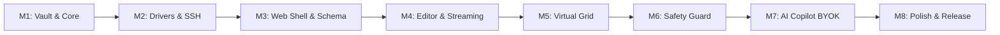

# SqlFox Delivery Milestones & Roadmap

Incremental implementation roadmap structured into 8 testable, self-contained milestones, followed by long-term release horizons.

## 1. Incremental Milestone Breakdown (v1.0)

Every milestone delivers a runnable increment with its own minimal verification check.



---

### Milestone 1: Core Foundation & Connection Vault
- **Goal**: Establish the Go module, CLI entry point, local SQLite configuration database, and AES-256-GCM credential encryption.
- **Deliverables**:
  - `cmd/sqlfox/main.go` flag parsing and local runtime directory setup (`~/.sqlfox/`).
  - `internal/vault/crypto.go`: Argon2id key derivation and AES-GCM cipher encrypt/decrypt helpers.
  - `internal/vault/vault.go`: SQLite-backed connection repository (CRUD for connection profiles).
- **Runnable Verification**: CLI test command that creates, encrypts, persists, and decrypts a dummy database connection without plaintext leakage.

---

### Milestone 2: Driver Abstraction, MySQL & SSH Tunneling
- **Goal**: Implement the core `Driver` and `Session` interfaces for MySQL 5.7/8.x and SQLite, including SSH bastion tunnels.
- **Deliverables**:
  - `internal/driver/driver.go`: Core interfaces (`Driver`, `Session`, `RowStream`).
  - `internal/driver/mysql/`: `go-sql-driver/mysql` integration with custom SSH dialer (`golang.org/x/crypto/ssh`).
  - `internal/driver/sqlite/`: `modernc.org/sqlite` pure-Go driver.
  - Server status ping, connection test, and TLS/mTLS verification.
- **Runnable Verification**: Integration test connecting to a remote MySQL instance through an SSH tunnel and reading server version and active connections.

---

### Milestone 3: Embedded Web Shell & Schema Explorer
- **Goal**: Provide the embedded HTTP server and web application shell to browse databases, tables, columns, indexes, and foreign keys.
- **Deliverables**:
  - `internal/server/`: Chi HTTP router serving REST endpoints and embedded static assets (`//go:embed`).
  - Web UI: Left sidebar connection manager (grouped by Environment: Production, Staging, Dev).
  - Schema tree viewer: Tables, Columns, Indexes, Views.
  - DDL modal: `SHOW CREATE TABLE` formatted display with "Copy to Editor".
- **Runnable Verification**: Launch binary -> automatically opens browser at `127.0.0.1:<port>` -> shows connected databases and lets user browse tables.

---

### Milestone 4: Query Editor & Out-of-Band Streaming
- **Goal**: Multi-tab SQL query editing with autocompletion, real-time chunked row streaming, and graceful cancellation.
- **Deliverables**:
  - CodeMirror 6 integration with SQL dialect syntax highlighting.
  - Schema-aware autocompleter (tables, columns from cached schema metadata).
  - WebSocket streaming pipeline (`RowStream`) pushing chunks of 100 records per frame.
  - Out-of-band cancellation (`KILL QUERY <thread_id>` / `sqlite3_interrupt`).
- **Runnable Verification**: Execute a 50,000-row `SELECT` query -> stream results into the browser smoothly with memory <50MB -> hit "Cancel" to verify query terminates immediately on MySQL.

---

### Milestone 5: Virtual Data Grid & Keyset Pagination
- **Goal**: High-performance data viewer handling large tables without UI lag, plus inline editing and CSV/JSON export.
- **Deliverables**:
  - `@tanstack/virtual` implementation rendering up to 100,000 buffered rows with 60fps scrolling.
  - Keyset pagination with tie-breaker sorting for tables with primary keys.
  - Double-click inline cell editing generating targeted `UPDATE` statements.
  - Client-side and server-side CSV and JSON export.
- **Runnable Verification**: Browse a table with 1,000,000 rows -> scroll through pages seamlessly using keyset traversal without `OFFSET` bottlenecks.

---

### Milestone 6: Safety Guard Engine & Tiered Backup
- **Goal**: Deterministic AST-based interception of destructive statements with challenge modals and automated DDL snapshots.
- **Deliverables**:
  - `internal/safety/`: TiDB SQL AST parser integration checking for unqualified `DELETE`/`UPDATE`, `DROP`, `TRUNCATE`, and `ALTER DROP`.
  - Non-intrusive Impact Preview (`EXPLAIN` row estimate and scan type badge).
  - UI Challenge Modal requiring exact table name input for irreversible actions.
  - Smart Tiered Backup: Auto-snapshot DDL to `.scratch/backups/`, and table data if <50MB.
- **Runnable Verification**: Submit `DELETE FROM users;` -> Safety Guard intercepts and halts execution -> verify Challenge Modal pops up -> submit `DROP TABLE logs;` and verify `.sql` backup file is written to disk.

---

### Milestone 7: AI Copilot BYOK & Privacy Firewall
- **Goal**: Context-aware AI assistant supporting OpenAI, Claude, Gemini, and Ollama with zero row-data leakage.
- **Deliverables**:
  - `internal/ai/`: Unified multi-provider BYOK client.
  - Privacy Firewall: Extract referenced table DDLs, strip all row data, optional identifier masking.
  - AI Features: "Explain This Query", "Explain Query Plan", "Optimize Query", and "Natural Language to SQL".
  - Auto-detection for local Ollama instances (`localhost:11434`).
- **Runnable Verification**: Ask AI "Show top 5 customers with highest spend" -> AI receives schema DDL (no data) and returns syntactically correct SQL -> click "Insert to Editor" to run.

---

### Milestone 8: Production Polish, Vault Portability & Single-Binary Release
- **Goal**: Finalize UX polish, environment locks, vault export/import, and cross-platform binary builds.
- **Deliverables**:
  - Production mode locks (read-only session default, red warning chrome).
  - Encrypted Vault Archive export/import (`.sqlfox-vault` with Argon2id passphrase).
  - Command Palette (`Ctrl+K` / `Cmd+K`) for keyboard-driven navigation.
  - Cross-platform build script producing single static binaries (`sqlfox-linux-amd64`, `sqlfox-darwin-arm64`, `sqlfox-windows-amd64.exe`).
- **Runnable Verification**: Complete end-to-end workflow: import a `.sqlfox-vault` archive -> connect to production MySQL via SSH -> execute protected query -> export CSV report -> binary size <25MB, RAM <60MB.

---

## 2. Long-Term Release Horizon

```
v1.0 (MVP Core Trinity)
├── Connection & SSH Vault
├── CodeMirror 6 Editor & Virtual Grid
├── Deterministic Safety Guard
└── AI Copilot BYOK (Cloud + Ollama)
      │
      ▼
v1.1 (Productivity & Collaboration)
├── Snippets with Dynamic Variables ({{tenant_id}})
├── Table Notes & Query Analysis Knowledge Base
├── Cross-Database Schema Search ("Where is column customer_id?")
└── Excel (.xlsx) Import/Export with column mapping
      │
      ▼
v2.0 (Enterprise & Multi-Engine)
├── PostgreSQL, ClickHouse & MongoDB Driver Extensions
├── Visual ERD Interactive Canvas (Drag-and-drop layout)
├── Cross-Database Schema Diff & Migration Generator
├── Server Performance Dashboard (QPS, Buffer Pool, Replication Lag)
└── Headless CLI Suite (`sqlfox query --format=json`) for CI/CD
```
