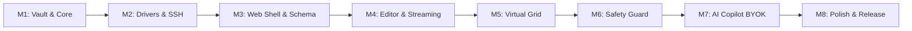

# SqlFox Delivery Milestones & Roadmap

Incremental implementation roadmap structured into 8 testable, self-contained milestones, followed by long-term release horizons.

## 1. Incremental Milestone Breakdown (v1.0)

Every milestone delivers a runnable increment with its own minimal verification check.



---

### Milestone 1: Core Foundation & Connection Vault
- **Goal**: Establish the Go module, CLI entry point, local SQLite configuration database, and AES-256-GCM credential encryption.
- **Deliverables**:
  - `cmd/sqlfox/main.go` flag parsing and local runtime directory setup (`~/.sqlfox/`).
  - `internal/vault/crypto.go`: Argon2id key derivation and AES-GCM cipher encrypt/decrypt helpers.
  - `internal/vault/vault.go`: SQLite-backed connection repository (CRUD for connection profiles).
- **Runnable Verification**: CLI test command that creates, encrypts, persists, and decrypts a dummy database connection without plaintext leakage.

---

### Milestone 2: Driver Abstraction, MySQL & SSH Tunneling
- **Goal**: Implement the core `Driver` and `Session` interfaces for MySQL 5.7/8.x and SQLite, including SSH bastion tunnels.
- **Deliverables**:
  - `internal/driver/driver.go`: Core interfaces (`Driver`, `Session`, `RowStream`).
  - `internal/driver/mysql/`: `go-sql-driver/mysql` integration with custom SSH dialer (`golang.org/x/crypto/ssh`).
  - `internal/driver/sqlite/`: `modernc.org/sqlite` pure-Go driver.
  - Server status ping, connection test, and TLS/mTLS verification.
- **Runnable Verification**: Integration test connecting to a remote MySQL instance through an SSH tunnel and reading server version and active connections.

---

### Milestone 3: Embedded Web Shell & Schema Explorer
- **Goal**: Provide the embedded HTTP server and web application shell to browse databases, tables, columns, indexes, and foreign keys.
- **Deliverables**:
  - `internal/server/`: Chi HTTP router serving REST endpoints and embedded static assets (`//go:embed`).
  - Web UI: HeidiSQL-style compact Session Switcher header with quick search filter, environment badges, and quick session actions, freeing 100% of sidebar height for schema trees.
  - Schema tree viewer: Tables, Columns, Indexes, Views, and Triggers.
  - Table Designer: HeidiSQL-style sub-tabs (`[Data]`, `[Structure & PK]`, `[Indexes]`, `[Foreign Keys]`, `[CREATE Code]`) with staged draft modifications.
  - Type Guard Palette: Categorized native dropdown and auto-disabled Length on lengthless types (`INT`, `BIGINT`, `TEXT`, `DATETIME`, `JSON`, `BOOLEAN`) to eliminate invalid syntax errors like `int(200)`.
  - Default Value Presets: Structured preset selector (`None`, `NULL`, `CURRENT_TIMESTAMP`, `0`, `''`, `Custom...`) with type-aware auto-quoting and PK nullability protection.
  - View & Trigger Designers: Specialized GUI forms and SQL editors to create/drop views and triggers.
  - DDL modal: `SHOW CREATE TABLE` formatted display with "Copy to Editor" and pre-execution review.
- **Runnable Verification**: Launch binary -> automatically opens browser at `127.0.0.1:<port>` -> browse tables, alter table structure visually with Type Guard presets, and create/drop views & triggers with DDL review.

---

### Milestone 4: Query Editor & Out-of-Band Streaming
- **Goal**: Multi-tab SQL query editing with autocompletion, real-time chunked row streaming, and graceful cancellation.
- **Deliverables**:
  - CodeMirror 6 integration with SQL dialect syntax highlighting.
  - Cross-Database Autocompletion: Lazy multi-database catalog indexing supporting `FROM `/`JOIN ` database suggestions (`[DB]`), `dbname.` table suggestions (`[TBL]`), `dbname.tablename.` column suggestions (`[COL]`), and cross-database alias resolution.
  - Client-side zero-dependency SQL Formatter with `Ctrl+Shift+F` / `Cmd+Shift+F` shortcut.
  - WebSocket streaming pipeline (`RowStream`) pushing chunks of 100 records per frame.
  - Out-of-band cancellation (`KILL QUERY <thread_id>` / `sqlite3_interrupt`).
- **Runnable Verification**: Execute a 50,000-row `SELECT` query -> stream results into the browser smoothly with memory <50MB -> hit "Cancel" to verify query terminates immediately on MySQL -> format messy query with `Ctrl+Shift+F` -> type `finance.` and verify cross-db suggestions pop up.

---

### Milestone 5: Virtual Data Grid & Keyset Pagination
- **Goal**: High-performance data viewer handling large tables without UI lag, plus inline editing and CSV/JSON export.
- **Deliverables**:
  - `@tanstack/virtual` implementation rendering up to 100,000 buffered rows with 60fps scrolling.
  - Keyset pagination with tie-breaker sorting for tables with primary keys.
  - Double-click inline cell editing generating targeted `UPDATE` statements.
  - Client-side and server-side CSV and JSON export.
- **Runnable Verification**: Browse a table with 1,000,000 rows -> scroll through pages seamlessly using keyset traversal without `OFFSET` bottlenecks.

---

### Milestone 6: Safety Guard Engine & Tiered Backup
- **Goal**: Deterministic AST-based interception of destructive statements with challenge modals and automated DDL snapshots.
- **Deliverables**:
  - `internal/safety/`: TiDB SQL AST parser integration checking for unqualified `DELETE`/`UPDATE`, `DROP`, `TRUNCATE`, and `ALTER DROP`.
  - Non-intrusive Impact Preview (`EXPLAIN` row estimate and scan type badge).
  - Native HTML5 `<dialog>` Safety Inspection modal with risk level badge, destructive indicator, and audit reason.
  - UI Challenge Modal requiring exact table name input for irreversible actions.
  - Smart Tiered Backup: Auto-snapshot DDL to `.scratch/backups/`, and table data if <50MB.
- **Runnable Verification**: Submit `DELETE FROM users;` -> Safety Guard intercepts and halts execution -> verify Challenge Modal pops up -> submit `DROP TABLE logs;` and verify `.sql` backup file is written to disk.

---

### Milestone 7: AI Copilot BYOK & Privacy Firewall
- **Goal**: Context-aware AI assistant supporting OpenAI, Claude, Gemini, and Ollama with zero row-data leakage.
- **Deliverables**:
  - `internal/ai/`: Unified multi-provider BYOK client.
  - Privacy Firewall: Extract referenced table DDLs, strip all row data, optional identifier masking.
  - AI Features: "Explain This Query", "Explain Query Plan", "Optimize Query", and "Natural Language to SQL".
  - Auto-detection for local Ollama instances (`localhost:11434`).
- **Runnable Verification**: Ask AI "Show top 5 customers with highest spend" -> AI receives schema DDL (no data) and returns syntactically correct SQL -> click "Insert to Editor" to run.

---

### Milestone 8: Production Polish, Vault Portability & Single-Binary Release
- **Goal**: Finalize UX polish, environment locks, vault export/import, and cross-platform binary builds.
- **Deliverables**:
  - Native HTML5 `<dialog>` architecture completely replacing browser `window.alert()` and `window.confirm()`.
  - Production mode locks (read-only session default, red warning chrome).
  - Encrypted Vault Archive export/import (`.sqlfox-vault` with Argon2id passphrase).
  - Command Palette (`Ctrl+K` / `Cmd+K`) for keyboard-driven navigation.
  - Cross-platform build script producing single static binaries (`sqlfox-linux-amd64`, `sqlfox-darwin-arm64`, `sqlfox-windows-amd64.exe`).
- **Runnable Verification**: Complete end-to-end workflow: import a `.sqlfox-vault` archive -> connect to production MySQL via SSH -> execute protected query -> export CSV report -> binary size <25MB, RAM <60MB.

---

## 2. Long-Term Release Horizon

```
v1.0 (MVP Core Trinity)
├── Connection & SSH Vault
├── CodeMirror 6 Editor & Virtual Grid
├── Deterministic Safety Guard
└── AI Copilot BYOK (Cloud + Ollama)
      │
      ▼
v1.1 (Productivity & Collaboration)
├── [x] Cross-Database Schema Search ("Where is column customer_id?") (Ctrl+P)
├── [x] Snippets with Dynamic Variables ({{tenant_id}})
├── [x] Table Notes & Query Analysis Knowledge Base
└── [x] Robust CSV Import with Column Mapping & Excel-Safe Export (Zero-Dependency)
      │
      ▼
v2.0 (Enterprise, Multi-Engine & DBA Power Suite)
├── [A] Navicat Power Suite (Synchronization, Transfer & CRUD)
│   ├── [ ] 1. Simple CRUD Table Suite (Spreadsheet Data Manipulation)
│   │   ├── Inline "+ Add Row" draft insertion with type-aware validation
│   │   ├── Multi-row deletion with Safety Guard challenge verification
│   │   └── Instant visual column sorting and quick-filter toolbar without raw SQL
│   ├── [ ] 2. Comprehensive Import & Export Tooling
│   │   ├── Streaming SQL Dump Export (DDL + chunked multi-insert statements)
│   │   ├── Large SQL Script Runner with progress tracking and transaction boundary control
│   │   ├── FK-Aware Smart Seed Dump (Referential Slice Exporter with recursive master table closure)
│   │   └── Clipboard TSV / Markdown table export for quick team sharing
│   ├── [ ] 3. Structure Sync (Schema Diff & Migration Generator)
│   │   ├── Side-by-side DDL comparison across two databases or connections
│   │   ├── Color-coded diff breakdown (missing tables, column alterations, index drift)
│   │   └── Safe DDL migration generator with rollback preview and DDL review modal
│   ├── [ ] 4. Cross-Connection Data Transfer
│   │   ├── Direct streaming transfer between source and target connections (e.g. Remote -> Local)
│   │   ├── Table mapping matrix and schema recreation option (DROP/CREATE + INSERT)
│   │   └── Memory-bounded chunked pipe (<50MB buffer) with live transfer progress
│   └── [ ] 5. Data Sync (Row-Level Delta Synchronization)
│       ├── Keyset / Primary Key comparison across source and target tables
│       ├── Visual delta matrix (Identical, Insertions, Updates, Deletions)
│       └── Selective delta script generator and atomic execution runner
├── [B] SQLyog DBA Operations & Diagnostics Suite
│   ├── [x] 6. Interactive Processlist & Slow Query Killer
│   │   ├── Real-time thread monitor with auto-refresh (1s/3s) and status highlighting
│   │   ├── Slow query filter threshold (> N seconds)
│   │   ├── Lock Dependency Tree (Root Blocker analysis from sys/performance_schema lock waits)
│   │   └── Out-of-band "Kill Query" and "Kill Connection" buttons
│   ├── [x] 7. Table Diagnostics & Storage Overhead (Physical Size & Optimization)
│   │   ├── Real-time disk usage breakdown (Data Length, Index Length, Overhead/Fragmentation)
│   │   └── One-click maintenance operations (OPTIMIZE TABLE, ANALYZE TABLE, CHECK TABLE)
│   ├── [x] 8. Visual User & Privilege Manager (Permission Matrix)
│   │   ├── Account provisioning (User, Host %, Password, Resource Limits)
│   │   └── Visual checkbox privilege matrix (Global, Database, and Table scopes)
│   ├── [x] 9. Foreign Key Hyperlink & Data Peeking
│   │   ├── Clickable FK cells in Virtual Data Grid
│   │   └── Hover/click popover previewing parent table record with 1-click jump
│   ├── [x] 10. Query Execution Profiler (SHOW PROFILE Stages)
│   │   ├── Visual breakdown of execution phases (optimizing, lock, sorting, tmp table on disk)
│   │   └── Microsecond stage timing chart
│   ├── [x] 11. Redundant / Duplicate Index Detector
│   │   ├── Static schema analysis detecting shadowed or overlapping prefix indexes
│   │   └── Safe cleanup recommendations
│   ├── [x] 12. Full Execution History & Session Audit Log
│   │   ├── Append-only chronological ledger of all queries executed in session
│   │   └── Execution metrics (timestamp, duration in ms, rows affected, error status)
│   └── [x] 13. Dynamic Cluster & Replication Inspector (Galera, PXC 5.7/8.0, Source-Replica)
│       ├── Auto-detection of Flow Control pauses, EVS network latency & InnoDB disk stalls
│       └── Peer Node Auto-Discovery isolating the slowest bottleneck culprit node
└── [C] Enterprise Foundations & Multi-Engine Extensions
    ├── [ ] 14. PostgreSQL & ClickHouse Driver Extensions
    ├── [ ] 15. Visual ERD Interactive Canvas (Drag-and-drop relationship visualizer)
    └── [ ] 16. Headless CLI Suite (`sqlfox query --format=json`, `sqlfox transfer`) for CI/CD
```

---

## 3. Detailed v2.0 Incremental Milestone Specifications

### Milestone 9: Simple CRUD Table Suite & SQL Dump Tooling
- **Goal**: Transform the Virtual Data Grid into an effortless spreadsheet-like data editor and provide robust streaming SQL dump export/import alongside referential slice seeding.
- **Deliverables**:
  - **Inline Add Row**: Toolbar `+ Add Row` button displaying an editable draft row at the top/bottom of the grid; commits via generated `INSERT` with Type Guard validation.
  - **Multi-Row Deletion**: Row checkboxes with multi-selection and `Delete Selected` action routed through the Safety Guard challenge.
  - **Column Filter Toolbar**: Quick filter input below every column header in the grid for rapid instant filtering without writing SQL.
  - **Streaming SQL Dump Export**: Backend pipeline generating standard `.sql` dumps containing `CREATE TABLE` and chunked `INSERT INTO` statements.
  - **Referential Slice Exporter (Zero-Config FK-Aware Smart Seed Dump)**: Automatic schema-wide dependency crawler without requiring manual table selection; exports complete DDL + bounded row sample (e.g. 20 rows per table), while recursively resolving and including all upstream referenced parent rows across the entire database's Foreign Key graph (transitive closure) in topological order, guaranteeing clean, error-free restores.
  - **Large SQL Script Runner**: Streaming executor parsing and dispatching multi-megabyte `.sql` scripts with progress tracking without memory exhaustion.
  - **Clipboard Formats**: Context menu options to `Copy as TSV` (Excel-ready) and `Copy as Markdown Table`.
- **Runnable Verification**: Open table in grid -> add a new row inline -> edit a cell -> filter by status -> select rows and delete -> click 1-click "Export Smart Seed Dump (20 rows)" for the entire database -> restore `.sql` to a clean database instance and verify 100% success with zero FK constraint violations.


---

### Milestone 10: DBA Operations & Real-Time Processlist Manager
- **Goal**: Equip DBAs with instant visibility into running server threads, slow queries, lock dependency trees, and single-click termination tools.
- **Deliverables**:
  - **Processlist Manager UI**: Dedicated dashboard displaying active threads (`Id`, `User`, `Host`, `db`, `Command`, `Time`, `State`, `Info`).
  - **Auto-Refresh & Slow Threshold Filter**: Configurable refresh interval (1s/3s) and duration filter to spotlight long-running transactions.
  - **Lock Dependency Tree & Root Blocker Analyzer**: Interactive tree identifying locked and blocking sessions using `sys.innodb_lock_waits` / `performance_schema.data_lock_waits`; visually flags the root culprit transaction holding locks and causing wait cascades.
  - **Out-of-Band Kill**: Dedicated control connection dispatching `KILL QUERY <id>` or `KILL <id>` without freezing the main UI.
  - **Best Practice Filter Toggles**: `Hide Sleep` (connection pool idle threads) and `Hide System` (event scheduler, binlog dump) filters with `localStorage` state persistence.
  - **Deep Query Diagnostic Actions**: Per-thread inline actions (`⚡ Explain` plan preview, `📝 To Tab` editor transfer, `🤖 AI Copilot Draft` prompt populating with overwrite guard, `📑 Catatan` internal notes append to `Notes.md`, `📋 Copy`).
  - **Session Audit Log**: Expandable bottom panel recording every executed statement with duration in milliseconds, affected rows, error states, instant search, CSV export, and clear action.
- **Runnable Verification**: In session 1, execute `START TRANSACTION; UPDATE accounts SET balance = 100 WHERE id = 1;` without committing -> in session 2, execute `UPDATE accounts SET balance = 200 WHERE id = 1;` -> open Processlist Manager -> observe Lock Dependency Tree pointing to Session 1 as the Root Blocker -> click "Kill Connection" on Session 1 -> verify Session 2 immediately unblocks; toggle "Hide Sleep" -> click "Catatan" on active query and verify entry appears in `Notes.md`; click "Audit Log" -> verify execution history with CSV export.


### Milestone 11: Schema & Data Synchronization Engine
- **Goal**: Enable cross-connection schema comparison (Structure Sync) and direct streaming migration (Data Transfer & Data Sync).
- **Deliverables**:
  - **Structure Sync**: AST-based DDL comparison between source and target databases; side-by-side visual diff showing missing tables, column discrepancies, and index drift; auto-generated DDL migration script with DDL Review Modal.
  - **Cross-Connection Data Transfer**: Direct memory-bounded pipe between two connection sessions (`SourceSession` -> `TargetSession`) transferring tables and data without temporary disk files.
  - **Data Sync**: Row-level reconciliation using primary key scans; computes delta (`INSERT`, `UPDATE`, `DELETE`) with visual confirmation before atomic execution.
- **Runnable Verification**: Compare two local databases with diverging schemas -> verify generated `ALTER TABLE` matches delta -> execute Data Transfer of 10,000 rows between connections -> verify target table row count matches source.

---

### Milestone 12: Advanced Diagnostics & Privilege Matrix
- **Goal**: Provide in-depth storage inspection, query execution phase profiling, redundant index detection, and visual user permission management.
- **Deliverables**:
  - **Table Diagnostics**: Physical storage breakdown displaying exact Data Length, Index Length, and Overhead/Fragmentation; 1-click `OPTIMIZE TABLE`, `ANALYZE TABLE`, and `CHECK TABLE`.
  - **Foreign Key Hyperlink & Data Peeking**: Automatic detection of foreign key columns in Virtual Data Grid; clickable cell with popover previewing parent table row and direct jump.
  - **Execution Profiler**: Stage-by-stage timing breakdown (`SHOW PROFILE` / `performance_schema`) showing microsecond allocation across query execution phases.
  - **Redundant Index Detector**: Static analysis of table index definitions flagging duplicate or shadowed prefix indexes with safe cleanup recommendations.
  - **Visual Privilege Matrix**: User account provisioning with host pattern restrictions and an interactive checkbox permission matrix (Global, Database, and Table levels).
- **Runnable Verification**: Inspect fragmented table -> click "Optimize Table" -> view reclaimed overhead; click FK cell in grid and verify parent row popover appears; view execution profile breakdown of a complex query.

---

### Milestone 13: TablePlus-Style Inline Filter Bar & Server-Side Pushdown
- **Goal**: Enable instantaneous, visual, and freeform SQL filtering directly within the Table Viewer data grid, pushing WHERE conditions down to the remote database engine with strict injection safety.
- **Deliverables**:
  - **Hybrid Inline Filter Bar**: Docked above the Data Grid table in Table Viewer `Data` mode; toggles between *Quick Clause Pills* and freeform *Raw WHERE Expression*.
  - **Quick Clause Pills**: Modular visual conditions (`[Column] [Operator] [Value]`) with `=`, `!=`, `LIKE`, `NOT LIKE`, `>`, `<`, `>=`, `<=`, `IN`, `IS NULL`, `IS NOT NULL`, supporting `+ AND` chaining.
  - **Raw WHERE Expression Mode**: Freeform text input prefilled with `WHERE ` badge for arbitrary boolean logic, nested parentheses, and SQL scalar functions.
  - **Server-Side Pushdown**: Full filter pushdown (`SELECT * FROM table WHERE (<filter>)`) using database indexes across arbitrarily large datasets.
  - **Backend Safety Boundary**: Strict token guard disallowing statement terminators (`;`), destructive verbs (`DROP`, `DELETE`, `UPDATE`, `INSERT`, `ALTER`, `TRUNCATE`, `GRANT`, `REVOKE`, `SHUTDOWN`), and redirection clauses (`UNION`, `INTO OUTFILE`).
  - **Integrated Sorting & Pagination**: Column header click sorting (`ASC`/`DESC`) and keyset/offset pagination integrate seamlessly while preserving active WHERE clauses.
  - **Grid Query Handoff ("📝 Open in SQL Tab")**: 1-click generation of the complete `SELECT * FROM table WHERE ... ORDER BY ... LIMIT 50;` statement into a new Query Editor tab.
  - **Keyboard Shortcut**: `Ctrl+F` / `Cmd+F` focuses the active filter bar in Table Viewer.
- **Runnable Verification**: Open Table Viewer -> add pill `status = 'active'` -> click Run -> verify rows filtered on server; switch to `WHERE` mode and type `id > 10` -> verify pushdown; click "📝 Open in SQL Tab" -> verify query editor opens with exact query populated.

---

### Milestone 14: Ponytail Codebase Pruning & Zero-Bloat Hardening
- **Goal**: Audit and eliminate speculative abstractions, dead test scripts, and redundant code to preserve minimal footprint and zero external bloat.
- **Deliverables**:
  - **Removal of Speculative In-Process SSH Tunneling**: Deleted `internal/driver/mysql/ssh_dialer.go`, removed SSH columns/encryption from `internal/vault/vault.go`, and normalized drivers to direct TCP; delegated bastion connectivity to standard OS native port forwarding (`ssh -N -L`).
  - **Pruning Ad-Hoc Scripts**: Removed 15 dead test scripts in `scripts/` (-1,033 lines), reaffirming standard `go test ./...` as single source of automated testing truth.
  - **Sentinel & Manifest Cleanup**: Removed unreferenced error sentinels (`ErrConnectionFailed`, `ErrQueryCancelled`) and empty `package-lock.json`.
  - **Net Reduction**: Removed over 1,400 lines of dead and speculative code while maintaining 100% test coverage and zero runtime regressions.
- **Runnable Verification**: Run `go test -v ./...` -> verify 100% pass across all packages with zero build errors; launch `sqlfox` -> verify clean startup and instant UI load.

---

### Milestone 15: Workspace Ergonomics, Shortcuts Discovery & Search Standardization
- **Goal**: Polish desktop workspace ergonomics, centralize keyboard shortcut discovery, organize database objects into persistent collapsible trees, and unify search/filter textbox interactions across all toolbars and modals.
- **Deliverables**:
  - **Top Navbar Uniformity**: Standardized all navbar buttons to fixed `h-7` (28px) height, eliminating vertical height discrepancies between controls.
  - **Uncluttered Button Labels & Tooltips**: Stripped inline `<kbd>` shortcut badges from navbar buttons to prevent visual clutter; cleanly exposed keyboard shortcuts via native `title="..."` tooltips.
  - **Centralized Keyboard Shortcuts Cheatsheet**: Accessible via `?`, `F1`, statusbar `⌨️ Shortcuts` button, and Command Palette (`Ctrl+K`); cleanly categorizes all hotkeys (Query Execution, Navigation, Tabs, Tools).
  - **Collapsible Schema Tree Sections**: `Tables`, `Views`, and `Triggers` grouped into independent collapsible sections with item count badges, section icons, and `localStorage` state persistence.
  - **Sidebar Table Item Row Cleanup**: Removed floating hover icons (`📄 View DDL`, `🗑️ Drop Table`) from sidebar rows; row counts right-aligned with `tabular-nums` formatting.
  - **Safe Table Deletion**: Relocated `Drop Table` to Table Viewer sub-tab toolbar and right-click context menu, protected by the AST Safety Guard Challenge.
  - **Sidebar Visibility Persistence**: Left Sidebar (`#left-sidebar`) and AI Copilot (`#ai-sidebar`) visibility states persist across browser reloads via `localStorage`.
  - **Maximized Search & Filter Textbox Standards**: Unified input behavior featuring dynamic horizontal expansion (`flex-1 min-w-[200px]`), leading `🔍` icon, dynamic `✕` clear button, and `Escape` reset handling across Processlist, Session Audit Log, Table Data Grid, Storage Diagnostics, Session Switcher, Database Switcher, and Snippets Manager.
- **Runnable Verification**: Open web UI -> verify top navbar buttons have identical `h-7` height without inline kbd badges -> press `?` to open Shortcuts Cheatsheet modal -> collapse Tables section in sidebar and refresh page, confirming collapsed state persists -> open Processlist tab and type into search box, confirming dynamic clear `✕` appears and pressing `Escape` clears the filter.

---

### Milestone 16: Safe DDL Guardrails, Pre-Flight Lock Inspection & Large-Scale Database Management (500GB+ Table Protection)
- **Goal**: Protect high-volume production databases (500GB+ datasets and small master tables referenced by massive transactional tables) from Metadata Lock (MDL) queues, application connection pool exhaustion, and deadlock cascades during DDL execution.
- **Deliverables**:
  - **Extensible Multi-Engine Driver Seam**: Defined uniform driver methods (`InspectTableLocks` and `ExecSafeDDL`) implemented for MySQL 8.x, MySQL 5.7, MariaDB, and SQLite, with architectural readiness for PostgreSQL and Oracle.
  - **Pre-Flight Lock Inspection**: Backend diagnostic hook interrogating `performance_schema.metadata_locks` and `information_schema.innodb_trx` + `processlist` to identify active uncommitted transactions and lock holders before statement execution.
  - **Schema Relationship Introspection**: Automated dependency analysis mapping inbound (`PARENT`) and outbound (`CHILD`) foreign keys, preventing blind-spot lock contention when altering small lookup tables coupled to gigabyte-scale child tables.
  - **Fail-Fast Dedicated Connection Execution**: DDL execution isolated to a dedicated single connection (`*sql.Conn`) with strict session timeout (`SET SESSION lock_wait_timeout = 3` on MySQL/MariaDB, `PRAGMA busy_timeout = 3000` on SQLite), closing immediately to ensure zero pool pollution and immediate abort if lock contention is encountered.
  - **Dual-Preset Online Schema Change (OSC) Generator**: Automated script generator producing production-ready commands for `gh-ost` (default, triggerless binlog streaming) and `pt-online-schema-change` with concurrency load throttles.
  - **Pre-Flight DDL REST Endpoint**: `GET /api/session/{id}/preflight-ddl/{table}` delivering live blocking transaction diagnostics, relationship graph warnings, and OSC scripts.
  - **Safety Guard Integration**: `Challenge Modal` in `Production` environment automatically populates active blocking queries and related table warnings on all `ALTER TABLE` statements before user confirmation.
  - **Architecture Decision Record**: Formally recorded in `docs/adr/0022-safe-ddl-guardrails-and-lock-contention-prevention.md`.
  - **Operational Playbook**: Formally documented in `docs/playbooks/large-scale-database-management.md`.
- **Runnable Verification**: Run `go test -v -run TestInspectTableRelationships ./internal/driver/...` and `go test -v -run TestPreflightDDLAndSafeExecution ./internal/server/...` -> verify inbound FK relationship warning is attached to Challenge Modal -> verify DDL executes via `ExecSafeDDL` with fail-fast timeout.

---

### Milestone 17: Dynamic Cluster & Replication Inspector with Peer Node Auto-Discovery & Tri-Metric Bottleneck Detective
- **Goal**: Provide real-time, zero-daemon clustering and replication telemetry for Percona XtraDB Cluster (PXC 5.7/8.0), Galera Cluster, MariaDB, and MySQL Source-Replica architectures, answering *"why is the cluster slow"* and identifying the bottleneck culprit node.
- **Deliverables**:
  - **Unified Driver Seam**: Added `InspectClusterHealth(ctx context.Context) (*ClusterHealthReport, error)` across `Session` interface implementations.
  - **Dynamic Engine & Topology Detection**: Automatically identifies Galera/PXC clustering (`wsrep_ready = ON`), standard MySQL Source-Replica replication (`SHOW SLAVE STATUS`), and standalone fallback instances without vendor lock-in.
  - **Peer Node Auto-Discovery**: Extracts active node IPs from `wsrep_incoming_addresses` and dispatches lightweight, bounded parallel health probes (1.5s timeout) to compare receive queues and flow control pause events across all cluster members.
  - **Culprit Node Attribution**: Automatically identifies and visually highlights the slowest node (`🚨 Slow Node`) causing cluster-wide backpressure.
  - **Graceful Firewall Fallback**: Handles closed/firewalled VPC peer ports safely without blocking or errors (`🔒 Unreachable directly from client`).
  - **Tri-Metric Bottleneck Detective**: Rule-based heuristic matrix correlating inter-node network latency (`wsrep_evs_repl_latency`), physical disk storage wait states (`Innodb_buffer_pool_wait_free`, log waits, fsyncs), and worker thread saturation (`wsrep_slave_threads`).
  - **Dedicated UI Tab & Active Ticker**: Main workspace tab (`🌐 Cluster`) with 4 summary cards, Tri-Metric telemetry gauges, peer node cards, live auto-refresh ticker (1s/3s/5s) with background tab pause.
  - **Actionable Remediation Shortcuts**: One-click actions to inspect processlists on the culprit node, switch active session connection to a peer node, and prefill AI Copilot with complete cluster telemetry for tuning guidance.
  - **Documentation & Tests**: ADR-0023, glossary in `CONTEXT.md`, architecture specification in `ARCHITECTURE.md`, unit tests in `internal/driver/mysql/cluster_test.go` and `internal/server/dba_test.go`.
- **Runnable Verification**: Run `go test -v ./internal/driver/mysql -run TestDiagnoseClusterBottleneck` and `go test -v ./internal/server -run TestAdvancedDiagnosticsAndProfiling` -> verify 100% pass across cluster diagnostics.


