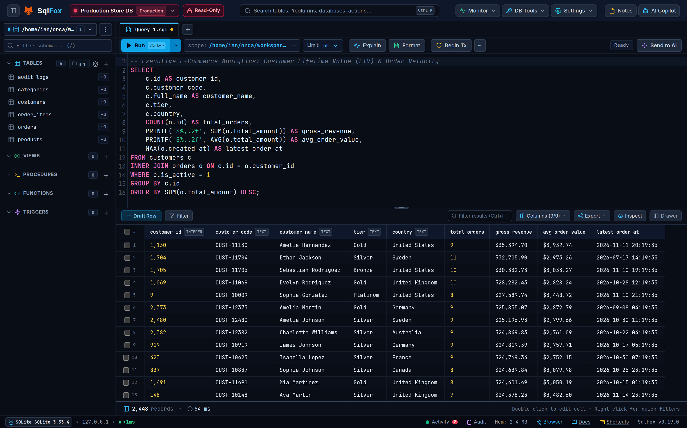

<div align="center">

  <a href="https://github.com/herliansyah/sqlfox">
    
  </a>

  <h1>SqlFox</h1>

  <p>Single-binary database manager and CLI for PostgreSQL, MySQL, MariaDB, and SQLite.</p>

[](https://github.com/herliansyah/sqlfox/releases)
[](https://golang.org)
[](https://github.com/herliansyah/sqlfox/actions)
[](LICENSE)

[English](README.md) · [Bahasa Indonesia](README_ID.md) · [User Guide (EN)](docs/USER_GUIDE.md) · [Panduan (ID)](docs/USER_GUIDE_ID.md) · [Screenshots](docs/SCREENSHOTS.md)

</div>

---

SqlFox is a Go binary with an embedded Svelte 5 web UI. It runs as a local desktop window (via Chromium/Edge `--app` mode), in a browser tab, or headlessly from the terminal without Electron or CGO dependencies.

<p align="center">
  
</p>

More screenshots (ERD, Safety Guard, Flight Recorder, Structure Sync, AI Copilot) are in [docs/SCREENSHOTS.md](docs/SCREENSHOTS.md).

## Features

- **Database Support**: Pure-Go drivers for PostgreSQL (9.6–16+), MySQL (5.7–9.x), MariaDB (10.3–11.x), and SQLite (3.x).
- **Desktop & Web Mode**: Opens in a frameless Chromium/Edge `--app` window by default, in a standard browser (`--browser`), or as a background server (`--no-browser`).
- **Query Editor & Virtual Grid**: Multi-tab SQL execution (`Ctrl+Alt+Enter` / `F5`), NDJSON streaming, inline row/cell editing (when a primary key exists), and a vertical record/JSON viewer.
- **Safety Guard**: Parses destructive queries (`DROP`, `TRUNCATE`, `UPDATE`/`DELETE` without `WHERE`) before execution, runs a bounded `SELECT COUNT(*)` check, and requires typing the table name to confirm.
- **DBA & Schema Tools**: Visual ERD canvas, table/view/procedure/trigger designers, schema diff & structure sync, cross-connection data transfer, 1-second interval telemetry (QPS, threads, lock waits), and root-blocker processlist triage.
- **BYOK AI Copilot**: Optional query tuning and index suggestions using your own key (Claude, OpenAI, Gemini, DeepSeek, or local Ollama). Sends DDL/schema metadata only, no table rows.
- **Security**: Connection credentials encrypted at rest with AES-256-GCM + Argon2id. Binds to `127.0.0.1` by default, with optional `--lan` mode (Master PIN) and TLS (`--tls`, `--tls-cert`, `--tls-key`).

## Installation

### Prebuilt Binary

Download the latest release (**v0.20.1**) from [GitHub Releases](https://github.com/herliansyah/sqlfox/releases) for Linux, macOS, or Windows (`amd64` / `arm64`).

**Linux (amd64):**
```bash
curl -sL https://github.com/herliansyah/sqlfox/releases/download/v0.20.1/sqlfox-v0.20.1-linux-amd64.tar.gz | tar -xz
./sqlfox
```

**macOS (Apple Silicon):**
```bash
curl -sL https://github.com/herliansyah/sqlfox/releases/download/v0.20.1/sqlfox-v0.20.1-darwin-arm64.tar.gz | tar -xz
./sqlfox
```

**Linux Desktop Entry:**
```bash
./sqlfox desktop install
```

### Docker

```bash
docker run -d \
  --name sqlfox \
  -p 127.0.0.1:8080:8080 \
  -v sqlfox_data:/data \
  --add-host=host.docker.internal:host-gateway \
  ghcr.io/herliansyah/sqlfox:latest
```

Or with Docker Compose:
```bash
docker compose up -d
```

### Go Install / Build from Source

```bash
go install github.com/herliansyah/sqlfox/cmd/sqlfox@latest
```

Or build locally:
```bash
git clone https://github.com/herliansyah/sqlfox.git
cd sqlfox
npm ci && npm --prefix web/frontend ci && npm run build:svelte
go build -o sqlfox ./cmd/sqlfox
```

## CLI Usage

```text
Usage:
  sqlfox [command] [flags]
  sqlfox [server-flags]

Commands:
  query     Execute SQL queries or scripts (table, json, ndjson, csv)
  transfer  Stream data transfer between connections
  job       Run declarative automation pipelines
  advise    Analyze query AST and suggest ESR indexes
  stop      Stop a running background SqlFox instance
  desktop   Manage desktop launcher (install, uninstall, status)
  help      Show help

Server Flags:
  -port int          Port to listen on (default 8080)
  -host string       Bind address (default "127.0.0.1")
  -lan               Enable LAN access (binds 0.0.0.0 with Master PIN)
  -pass string       Master password for vault encryption (default: ~/.sqlfox/master.key)
  -db string         Path to config database (default: ~/.sqlfox/config.db)
  -app               Launch in Chromium/Edge --app window (default true)
  -browser           Open in standard browser tab
  -no-browser        Run headless without opening a window
  -strict-port       Exit if port is already in use
  -log-level string  debug, info, warn, error, silent (default "info")
  -log-file string   Write logs to file
  -log-format string text or json (default "text")
  -silent, -q        Suppress terminal output
```

### Examples

```bash
# Start desktop window on port 9000
sqlfox -port 9000

# Start headless server
sqlfox -port 9000 -no-browser

# Run a query and output JSON
sqlfox query --dsn "root:secret@tcp(127.0.0.1:3306)/app" --sql "SELECT id, email FROM users" --format json

# Pipe SQL from stdin
echo "SELECT count(*) FROM orders WHERE status = 'pending';" | sqlfox query --dsn "$DATABASE_URL" --format csv

# Get index recommendations
sqlfox advise --dsn "$DATABASE_URL" --sql "SELECT * FROM orders WHERE user_id = 42 ORDER BY created_at DESC"

# Stop background instance
sqlfox stop
```

## Architecture

- **Backend**: Go 1.26+, pure-Go SQL drivers, SQL AST guard, Argon2id + AES-256-GCM vault, and CLI runner.
- **Frontend**: Svelte 5 + CodeMirror 6, compiled and embedded via `//go:embed`.

Details: [ARCHITECTURE.md](ARCHITECTURE.md) and [SECURITY.md](SECURITY.md).

## License

[MIT](LICENSE)
