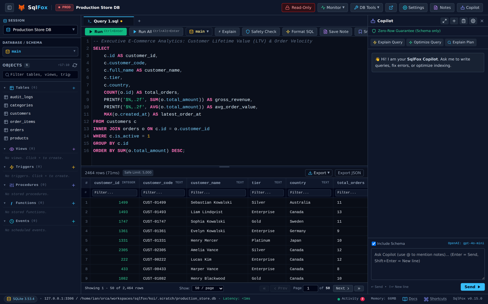
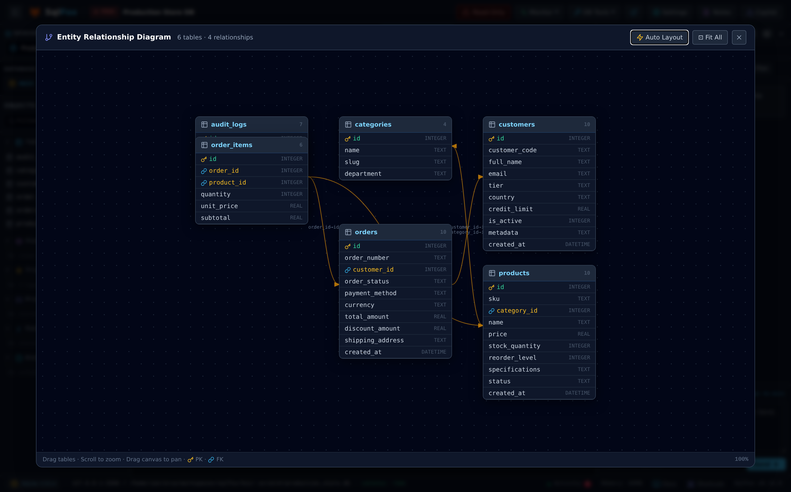
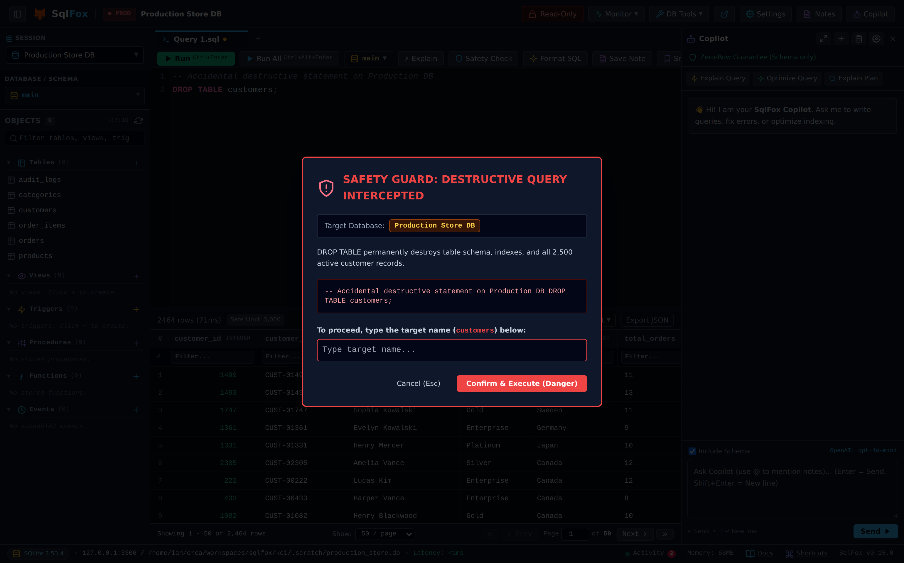
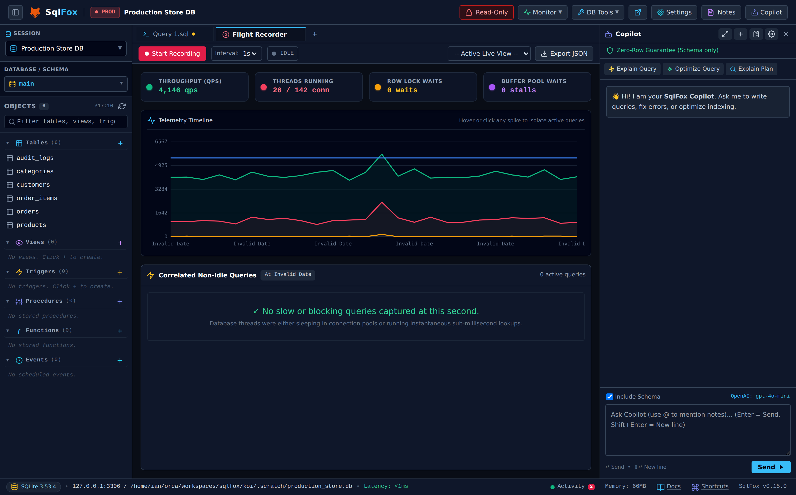
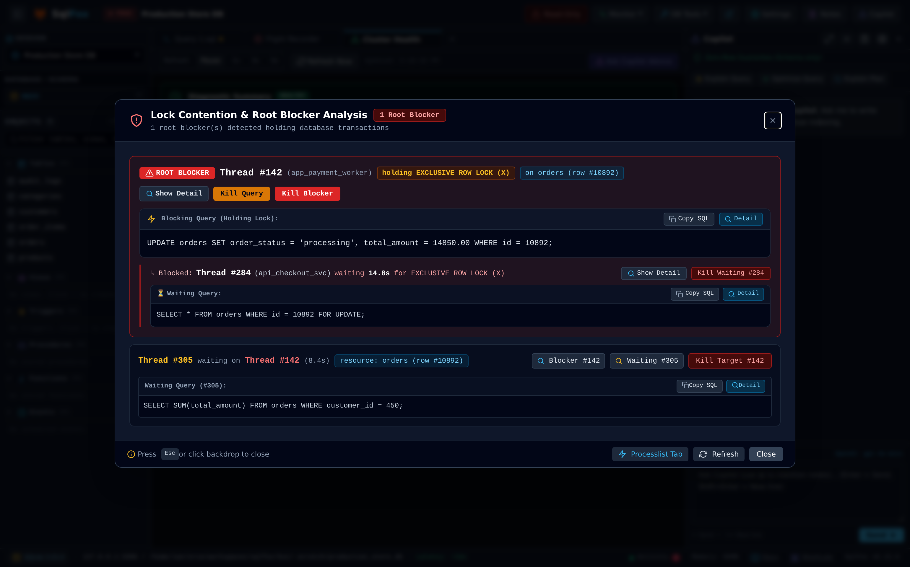
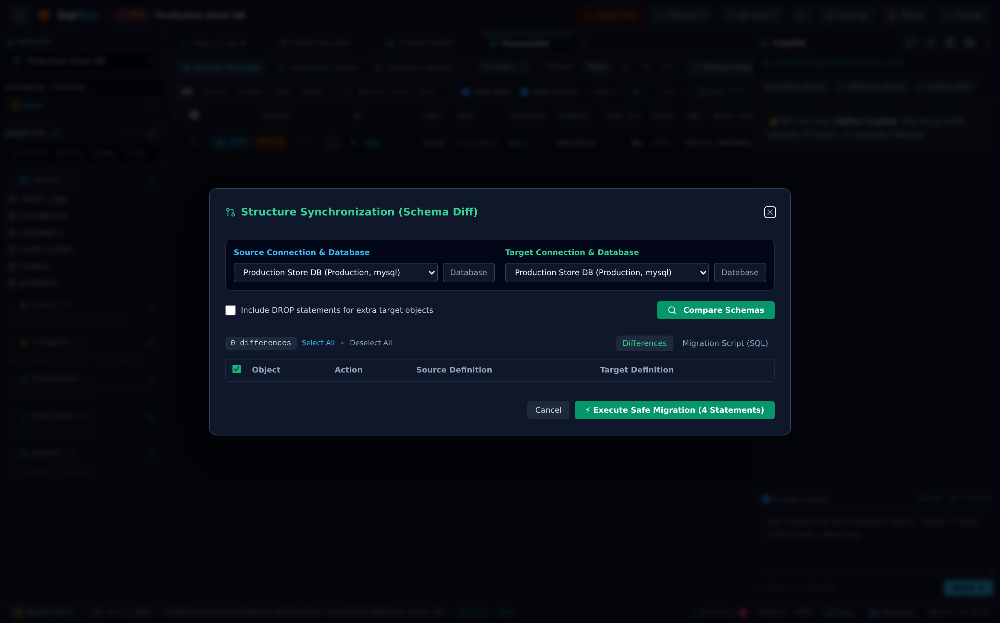
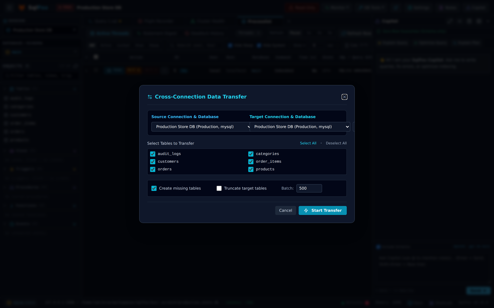
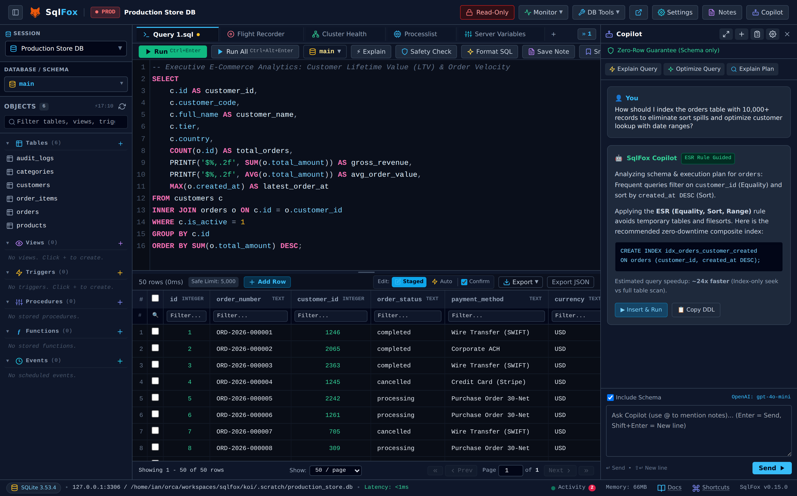
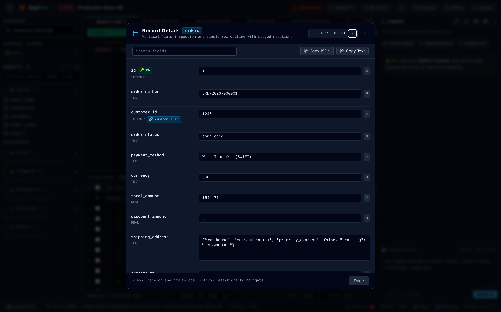

<div align="center">

  <a href="https://github.com/herliansyah/sqlfox">
    
  </a>

  <h1>SqlFox</h1>

  <p><b>High-Performance, Single-Binary Database Manager &amp; Headless Automation CLI</b></p>
  <p><i>Tailored for PostgreSQL, MySQL, MariaDB, and SQLite with zero external dependencies.</i></p>

[](https://github.com/herliansyah/sqlfox/releases)
[](https://golang.org)
[](ARCHITECTURE.md)
[](ARCHITECTURE.md)
[](https://github.com/herliansyah/sqlfox/releases)
[](https://github.com/herliansyah/sqlfox/releases)
[](https://opensource.org/licenses/MIT)
[](https://github.com/herliansyah/sqlfox/actions)

<br />

[ 🇬🇧 English ](README.md) &nbsp;•&nbsp; [ 🇮🇩 Bahasa Indonesia ](README_ID.md) &nbsp;•&nbsp; [ 📖 User Guide (EN) ](docs/USER_GUIDE.md) &nbsp;•&nbsp; [ 📖 Panduan Pengguna (ID) ](docs/USER_GUIDE_ID.md) &nbsp;•&nbsp; [ 📸 Visual Showcase (16 Captures) ](docs/SCREENSHOTS.md)

</div>

---

### Why SqlFox?

Most modern database tools are either bulky Electron apps consuming hundreds of megabytes of RAM before connecting, or terminal-only clients lacking intuitive visual ergonomics. **SqlFox delivers the best of both worlds**:

- ⚡ **Lightweight & Blazing Fast**: Single static binary compiled with pure-Go drivers (`CGO_ENABLED=0`). Boots in under **1 second** and operates strictly within a **< 100MB RAM** ceiling even with 1,000+ tables.
- 🛡️ **Deterministic Safety Guard™**: Pre-execution AST inspection and row mutation estimation intercepts accidental `DROP TABLE` or `UPDATE`/`DELETE` without `WHERE` before they hit production.
- 🖥️ **Native App Window & Web Workspace**: Launches automatically in a clean frameless native desktop window via Chromium/Edge `--app` mode, in a browser tab, or as a background daemon.
- 🤖 **Private AI Copilot (BYOK)**: Schema-aware query optimization and index advice powered by your own API key (Claude, OpenAI, Gemini, DeepSeek, or local Ollama) with **zero row data leakage**.
- 🔄 **Production-Grade DBA Suite**: Real-time Flight Recorder telemetry, lock contention & root blocker triage, structure sync diffs, and streaming cross-connection data transfer.

---

### 🌟 Core Workspace

<p align="center">
  
</p>
<p align="center">
  <i>The unified SqlFox workspace: High-concurrency SQL editor, multi-tab execution, live stats, and DOM-windowed virtual data grid rendering 10,000+ records at a buttery-smooth 60fps.</i>
</p>

---

### 📸 Highlight Showcase

#### 1. Interactive Visual ERD Canvas
Explore complex relational schemas effortlessly. Drag-and-drop table entities connected by dynamic SVG cubic Bézier curves, with auto-layout, viewport scaling, and column cardinality inspection.

<p align="center">
  
</p>

---

#### 2. Deterministic Safety Guardrails & Row Impact Estimation
Never accidentally drop a table or mutate production rows again. Destructive statements (`DROP`, `TRUNCATE`, unqualified `UPDATE`/`DELETE`) trigger an automated bounded `SELECT COUNT(*)` probe and demand typed table name affirmation before execution.

<p align="center">
  
</p>

---

#### 3. DBA Flight Recorder & Root Blocker Triage
Diagnose production incidents with 1-second interval telemetry recording QPS, running threads, and lock waits correlated with active SQL queries. Isolate root blocker transactions during lock storms with dedicated out-of-band kill triggers.

<p align="center">
  
</p>

<p align="center">
  
</p>

---

#### 4. Structure Sync & Cross-Connection Data Transfer
Compare database schemas across staging and production to generate color-coded DDL diffs and safe migration scripts. Stream tables directly between servers with a bounded memory buffer (<50MB) and transaction rollback safety.

<p align="center">
  
</p>

<p align="center">
  
</p>

---

#### 5. In-Context AI Copilot & Query Tuner
Accelerate SQL development with schema-aware AI assistance. Suggests ESR-guided composite indexes, optimizes slow queries, explains execution plans, and inserts code directly into the editor with 1 click.

<p align="center">
  
</p>

---

#### 6. Vertical Record Inspector & Nested JSON Viewer
Inspect complex rows, multi-line text, and raw payloads comfortably with formatted card views and syntax-highlighted pretty-printed nested JSON.

<p align="center">
  
</p>

---

### 🖼️ Complete Visual Showcase (16 Screenshots)

All captures are taken in high resolution (**2x Retina / HiDPI**) on an enterprise dummy dataset (10,000+ orders, 25,000 order items, customers, and system audit logs). Explore the **[Full Feature Gallery (docs/SCREENSHOTS.md)](docs/SCREENSHOTS.md)**:

| Category | High-Resolution Captures |
| :--- | :--- |
| **Workspace & Querying** | [01. Hero Workspace](docs/assets/screenshots/01_hero_workspace.png) • [15. Record Inspector](docs/assets/screenshots/15_vertical_record_inspector.png) • [16. AI Copilot Assistant](docs/assets/screenshots/16_ai_copilot_assistant.png) |
| **Safety & Guardrails** | [02. Safety Guard Challenge Modal](docs/assets/screenshots/02_safety_guard_destructive.png) |
| **DBA & Live Telemetry** | [03. Flight Recorder Telemetry](docs/assets/screenshots/03_flight_recorder_telemetry.png) • [04. Cluster & Replication](docs/assets/screenshots/04_cluster_replication_inspector.png) • [05. Lock Contention & Root Blocker](docs/assets/screenshots/05_lock_contention_root_blocker.png) • [06. Real-Time Processlist](docs/assets/screenshots/06_realtime_processlist.png) • [13. Storage Diagnostics](docs/assets/screenshots/13_storage_health_diagnostics.png) • [14. Server Variables Tuning](docs/assets/screenshots/14_server_variables_tuning.png) |
| **DB Tools & Sync** | [07. Smart Seed FK Exporter](docs/assets/screenshots/07_smart_seed_fk_exporter.png) • [08. Structure Sync Diff](docs/assets/screenshots/08_structure_sync_schema_diff.png) • [09. Cross-Connection Data Transfer](docs/assets/screenshots/09_cross_connection_data_transfer.png) • [10. Row-Level Data Sync](docs/assets/screenshots/10_row_level_data_sync.png) • [11. Visual ERD Canvas](docs/assets/screenshots/11_visual_erd_canvas.png) • [12. Visual Table Designer](docs/assets/screenshots/12_visual_table_designer.png) |

---

### 🚀 Key Features

- **Multi-Engine Support**: Native pure-Go drivers for **PostgreSQL** (9.6–16+ via pgx), **MySQL** (5.7, 8.0, 8.4 LTS, 9.x), **MariaDB** (10.3–11.x), and local **SQLite** (3.x).
- **Standalone Native Window**: Starts as a native desktop application window via Chromium/Edge `--app` mode without requiring Electron. Includes `sqlfox desktop install` for Linux desktop entries.
- **Fixed-Height Virtual Data Grid**: Uniform 32px DOM row windowing maintaining `< 500` active DOM nodes across 100,000+ rows.
- **Micro-Chunk NDJSON Streaming**: TTFR (Time to First Row) under 50ms with an initial 20-row flush, cancellable out-of-band at any time.
- **Query Result Mutations**: Directly edit cells, insert draft rows, duplicate records, or delete rows on query results with a resolved primary key.
- **Multi-Statement Execution & Multi-Result Tabs**: Execute complex SQL batches (`Ctrl+Alt+Enter` or `F5`) and review isolated result sub-tabs with per-statement execution times and row counts.
- **Visual Programmability Designers**: Interactive visual editors for Views, Stored Procedures, Functions, Triggers, and Scheduled Events with embedded CodeMirror syntax editors.
- **Encrypted Connection Vault**: Database passwords and client SSL keys encrypted at rest via **AES-256-GCM** (with per-field authenticated binding) and **Argon2id**.
- **Ingress Security**: Default loopback binding (`127.0.0.1`), DNS rebinding protection (LAN mode restricted to private/loopback hosts), and byte-for-byte Same-Origin validation against cross-port CSRF.
- **Remote LAN Mode & TLS Encryption**: Tablet and remote browser access (`--lan`) guarded by Master PIN authentication and brute-force lockout, with built-in HTTPS/TLS encryption (`--tls`, `--tls-cert`, `--tls-key`).
- **Signed Self-Update**: In-app updates are gated by an official-origin allowlist and verified against an Ed25519-signed checksum manifest (fail-closed) before the binary is replaced.

---

### 📦 Quick Start & Installation

#### Standalone Binary (Recommended)

Download the latest pre-compiled static binary (**v0.16.1**) from [GitHub Releases](https://github.com/herliansyah/sqlfox/releases):

| OS | Architecture | Archive Format |
| :--- | :--- | :--- |
| **Linux** | `x86_64` (amd64), `ARM64` | `.tar.gz` |
| **macOS** | Apple Silicon (`arm64`), Intel (`amd64`) | `.tar.gz` |
| **Windows** | `x86_64` (amd64), `ARM64` | `.zip` |

**Linux (amd64):**
```bash
curl -sL https://github.com/herliansyah/sqlfox/releases/download/v0.16.1/sqlfox-v0.16.1-linux-amd64.tar.gz | tar -xz
./sqlfox
```

**macOS (Apple Silicon):**
```bash
curl -sL https://github.com/herliansyah/sqlfox/releases/download/v0.16.1/sqlfox-v0.16.1-darwin-arm64.tar.gz | tar -xz
./sqlfox
```

**Register Desktop Launcher (Linux):**
```bash
./sqlfox desktop install
```

#### Docker Container

```bash
docker run -d \
  --name sqlfox \
  -p 8080:8080 \
  -v sqlfox_data:/data \
  --add-host=host.docker.internal:host-gateway \
  ghcr.io/herliansyah/sqlfox:latest
```

Or deploy via Docker Compose:
```bash
docker compose up -d
```

#### Go Install / Build from Source

```bash
# Install via Go toolchain
go install github.com/herliansyah/sqlfox/cmd/sqlfox@latest

# Or build from source
git clone https://github.com/herliansyah/sqlfox.git
cd sqlfox
go build -o sqlfox ./cmd/sqlfox
```

---

### 💻 Command-Line Interface (CLI)

SqlFox functions both as an interactive desktop workspace and a headless automation utility:

```text
Usage:
  sqlfox [command] [flags]
  sqlfox [server-flags]    (launches native desktop app or web workspace)

Commands:
  query     Execute SQL queries or scripts with streaming output (table, json, ndjson, csv)
  transfer  Stream cross-connection data transfer between databases
  job       Run declarative database automation pipelines
  advise    Analyze query AST and generate ESR index recommendations
  stop      Stop a running background SqlFox instance
  desktop   Manage desktop application launcher (install, uninstall, status)
  help      Display command help

Server Options:
  -port int          Port to listen on (default 8080, with automatic port hunting)
  -host string       Interface address to bind (default "127.0.0.1")
  -lan               Enable remote LAN and tablet access (binds 0.0.0.0 and displays Master PIN)
  -pass string       Master password for vault encryption (or uses ~/.sqlfox/master.key)
  -db string         Path to config vault database (default: ~/.sqlfox/config.db)
  -app               Launch in standalone native window mode using Chrome/Edge/Chromium (default true)
  -browser           Force launch in standard web browser tab instead of native app window
  -no-browser        Disable automatic browser or app window launch on startup
  -strict-port       Exit immediately if specified port is occupied
  -log-level string  Log verbosity: debug, info, warn, error, silent (default "info")
  -log-file string   File path for persistent log sink
  -log-format string Log output format: text, json (default "text")
  -silent, -q        Suppress terminal output while retaining file logs
```

#### CLI Examples

```bash
# Launch in native app window on port 9000
sqlfox -port 9000

# Launch headless daemon without opening window or browser
sqlfox -port 9000 -no-browser

# Execute query headlessly and output clean JSON
sqlfox query --dsn "root:secret@tcp(127.0.0.1:3306)/app" --sql "SELECT id, email FROM users" --format json

# Pipe SQL via STDIN in CI/CD pipelines
echo "SELECT count(*) FROM orders WHERE status = 'pending';" | sqlfox query --dsn "$DATABASE_URL" --format csv

# Run heuristic index advisor on a slow query
sqlfox advise --dsn "$DATABASE_URL" --sql "SELECT * FROM orders WHERE user_id = 42 ORDER BY created_at DESC"

# Gracefully stop running background instance
sqlfox stop
```

---

### 🏗️ Architecture

```
┌────────────────────────────────────────────────────────────────────────┐
│ User Interface: Desktop App Window / Browser / Tablet / LAN Client      │
│        ▲                                                               │
│        │ Local HTTP REST & SSE (Protected by Master PIN & Origin Guard)│
│        ▼                                                               │
│ Go Core Daemon (< 100MB RAM, Single Static Binary)                     │
│   ├── Safety Guard™: Deterministic AST Analyzer & Row Impact Probes    │
│   ├── Session Manager: Singleflight Deduplication & Control Pools      │
│   ├── Virtual Data Grid: Fixed-Height DOM Windowing & Micro-Chunk NDJSON│
│   ├── AI Firewall: Schema-Only Context Sanitizer (BYOK)                │
│   └── Connection Vault: AES-256-GCM & Argon2id at Rest                 │
│   └── Desktop Manager: Frameless Chromium/Edge Window & OS Integration │
└────────┬─────────────────────────────────────────────┬─────────────────┘
         │                                             │
         │ TLS / Local Socket (MySQL, PG, SQLite)      │ HTTPS (DDL Metadata Only)
         ▼                                             ▼
[ Target Database Instances ]                 [ AI Provider API ]
(MySQL, MariaDB, PostgreSQL, SQLite)          (Claude, OpenAI, Gemini, Ollama)
```

For in-depth architectural specifications, see **[ARCHITECTURE.md](ARCHITECTURE.md)** and **[SECURITY.md](SECURITY.md)**.

---

### 📄 License

Distributed under the [MIT](LICENSE) open-source license.
