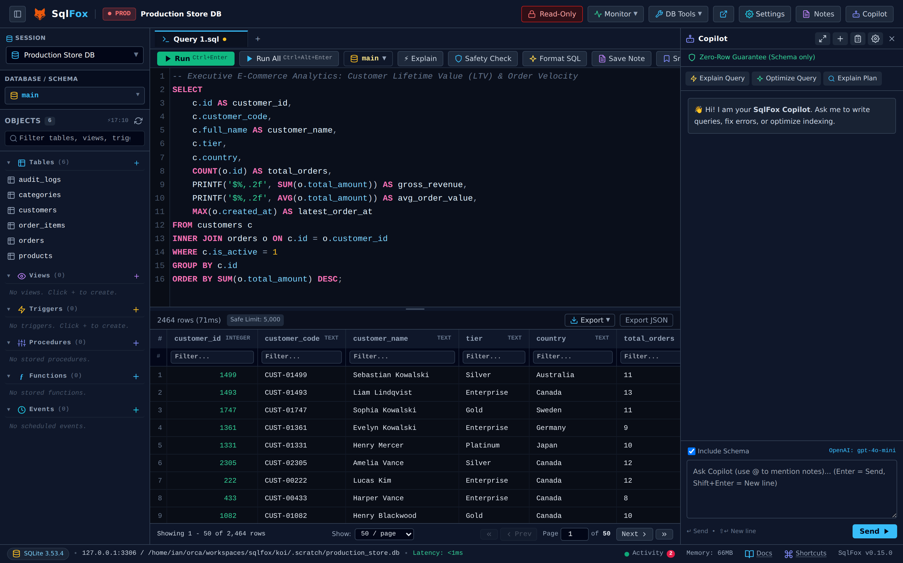
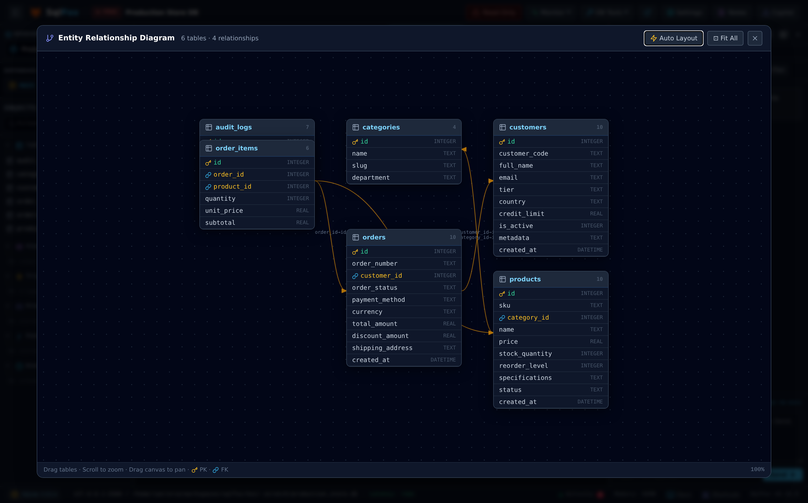
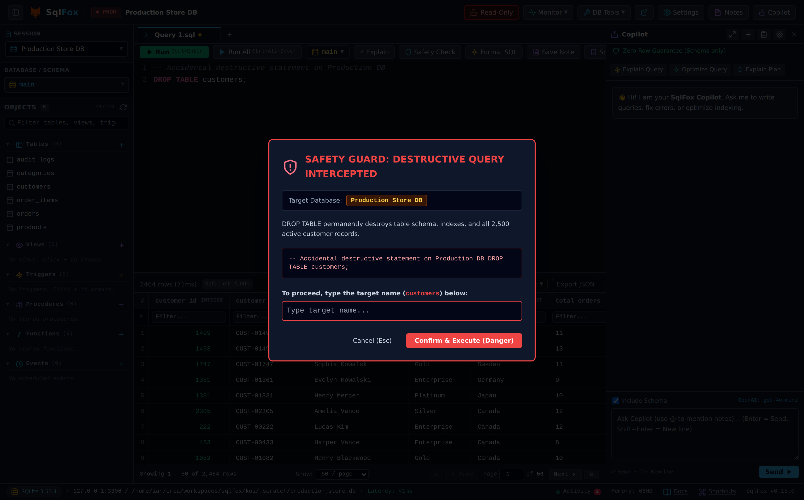
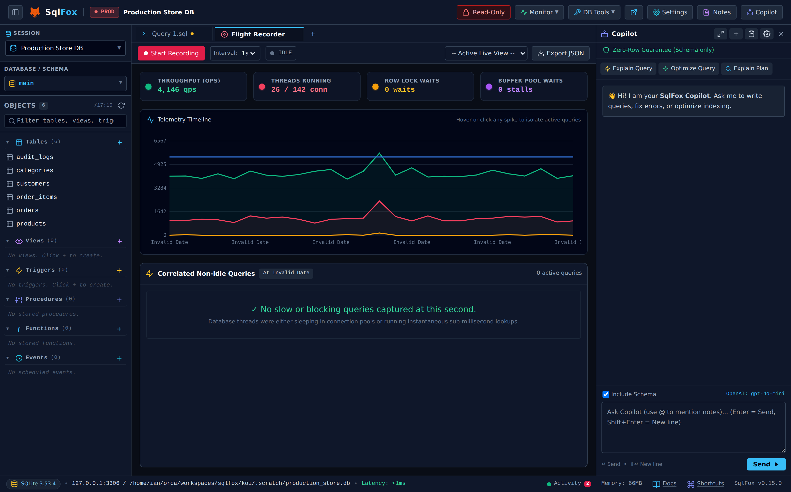
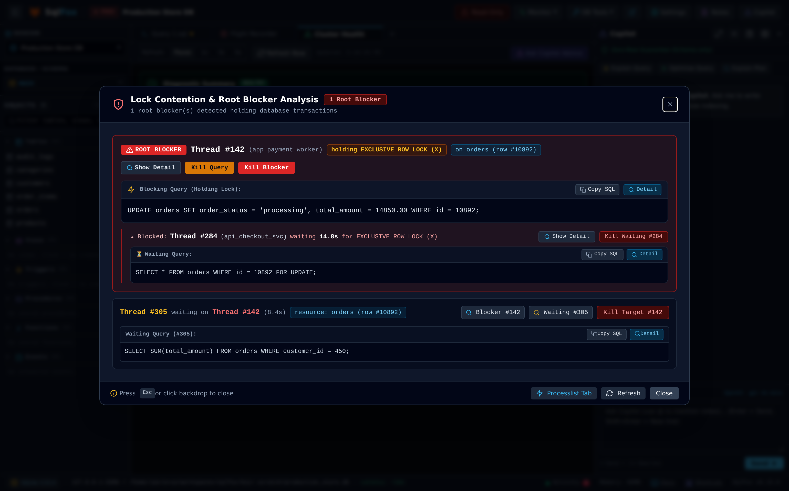
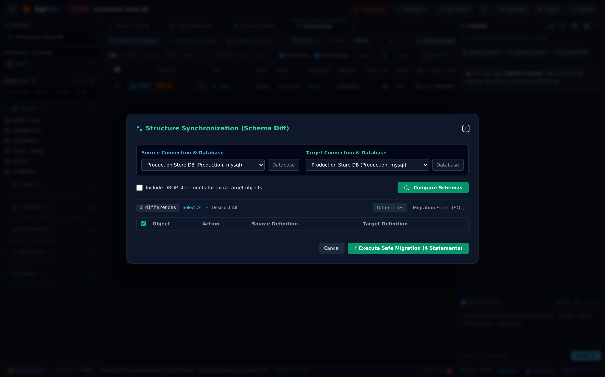
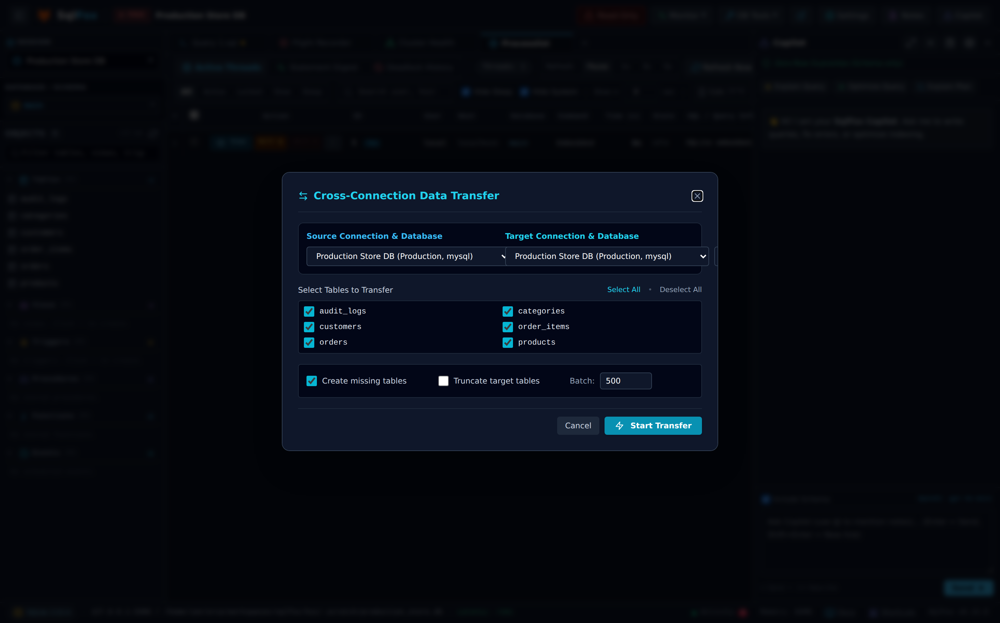
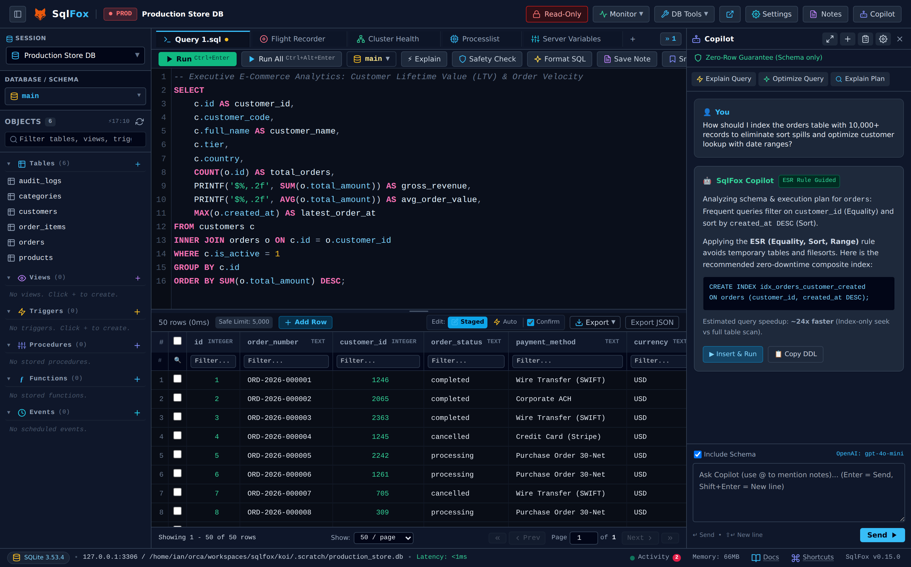
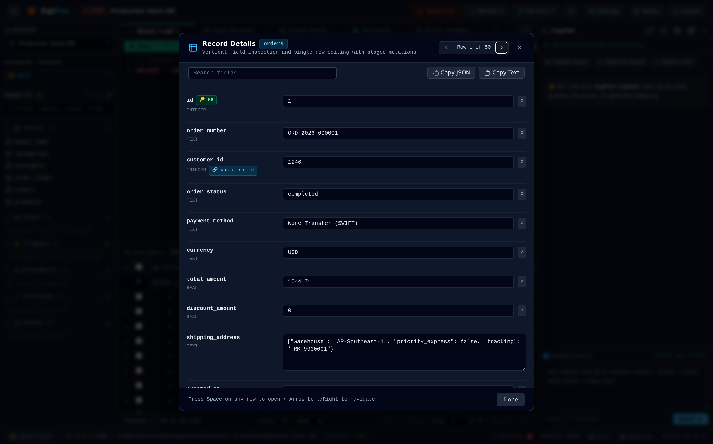

<div align="center">

  <a href="https://github.com/herliansyah/sqlfox">
    
  </a>

  <h1>SqlFox</h1>

  <p><b>Database Manager &amp; Headless CLI Ringan Berperforma Tinggi</b></p>
  <p><i>Dirancang untuk PostgreSQL, MySQL, MariaDB, dan SQLite tanpa dependensi runtime eksternal.</i></p>

[](https://github.com/herliansyah/sqlfox/releases)
[](https://golang.org)
[](ARCHITECTURE.md)
[](ARCHITECTURE.md)
[](https://github.com/herliansyah/sqlfox/releases)
[](https://github.com/herliansyah/sqlfox/releases)
[](https://opensource.org/licenses/MIT)
[](https://github.com/herliansyah/sqlfox/actions)

<br />

[ 🇬🇧 English ](README.md) &nbsp;•&nbsp; [ 🇮🇩 Bahasa Indonesia ](README_ID.md) &nbsp;•&nbsp; [ 📖 Panduan Pengguna (ID) ](docs/USER_GUIDE_ID.md) &nbsp;•&nbsp; [ 📖 User Guide (EN) ](docs/USER_GUIDE.md) &nbsp;•&nbsp; [ 📸 Galeri Visual (16 Screenshot) ](docs/SCREENSHOTS.md)

</div>

---

### Mengapa SqlFox?

Sebagian besar aplikasi database modern berbasis Electron yang lambat dan memakan ratusan megabyte RAM sebelum koneksi terbentuk, atau hanya berupa CLI terminal tanpa kenyamanan visual. **SqlFox menyatukan keunggulan keduanya**:

- ⚡ **Ringan & Secepat Kilat**: Berkas binary tunggal (*single static binary*) dengan driver Go murni (`CGO_ENABLED=0`). Start dalam **< 1 detik** dan beroperasi ketat di bawah plafon **< 100MB RAM** bahkan pada skema besar dengan 1.000+ tabel.
- 🛡️ **Safety Guard™ Deterministik**: Mencegat operasi destruktif (`DROP TABLE`, `UPDATE`/`DELETE` tanpa `WHERE`) via analisis sintaks AST dan estimasi dampak baris sebelum menyentuh database produksi.
- 🖥️ **Aplikasi Desktop Mandiri & Web**: Terbuka otomatis sebagai jendela aplikasi desktop frameless menggunakan mode `--app` Chromium/Edge, di tab browser standar, atau sebagai daemon latar belakang.
- 🤖 **AI Copilot Sadar Privasi (BYOK)**: Rekomendasi indeks komposit ESR dan optimasi kueri menggunakan API key pribadi (Claude, OpenAI, Gemini, DeepSeek, atau Ollama lokal) dengan **garansi nol kebocoran data baris**.
- 🔄 **Fitur DBA Skala Enterprise**: Telemetri Flight Recorder per detik, isolasi root blocker saat lock contention, diff migrasi skema Structure Sync, dan transfer data antar-koneksi streaming.

---

### 🌟 Ruang Kerja Utama (Core Workspace)

<p align="center">
  
</p>
<p align="center">
  <i>Ruang kerja SqlFox: Editor SQL konkurensi tinggi, eksekusi multi-tab, statistik real-time, dan virtual data grid berbasis windowing DOM yang menampilkan 10.000+ baris data dengan lancar pada 60fps.</i>
</p>

---

### 📸 Sorotan Fitur Unggulan

#### 1. Kanvas Visual ERD Interaktif
Pahami relasi skema database yang kompleks dengan mudah. Entitas tabel dapat digeser (*drag-and-drop*) dengan konektor kurva Bézier SVG kubik dinamis, tata letak otomatis (*auto-layout*), penskalaan viewport, dan visualisasi kardinalitas foreign key.

<p align="center">
  
</p>

---

#### 2. Proteksi Safety Guard & Estimasi Baris Terdampak
Hindari bencana salah drop tabel atau update massal di produksi. Kueri berbahaya (`DROP`, `TRUNCATE`, `UPDATE`/`DELETE` tanpa `WHERE`) secara otomatis dicegat, diuji dengan probe `SELECT COUNT(*)` berbatas waktu, dan mewajibkan pengetikan nama tabel sebelum eksekusi.

<p align="center">
  
</p>

---

#### 3. Perekam Telemetri (Flight Recorder) & Triage Root Blocker
Diagnosa insiden performa secara langsung dengan telemetri per 1 detik yang merekam lonjakan QPS, thread aktif, dan waktu tunggu lock yang dikorelasikan langsung dengan teks SQL yang sedang berjalan. Isolasi thread biang keladi (*root blocker*) saat badai lock dengan tombol terminasi langsung.

<p align="center">
  
</p>

<p align="center">
  
</p>

---

#### 4. Sinkronisasi Struktur (Structure Sync) & Transfer Data Antar-Koneksi
Bandingkan skema database antar-lingkungan (staging vs produksi) untuk menghasilkan diff DDL berwarna dan skrip migrasi berurutan yang aman. Salin tabel langsung antar-koneksi dengan buffer memori terikat (<50MB) dan perlindungan rollback transaksi.

<p align="center">
  
</p>

<p align="center">
  
</p>

---

#### 5. AI Copilot & Penyetel Kueri (Query Tuner)
Percepat pengembangan SQL dengan asisten AI yang memahami konteks skema. Memberikan saran indeks komposit berbasis aturan ESR, mengoptimalkan kueri lambat, menganalisis explain plan, dan menyisipkan SQL ke editor dalam 1 klik.

<p align="center">
  
</p>

---

#### 6. Inspektur Rekaman Vertikal & Penampil JSON Berformat
Periksa detail baris yang lebar, teks multibaris, dan payload data kompleks secara nyaman menggunakan tampilan kartu vertikal dan penampil JSON berformat (*pretty-printed*) dengan pewarnaan sintaks.

<p align="center">
  
</p>

---

### 🖼️ Galeri Visual Lengkap (16 Screenshot)

Seluruh tangkapan layar diambil dalam resolusi tinggi (**2x Retina / HiDPI**) dengan data dummy skala enterprise (10.000+ pesanan, 25.000 item pesanan, pelanggan, dan log audit). Kunjungi **[Galeri Visual Lengkap (docs/SCREENSHOTS.md)](docs/SCREENSHOTS.md)**:

| Kategori | Tangkapan Layar Resolusi Tinggi |
| :--- | :--- |
| **Workspace & Kueri** | [01. Hero Workspace](docs/assets/screenshots/01_hero_workspace.png) • [15. Inspektur Rekaman](docs/assets/screenshots/15_vertical_record_inspector.png) • [16. AI Copilot Assistant](docs/assets/screenshots/16_ai_copilot_assistant.png) |
| **Keamanan & Guardrail** | [02. Modal Safety Guard](docs/assets/screenshots/02_safety_guard_destructive.png) |
| **DBA & Telemetri** | [03. Telemetri Flight Recorder](docs/assets/screenshots/03_flight_recorder_telemetry.png) • [04. Inspektur Replikasi Cluster](docs/assets/screenshots/04_cluster_replication_inspector.png) • [05. Lock Contention & Root Blocker](docs/assets/screenshots/05_lock_contention_root_blocker.png) • [06. Processlist Real-Time](docs/assets/screenshots/06_realtime_processlist.png) • [13. Diagnostik Storage](docs/assets/screenshots/13_storage_health_diagnostics.png) • [14. Penalaan Server Variables](docs/assets/screenshots/14_server_variables_tuning.png) |
| **DB Tools & Sinkronisasi** | [07. Smart Seed FK Exporter](docs/assets/screenshots/07_smart_seed_fk_exporter.png) • [08. Diff Structure Sync](docs/assets/screenshots/08_structure_sync_schema_diff.png) • [09. Transfer Data Antar-Koneksi](docs/assets/screenshots/09_cross_connection_data_transfer.png) • [10. Sinkronisasi Data Baris](docs/assets/screenshots/10_row_level_data_sync.png) • [11. Kanvas Visual ERD](docs/assets/screenshots/11_visual_erd_canvas.png) • [12. Visual Table Designer](docs/assets/screenshots/12_visual_table_designer.png) |

---

### 🚀 Kemampuan Utama

- **Dukungan Multi-Engine**: Driver Go murni tanpa CGO untuk **PostgreSQL** (9.6–16+ via pgx), **MySQL** (5.7, 8.0, 8.4 LTS, 9.x), **MariaDB** (10.3–11.x), dan **SQLite** lokal (3.x).
- **Mode Aplikasi Desktop Mandiri**: Berjalan sebagai jendela aplikasi desktop menggunakan mode `--app` Chromium/Edge tanpa Electron. Mendukung registrasi menu desktop Linux via `sqlfox desktop install`.
- **Virtual Data Grid Berketinggian Tetap**: Virtualisasi baris DOM seragam 32px yang mempertahankan `< 500` node DOM aktif pada dataset 100.000+ baris.
- **Streaming NDJSON Micro-Chunk**: TTFR (Time to First Row) di bawah 50ms dengan flush langsung 20 baris pertama, dapat dibatalkan seketika tanpa socket hang.
- **Mutasi Data Langsung pada Hasil Kueri**: Edit sel langsung, buat draf baris baru, duplikasi rekaman, atau hapus baris langsung dari hasil kueri SELECT yang memiliki Primary Key.
- **Eksekusi Multi-Statement & Tab Multi-Hasil**: Eksekusi batch SQL multi-pernyataan (`Ctrl+Alt+Enter` atau `F5`) dengan sub-tab terisolasi untuk tiap hasil lengkap dengan waktu eksekusi dan jumlah baris.
- **Desainer Visual Objek Terprogram**: Dialog desainer interaktif untuk Views, Stored Procedures, Functions, Triggers, dan Scheduled Events dengan editor CodeMirror bawaan.
- **Connection Vault Terenkripsi**: Kata sandi database dan kunci privat SSL dienkripsi saat istirahat (*at rest*) menggunakan **AES-256-GCM** dan KDF **Argon2id**.
- **Keamanan Akses Ingress**: Pengikatan default pada loopback (`127.0.0.1`), proteksi DNS rebinding, dan validasi Same-Origin bita-demi-bita penangkal CSRF lintas-port.
- **Akses Jaringan Lokal (LAN)**: Akses multi-perangkat via flag `--lan` yang dilindungi autentikasi Master PIN dan karantina otomatis terhadap brute force.

---

### 📦 Panduan Instalasi & Mulai Cepat

#### Berkas Binary Siap Pakai (Rekomendasi)

Unduh paket binary versi rilis terbaru (**v0.15.0**) langsung dari [GitHub Releases](https://github.com/herliansyah/sqlfox/releases):

| Sistem Operasi | Arsitektur CPU | Format Berkas |
| :--- | :--- | :--- |
| **Linux** | `x86_64` (amd64), `ARM64` | `.tar.gz` |
| **macOS** | Apple Silicon (`arm64`), Intel (`amd64`) | `.tar.gz` |
| **Windows** | `x86_64` (amd64), `ARM64` | `.zip` |

**Linux (amd64):**
```bash
curl -sL https://github.com/herliansyah/sqlfox/releases/download/v0.15.0/sqlfox-v0.15.0-linux-amd64.tar.gz | tar -xz
./sqlfox
```

**macOS (Apple Silicon):**
```bash
curl -sL https://github.com/herliansyah/sqlfox/releases/download/v0.15.0/sqlfox-v0.15.0-darwin-arm64.tar.gz | tar -xz
./sqlfox
```

**Registrasi Launcher Desktop (Linux):**
```bash
./sqlfox desktop install
```

#### Docker Container

```bash
docker run -d \
  --name sqlfox \
  -p 8080:8080 \
  -v sqlfox_data:/data \
  --add-host=host.docker.internal:host-gateway \
  ghcr.io/herliansyah/sqlfox:latest
```

Atau menggunakan Docker Compose:
```bash
docker compose up -d
```

#### Instalasi via Go Toolchain / Kompilasi Source Code

```bash
# Instalasi menggunakan Go toolchain
go install github.com/herliansyah/sqlfox/cmd/sqlfox@latest

# Kompilasi langsung dari source code
git clone https://github.com/herliansyah/sqlfox.git
cd sqlfox
go build -o sqlfox ./cmd/sqlfox
```

---

### 💻 Antarmuka Baris Perintah (CLI)

SqlFox dapat beroperasi sebagai aplikasi workspace visual maupun utilitas otomatisasi headless di terminal:

```text
Penggunaan:
  sqlfox [perintah] [flag]
  sqlfox [flag-server]     (membuka aplikasi desktop atau antarmuka web)

Perintah:
  query     Eksekusi kueri atau skrip SQL dengan output streaming (table, json, ndjson, csv)
  transfer  Streaming transfer data antar-koneksi database
  job       Jalankan pipeline otomatisasi basis data deklaratif
  advise    Analisis AST kueri dan buat rekomendasi indeks ESR
  stop      Hentikan instance SqlFox yang berjalan di latar belakang
  desktop   Kelola launcher aplikasi desktop (install, uninstall, status)
  help      Tampilkan panduan bantuan perintah

Opsi Server:
  -port int          Port HTTP (default 8080, dengan pemindaian otomatis jika terpakai)
  -host string       Alamat host (default "127.0.0.1")
  -lan               Aktifkan akses LAN/tablet (bind 0.0.0.0 dan tampilkan Master PIN)
  -pass string       Master password enkripsi vault (atau gunakan ~/.sqlfox/master.key)
  -db string         Path database vault konfigurasi (default: ~/.sqlfox/config.db)
  -app               Buka dalam mode jendela desktop mandiri via Chrome/Edge (default true)
  -browser           Buka di tab browser reguler alih-alih jendela app mandiri
  -no-browser        Jangan otomatis membuka browser/jendela saat startup
  -strict-port       Keluar jika port yang diminta sudah terpakai
  -log-level string  Tingkat log: debug, info, warn, error, silent (default "info")
  -log-file string   Path berkas penyimpanan log persisten
  -log-format string Format output log: text, json (default "text")
  -silent, -q        Senyapkan output konsol terminal dengan tetap mencatat ke berkas
```

#### Contoh Perintah CLI

```bash
# Jalankan jendela aplikasi desktop pada port 9000
sqlfox -port 9000

# Jalankan daemon headless di background tanpa membuka browser
sqlfox -port 9000 -no-browser

# Eksekusi kueri headless dengan output JSON rapi
sqlfox query --dsn "root:secret@tcp(127.0.0.1:3306)/app" --sql "SELECT id, email FROM users" --format json

# Alirkan SQL via STDIN dalam pipeline CI/CD
echo "SELECT count(*) FROM orders WHERE status = 'pending';" | sqlfox query --dsn "$DATABASE_URL" --format csv

# Analisis rekomendasi indeks pada kueri lambat
sqlfox advise --dsn "$DATABASE_URL" --sql "SELECT * FROM orders WHERE user_id = 42 ORDER BY created_at DESC"

# Hentikan background instance dengan bersih
sqlfox stop
```

---

### 🏗️ Arsitektur Sistem

```
┌────────────────────────────────────────────────────────────────────────┐
│ Antarmuka Pengguna: Jendela App Mandiri / Browser / Tablet / Klien LAN │
│        ▲                                                               │
│        │ HTTP REST & SSE Lokal (Dilindungi Master PIN & Origin Guard)  │
│        ▼                                                               │
│ Go Core Daemon (< 100MB RAM, Berkas Binary Statis Tunggal)             │
│   ├── Safety Guard™: Penganalisis AST & Probe Dampak Baris             │
│   ├── Session Manager: Deduplikasi Singleflight & Pool Out-of-Band     │
│   ├── Virtual Data Grid: Windowing DOM Tetap & Streaming NDJSON        │
│   ├── AI Firewall: Sanitasi Konteks Skema Saja (BYOK)                  │
│   ├── Connection Vault: Enkripsi AES-256-GCM & Argon2id                │
│   └── Desktop Manager: Jendela Mandiri Chromium/Edge & Integrasi OS    │
└────────┬─────────────────────────────────────────────┬─────────────────┘
         │                                             │
         │ TLS / Socket Lokal (MySQL, PG, SQLite)      │ HTTPS (Metadata DDL Saja)
         ▼                                             ▼
[ Database Target ]                           [ API Provider AI ]
(MySQL, MariaDB, PostgreSQL, SQLite)          (Claude, OpenAI, Gemini, Ollama)
```

Spesifikasi arsitektur dan keamanan mendalam dapat dibaca di **[ARCHITECTURE.md](ARCHITECTURE.md)** dan **[SECURITY.md](SECURITY.md)**.

---

### 📄 Lisensi

Didistribusikan di bawah lisensi terbuka [MIT](LICENSE).
