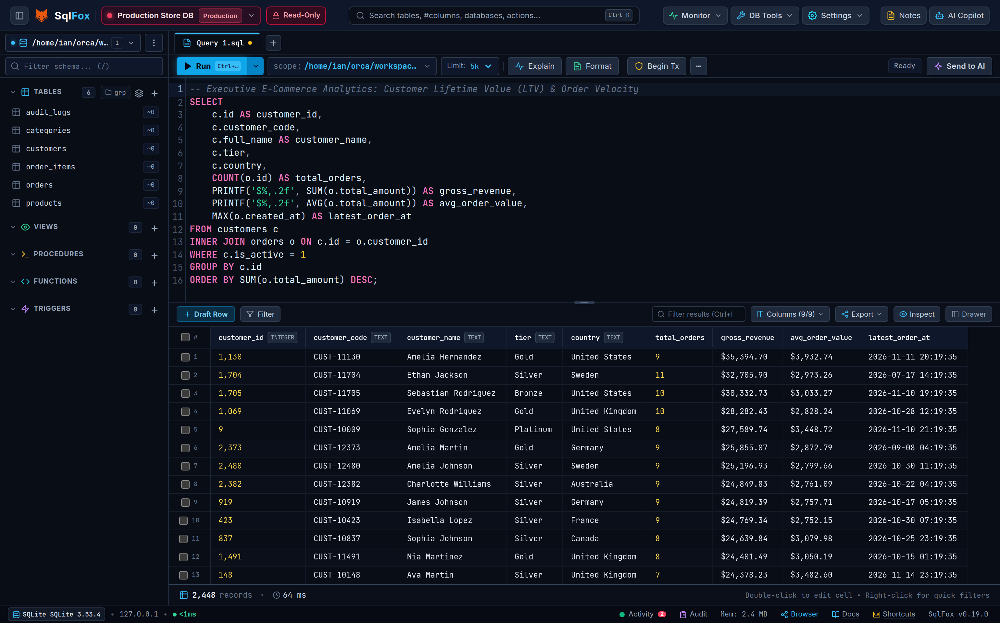

<div align="center">

  <a href="https://github.com/herliansyah/sqlfox">
    
  </a>

  <h1>SqlFox</h1>

  <p>Database manager dan CLI dalam satu binary untuk PostgreSQL, MySQL, MariaDB, dan SQLite.</p>

[](https://github.com/herliansyah/sqlfox/releases)
[](https://golang.org)
[](https://github.com/herliansyah/sqlfox/actions)
[](LICENSE)

[English](README.md) · [Bahasa Indonesia](README_ID.md) · [User Guide (EN)](docs/USER_GUIDE.md) · [Panduan (ID)](docs/USER_GUIDE_ID.md) · [Screenshot](docs/SCREENSHOTS.md)

</div>

---

SqlFox adalah binary Go dengan UI web Svelte 5 tersemat. Bisa dijalankan sebagai jendela aplikasi lokal (lewat mode `--app` Chromium/Edge), di tab browser, atau headless dari terminal tanpa Electron dan tanpa CGO.

<p align="center">
  
</p>

Screenshot lain (ERD, Safety Guard, Flight Recorder, Structure Sync, AI Copilot) ada di [docs/SCREENSHOTS.md](docs/SCREENSHOTS.md).

## Fitur

- **Dukungan Database**: Driver pure-Go untuk PostgreSQL (9.6–16+), MySQL (5.7–9.x), MariaDB (10.3–11.x), dan SQLite (3.x).
- **Mode Desktop & Web**: Default membuka jendela Chromium/Edge `--app` tanpa frame, atau lewat browser biasa (`--browser`), atau sebagai server background (`--no-browser`).
- **Editor Query & Virtual Grid**: Eksekusi multi-tab (`Ctrl+Alt+Enter` / `F5`), streaming NDJSON, edit baris/sel langsung (jika ada primary key), dan viewer record vertikal/JSON.
- **Safety Guard**: Memeriksa query destruktif (`DROP`, `TRUNCATE`, `UPDATE`/`DELETE` tanpa `WHERE`) sebelum dieksekusi, menjalankan `SELECT COUNT(*)` berbatas waktu, lalu meminta konfirmasi ketik nama tabel.
- **Tool DBA & Skema**: Kanvas ERD, desainer tabel/view/procedure/trigger, diff & sinkronisasi struktur skema, transfer data antar-koneksi, telemetri per detik (QPS, thread, lock wait), dan triage root blocker di processlist.
- **BYOK AI Copilot**: Opsional untuk saran optimasi query dan indeks memakai API key sendiri (Claude, OpenAI, Gemini, DeepSeek, atau Ollama lokal). Hanya mengirim metadata DDL/skema, bukan isi baris tabel.
- **Keamanan**: Kredensial koneksi dienkripsi di disk dengan AES-256-GCM + Argon2id. Default bind ke `127.0.0.1`, dengan opsi mode `--lan` (Master PIN) dan TLS (`--tls`, `--tls-cert`, `--tls-key`).

## Instalasi

### Binary Siap Pakai

Unduh rilis terbaru (**v0.19.8**) di [GitHub Releases](https://github.com/herliansyah/sqlfox/releases) untuk Linux, macOS, atau Windows (`amd64` / `arm64`).

**Linux (amd64):**
```bash
curl -sL https://github.com/herliansyah/sqlfox/releases/download/v0.19.8/sqlfox-v0.19.8-linux-amd64.tar.gz | tar -xz
./sqlfox
```

**macOS (Apple Silicon):**
```bash
curl -sL https://github.com/herliansyah/sqlfox/releases/download/v0.19.8/sqlfox-v0.19.8-darwin-arm64.tar.gz | tar -xz
./sqlfox
```

**Launcher Desktop Linux:**
```bash
./sqlfox desktop install
```

### Docker

```bash
docker run -d \
  --name sqlfox \
  -p 127.0.0.1:8080:8080 \
  -v sqlfox_data:/data \
  --add-host=host.docker.internal:host-gateway \
  ghcr.io/herliansyah/sqlfox:latest
```

Atau dengan Docker Compose:
```bash
docker compose up -d
```

### Go Install / Build dari Source

```bash
go install github.com/herliansyah/sqlfox/cmd/sqlfox@latest
```

Atau build lokal:
```bash
git clone https://github.com/herliansyah/sqlfox.git
cd sqlfox
npm ci && npm --prefix web/frontend ci && npm run build:svelte
go build -o sqlfox ./cmd/sqlfox
```

## Penggunaan CLI

```text
Penggunaan:
  sqlfox [perintah] [flag]
  sqlfox [flag-server]

Perintah:
  query     Jalankan query atau skrip SQL (table, json, ndjson, csv)
  transfer  Streaming transfer data antar-koneksi
  job       Jalankan pipeline otomatisasi deklaratif
  advise    Analisis AST query dan sarankan indeks ESR
  stop      Hentikan instance SqlFox yang berjalan di background
  desktop   Kelola launcher desktop (install, uninstall, status)
  help      Tampilkan bantuan

Flag Server:
  -port int          Port HTTP (default 8080)
  -host string       Alamat bind (default "127.0.0.1")
  -lan               Aktifkan akses LAN (bind 0.0.0.0 dengan Master PIN)
  -pass string       Master password enkripsi vault (default: ~/.sqlfox/master.key)
  -db string         Path database konfigurasi (default: ~/.sqlfox/config.db)
  -app               Buka di jendela Chromium/Edge --app (default true)
  -browser           Buka di tab browser biasa
  -no-browser        Jalankan headless tanpa membuka jendela
  -strict-port       Keluar jika port sudah terpakai
  -log-level string  debug, info, warn, error, silent (default "info")
  -log-file string   Tulis log ke file
  -log-format string text atau json (default "text")
  -silent, -q        Sembunyikan output terminal
```

### Contoh

```bash
# Buka jendela desktop di port 9000
sqlfox -port 9000

# Jalankan server headless
sqlfox -port 9000 -no-browser

# Jalankan query dengan output JSON
sqlfox query --dsn "root:secret@tcp(127.0.0.1:3306)/app" --sql "SELECT id, email FROM users" --format json

# Pipe SQL dari stdin
echo "SELECT count(*) FROM orders WHERE status = 'pending';" | sqlfox query --dsn "$DATABASE_URL" --format csv

# Dapatkan rekomendasi indeks
sqlfox advise --dsn "$DATABASE_URL" --sql "SELECT * FROM orders WHERE user_id = 42 ORDER BY created_at DESC"

# Hentikan instance background
sqlfox stop
```

## Arsitektur

- **Backend**: Go 1.26+, driver SQL pure-Go, SQL AST guard, vault Argon2id + AES-256-GCM, dan runner CLI.
- **Frontend**: Svelte 5 + CodeMirror 6, dikompilasi dan di-embed lewat `//go:embed`.

Detail: [ARCHITECTURE.md](ARCHITECTURE.md) dan [SECURITY.md](SECURITY.md).

## Lisensi

[MIT](LICENSE)
