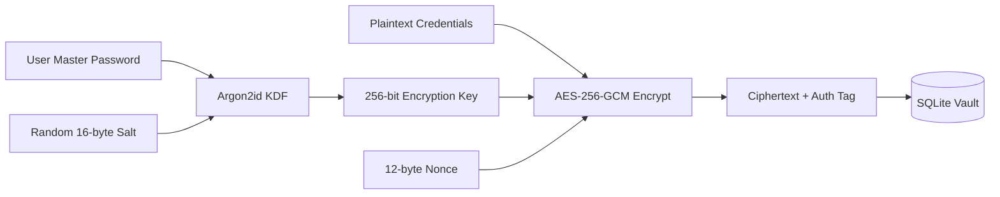
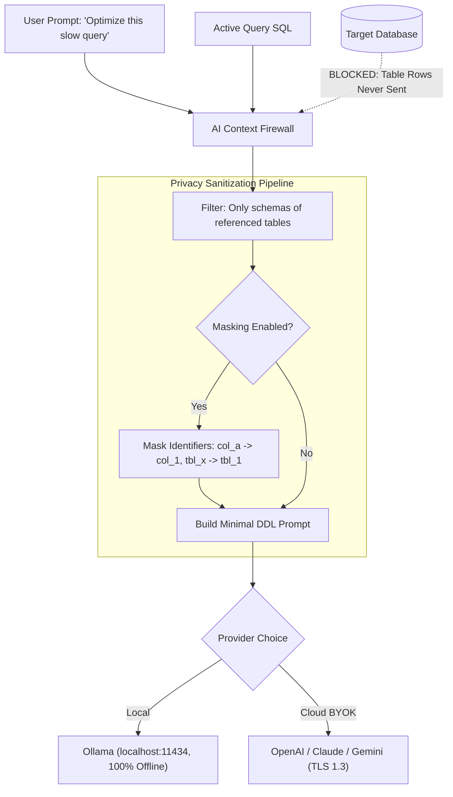

# SqlFox Security & Privacy Specification

Security architecture, cryptographic protocols, environment isolation, and AI privacy firewalls for SqlFox.

## 1. Threat Model & Trust Boundaries

```
[ Local Machine Trust Boundary ]
┌─────────────────────────────────────────────────────────┐
│ User Browser / Native App                                │
│        ▲                                                │
│        │ Local HTTP / WS (Bound to 127.0.0.1 ONLY)       │
│        ▼                                                │
│ Go Backend Process                                      │
│   ├── Memory: Decrypted Session Credentials (in-flight) │
│   └── Disk: ~/.sqlfox/config.db (Encrypted AES-256-GCM) │
└────────┬──────────────────────────────────┬─────────────┘
         │                                  │
         │ Direct TLS or Platform SSH Tunnel│ HTTPS (Metadata Only)
         ▼                                  ▼
[ Remote Database Server ]         [ Third-Party AI API ]
(Production / Staging / Dev)       (OpenAI / Claude / Gemini / Ollama)
```

### Trust Boundary Rules
1. **Secure-by-Default Ingress Binding**: The backend web daemon strictly binds to loopback (`127.0.0.1`) on a dynamic port or Unix socket. It never exposes ports to external networks unless the operator explicitly passes `--lan` (or `-host 0.0.0.0`).
2. **Controlled LAN Access Guard**: When `--lan` is enabled for tablet or remote device management, all non-loopback connections must pass the `Remote Access Guard` requiring Master Password authentication before session access.
3. **Third-Party Egress Control**: Outbound traffic is restricted strictly to configured target database endpoints and chosen AI provider endpoints.
4. **Flight Recorder Telemetry Safety**: The on-demand Performance Flight Recorder samples only global engine counters (`SHOW GLOBAL STATUS`) and running statement text from `PROCESSLIST`. Zero table row data is recorded. All metrics remain strictly within the local SQLite vault with an automated 24-hour retention purge and a 10-minute auto-stop polling ceiling.

---

## 2. Credential Encryption & Key Management

All database passwords, SSL/TLS certificates, and AI API keys stored locally in SQLite are encrypted at rest using **AES-256-GCM** with authentication tags.



### Cryptographic Parameters
- **KDF**: Argon2id (`time=3`, `memory=64MB`, `threads=4`).
- **Cipher**: `AES-256-GCM` with 96-bit random IV per record.
- **OS Keychain Integration**: If enabled by the user, the Master Key is stored in the operating system's native keychain (`github.com/zalando/go-keyring`) across macOS Keychain, Windows Credential Manager, or Linux Secret Service (via Freedesktop D-Bus).
- **Graceful Fallback**: If headless Linux or a container environment lacks a Secret Service daemon, SqlFox prompts for the Master Password upon startup.

### Vault Migration (`.sqlfox-vault`)
- Exporting connections generates an encrypted `.sqlfox-vault` JSON envelope.
- The user provides an **Export Passphrase** used exclusively to derive an ephemeral Argon2id key for that specific archive.
- Private keys and passwords never leave the machine in plaintext.

### Master PIN Entropy & Remote Lockout Policy
- **PIN Entropy**: Auto-generated Master PINs employ `fox-[a-z0-9]{6}` (>2.17 billion combinations), replacing legacy 4-digit PINs.
- **Brute-Force Rate Limiting**: The `Remote Access Guard` tracks consecutive failed unlock attempts per remote IP address.
- **10-Minute Quarantine**: Reaching 5 consecutive failed attempts immediately triggers a 10-minute lockout (`429 Too Many Requests`), completely neutralizing brute-force dictionary attacks.

---

## 3. Environment Isolation & Safety Policies

Every connection is tagged with an **Environment** that governs Safety Guard strictness:

| Policy Enforcement | Development | Staging | Production |
| :--- | :--- | :--- | :--- |
| **Visual Indicator** | Green dot | Yellow dot | Bold Red Banner (`PRODUCTION`) |
| **Read-Only Mode** | Optional toggle | Optional toggle | Default ON (Prompt to unlock) |
| **Unqualified `DELETE`/`UPDATE`** | Warning Banner | Warning + Confirm | **Blocked** (Hard Challenge Modal) |
| **`DROP TABLE` / `TRUNCATE`** | Confirmation Click | Challenge Modal | **Challenge Modal + Auto-Backup** |
| **Full Table Scan Alert (>100k rows)** | Toast notice | Toast notice | Modal Warning before running |
| **Max Auto Limit** | 5,000 | 1,000 | 500 (Strict) |

### Read-Only Enforcement
When Read-Only mode is toggled for a connection, SqlFox executes:
```sql
SET SESSION TRANSACTION READ ONLY;
```
Any accidental write query is rejected at the database engine level, in addition to the client-side Safety Guard block.

---

## 4. AI Privacy Firewall

SqlFox operates on a **Zero Data Leakage** guarantee.



### Privacy Guarantees
1. **Never Send Table Data**: Query results and row data **NEVER** leave the client. AI only receives table structure (DDL metadata: column names, data types, indexes) necessary for query generation or optimization.
2. **Selective Just-in-Time Schema**: Instead of dumping the whole database, the firewall extracts table names from the current editor via AST and passes only those specific DDL definitions.
3. **Client-Side Identifier Masking (Optional)**: In high-compliance environments, users can enable *Identifier Masking*. Column names (`salary`, `patient_id`) are mapped to synthetic tokens (`col_1`, `col_2`) before leaving the machine, and mapped back upon receiving the response.
4. **Local LLM First-Class Support**: Native integration with Ollama (`http://localhost:11434`) allows air-gapped database management with zero external internet traffic.

---

## 5. Diagnostic Profiling Security (`pprof`)

To balance developer observability under massive enterprise workloads with strict multi-IP security:

1. **Disabled by Default**: Runtime profiling endpoints (`/debug/pprof/*`) are completely unmounted by default in desktop and server runtimes.
2. **Explicit Opt-In via Environment Variable**: Endpoints are mounted conditionally strictly when `SQLFOX_PPROF=1` is exported in the host process environment.
3. **Loopback Client Enforcement**: Even when enabled, every incoming request to `/debug/pprof/*` is verified against `isLoopback(RemoteAddr)`. Non-loopback IP addresses (e.g. tablet clients or LAN peers connecting via Remote Access Guard) are rejected with `403 Forbidden`. This completely prevents heap snapshots, stack traces, or internal memory structures from leaking across the network.

---

## 6. Safe Online DDL & Index Tuning Guardrails

To prevent production database lockups and performance regressions during schema tuning:

1. **Non-Blocking DDL Enforcement**:
   - Recommendations on MySQL 5.7 and 8.0 explicitly generate `ALGORITHM=INPLACE, LOCK=NONE`, ensuring tables remain fully accessible for concurrent reads and writes throughout index construction.
   - PostgreSQL recommendations utilize `CREATE INDEX CONCURRENTLY` to avoid taking `ACCESS EXCLUSIVE` table locks.
   - SQLite DDL enforces a strict `PRAGMA busy_timeout = 3000` to prevent indefinite database file locking.
2. **Metadata Lock (MDL) Queue Protection**:
   - Index creation operations executed through SqlFox enforce an isolated connection with `SET SESSION lock_wait_timeout = 3` on MySQL, terminating fast rather than causing cascading metadata lock pileups.
3. **Index Bloat Write Guard**:
   - The advisor evaluates write overhead risk before suggesting new indexes. Tables with >5 secondary indexes trigger prominent warnings to alert operators to the write throughput penalty on `INSERT`/`UPDATE` operations.

---

## 7. DNS Rebinding & Cross-Origin CSRF Guard

To secure loopback communications against malicious websites accessed in local user browsers:

1. **Host Header Validation**:
   - Ingress middleware inspects the HTTP `Host` header on all requests.
   - Only `localhost`, `127.0.0.1`, `[::1]`, and the explicitly bound network host (when `--lan` is specified) are accepted.
   - External domains resolving to local loopback (DNS Rebinding attacks) are rejected with `403 Forbidden`.
2. **Cross-Origin Mutation Guard**:
   - State-altering endpoints (`POST`, `PUT`, `DELETE`, `PATCH`) enforce origin matching when `Origin` or `Referer` headers are supplied, rejecting `Sec-Fetch-Site: cross-site` requests.
3. **Master Password Inspection Restriction**:
   - `GET /api/auth/master-key` returns sensitive credentials only when `--lan` mode is active AND the request originates from loopback. In standard localhost mode, it returns `{ "lan_enabled": false }`.

---

## 8. In-App Self-Update & Supply Chain Verification

To maintain binary execution integrity during in-app updates:

1. **Strict Origin Enforcement**:
   - Update downloads are restricted strictly to official GitHub release URLs matching `https://github.com/herliansyah/sqlfox/releases/download/*`.
2. **Fail-Closed SHA-256 Digest Verification**:
   - The server downloads official release checksum manifests (`checksums.txt` / `SHA256SUMS`).
   - The downloaded binary archive is verified against the manifest digest with explicit non-empty asset name validation and strict exact filename matching.
   - If checksums do not match or if the manifest is unavailable, the update is rejected and the existing executable remains untouched.

---

## 9. Client SSL Private Key Encryption at Rest (`SSLKey`)

To prevent plaintext certificate exposure on disk:

1. **Envelope Encryption (`enc:v1:`)**:
   - Client SSL private keys (`SSLKey`) stored in the SQLite Connection Vault are encrypted at rest with AES-256-GCM.
   - Encrypted keys are prefixed with versioned envelope markers (`enc:v1:`), preventing accidental exposure if the database file is backed up or inspected.
2. **Backward Compatibility**:
   - Existing unsealed connection records continue to decode transparently, migrating to encrypted envelopes upon their next credential update or save.

---

## 10. Strict Same-Origin Ingress Guard

To completely eliminate cross-port CSRF execution from other local services running on the machine (e.g. a rogue node or python server on `localhost:3000` targeting SqlFox on `localhost:8080`):

1. **Byte-for-Byte Origin Host Matching**:
   - `IngressGuardMiddleware` parses incoming `Origin` and `Host` headers on all state-mutating requests (`POST`, `PUT`, `DELETE`, `PATCH`).
   - If the origin's host does not match the request host byte-for-byte, the request is immediately rejected with `403 Forbidden`.
2. **Direct Browser Navigation Preservation**:
   - Same-origin requests and standard GET requests continue without disruption.

---

## 11. MySQL Executable Comment Unwrapping in AST Safety Guard

To prevent evasion of destructive statement interception:

1. **Evasion Vector Elimination**:
   - Attackers or unintended scripts may wrap destructive statements inside MySQL conditional/executable comments (e.g. `/*! DROP TABLE users */` or `/*!50000 DELETE FROM orders */`).
2. **Syntax Unwrapping (`StripLeadingComments`)**:
   - The lexical preprocessor detects `/*!` opening delimiters, unwraps the enclosed SQL into raw executable tokens, and passes the unwrapped statement to the AST parser.
   - Destructive statements wrapped in comments trigger mandatory Challenge Modals and tiered affirmations without bypass.

---

## 12. Fail-Closed Processlist Batch Termination Policy

To ensure high-privilege thread management never accidentally harms the system:

1. **Fail-Closed Verification**:
   - `handleBatchKillProcess` requires a fresh, validated processlist from the database driver before dispatching any kill commands.
   - If the processlist query fails or times out, the handler aborts immediately with `HTTP 503 Service Unavailable`.
2. **Immune Caller & System Worker Protection**:
   - Thread candidate lists are strictly cross-referenced against immune thread identifiers (`@@pseudo_thread_id`, `pg_backend_pid()`, `system user`, `event_scheduler`, `binlog_dump`).
   - If candidate validation cannot be guaranteed, no terminations are executed.

---

## 13. Path Traversal Guard in Backup Filename Sanitization

To ensure backup artifacts cannot escape authorized storage locations:

1. **Directory Boundary Enforcement**:
   - Table and schema backup filenames generated before DDL execution (`internal/safety`) are sanitized against directory traversal sequences (`../`, `..\`).
   - Output paths are strictly resolved within the configured `.scratch/backups/` directory boundary.

---

## 14. Singleflight Connection Deduplication & Lazy Metadata Inspection

To prevent metadata lock exhaustion and denial-of-service during connection spikes:

1. **Singleflight Request Coalescing**:
   - Concurrent connect requests targeting the same connection ID are synchronized using `singleflight.Group` in `SessionManager`, collapsing concurrent UI requests into a single physical connection routine.
2. **Lazy Catalog Introspection**:
   - Schema and table metadata introspection is deferred from initial connection establishment to lazy on-demand retrieval, eliminating heavy metadata locks (`KEY_COLUMN_USAGE`) during initial session connection.


