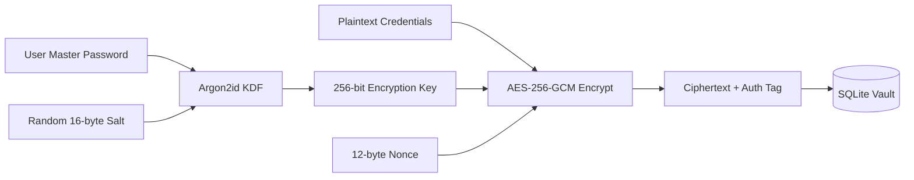
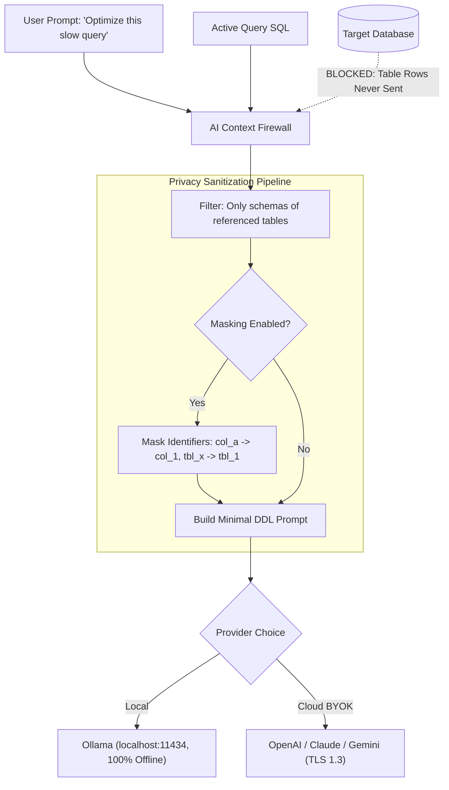

# SqlFox Security & Privacy Specification

Security architecture, cryptographic protocols, environment isolation, and AI privacy firewalls for SqlFox.

## 1. Threat Model & Trust Boundaries

```
[ Local Machine Trust Boundary ]
┌─────────────────────────────────────────────────────────┐
│ User Browser / Native App                                │
│        ▲                                                │
│        │ Local HTTP / WS (Bound to 127.0.0.1 ONLY)       │
│        ▼                                                │
│ Go Backend Process                                      │
│   ├── Memory: Decrypted Session Credentials (in-flight) │
│   └── Disk: ~/.sqlfox/config.db (Encrypted AES-256-GCM) │
└────────┬──────────────────────────────────┬─────────────┘
         │                                  │
         │ Direct TLS or SSH Tunnel         │ HTTPS (Metadata Only)
         ▼                                  ▼
[ Remote Database Server ]         [ Third-Party AI API ]
(Production / Staging / Dev)       (OpenAI / Claude / Gemini / Ollama)
```

### Trust Boundary Rules
1. **Localhost Binding**: The backend web daemon strictly binds to `127.0.0.1` on a dynamic port or Unix socket. It never binds to `0.0.0.0`, preventing LAN unauthorized access.
2. **Zero Ingress from Outside**: No public inbound open ports.
3. **Third-Party Egress Control**: Outbound traffic is restricted strictly to configured target database endpoints and chosen AI provider endpoints.

---

## 2. Credential Encryption & Key Management

All database passwords, SSH private keys, and AI API keys stored locally in SQLite are encrypted at rest using **AES-256-GCM** with authentication tags.



### Cryptographic Parameters
- **KDF**: Argon2id (`time=3`, `memory=64MB`, `threads=4`).
- **Cipher**: `AES-256-GCM` with 96-bit random IV per record.
- **OS Keychain Integration**: If enabled by the user, the Master Key is stored in the operating system's native keychain (`github.com/zalando/go-keyring`) across macOS Keychain, Windows Credential Manager, or Linux Secret Service (via Freedesktop D-Bus).
- **Graceful Fallback**: If headless Linux or a container environment lacks a Secret Service daemon, SqlFox prompts for the Master Password upon startup.

### Vault Migration (`.sqlfox-vault`)
- Exporting connections generates an encrypted `.sqlfox-vault` JSON envelope.
- The user provides an **Export Passphrase** used exclusively to derive an ephemeral Argon2id key for that specific archive.
- Private keys and passwords never leave the machine in plaintext.

---

## 3. Environment Isolation & Safety Policies

Every connection is tagged with an **Environment** that governs Safety Guard strictness:

| Policy Enforcement | Development | Staging | Production |
| :--- | :--- | :--- | :--- |
| **Visual Indicator** | Green dot | Yellow dot | Bold Red Banner (`PRODUCTION`) |
| **Read-Only Mode** | Optional toggle | Optional toggle | Default ON (Prompt to unlock) |
| **Unqualified `DELETE`/`UPDATE`** | Warning Banner | Warning + Confirm | **Blocked** (Hard Challenge Modal) |
| **`DROP TABLE` / `TRUNCATE`** | Confirmation Click | Challenge Modal | **Challenge Modal + Auto-Backup** |
| **Full Table Scan Alert (>100k rows)** | Toast notice | Toast notice | Modal Warning before running |
| **Max Auto Limit** | 5,000 | 1,000 | 500 (Strict) |

### Read-Only Enforcement
When Read-Only mode is toggled for a connection, SqlFox executes:
```sql
SET SESSION TRANSACTION READ ONLY;
```
Any accidental write query is rejected at the database engine level, in addition to the client-side Safety Guard block.

---

## 4. AI Privacy Firewall

SqlFox operates on a **Zero Data Leakage** guarantee.



### Privacy Guarantees
1. **Never Send Table Data**: Query results and row data **NEVER** leave the client. AI only receives table structure (DDL metadata: column names, data types, indexes) necessary for query generation or optimization.
2. **Selective Just-in-Time Schema**: Instead of dumping the whole database, the firewall extracts table names from the current editor via AST and passes only those specific DDL definitions.
3. **Client-Side Identifier Masking (Optional)**: In high-compliance environments, users can enable *Identifier Masking*. Column names (`salary`, `patient_id`) are mapped to synthetic tokens (`col_1`, `col_2`) before leaving the machine, and mapped back upon receiving the response.
4. **Local LLM First-Class Support**: Native integration with Ollama (`http://localhost:11434`) allows air-gapped database management with zero external internet traffic.
