# SqlFox Visual Showcase & Feature Gallery

Welcome to the comprehensive visual tour of **SqlFox**. All captures below are taken in high-resolution (**2x Retina / HiDPI**) running on an enterprise-scale dataset (**10,000+ orders, 25,000 order items, 2,500 customers, products, and system audit logs**).

---

## Table of Contents
- [1. Core Workspace & Data Grid](#1-core-workspace--data-grid)
- [2. Deterministic Safety Guardrails](#2-deterministic-safety-guardrails)
- [3. DBA Operations & Live Telemetry](#3-dba-operations--live-telemetry)
- [4. DB Tools & Synchronization Suite](#4-db-tools--synchronization-suite)
- [5. Visual Schema Modeling & Table Designer](#5-visual-schema-modeling--table-designer)
- [6. In-Context AI Copilot](#6-in-context-ai-copilot)

---

## 1. Core Workspace & Data Grid

### Hero Workspace (SQL Editor + High-Performance Virtual Data Grid)
High-concurrency query editor with syntax highlighting, analytical aggregations, and DOM windowing that renders 10,000+ records smoothly without browser lag.
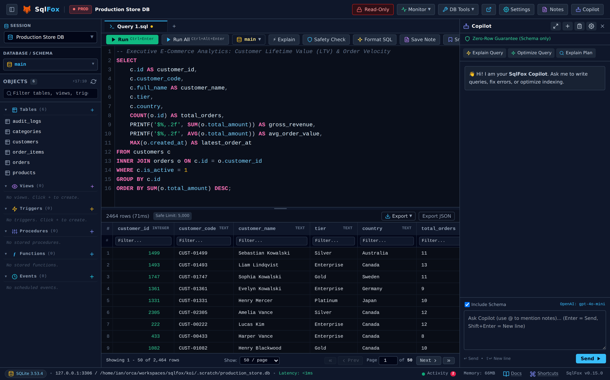

### Vertical Record Inspector (Form View + Nested JSON Viewer)
Single-row detail inspector with formatted card views and syntax-highlighted pretty-printed nested JSON payloads for complex schemas.
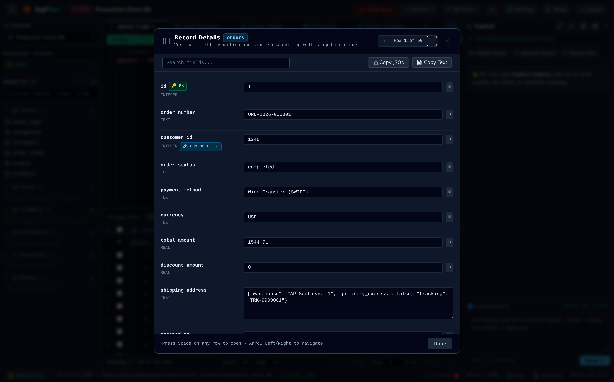

---

## 2. Deterministic Safety Guardrails

### Safety Guard™ (Destructive Query Challenge Modal)
AST-based pre-execution interceptor for dangerous queries (`DROP TABLE`, `UPDATE`/`DELETE` without `WHERE`). Calculates row impact in advance and requires explicit manual confirmation.
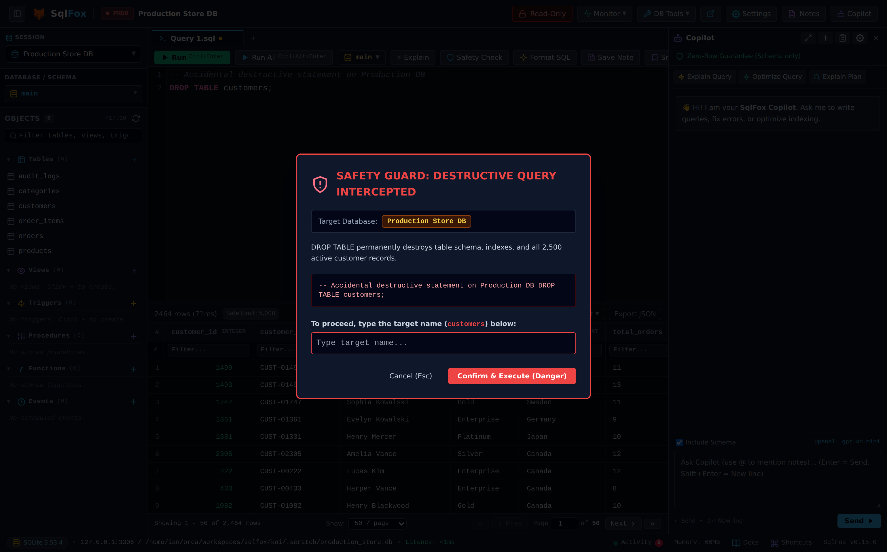

---

## 3. DBA Operations & Live Telemetry

### Flight Recorder (On-Demand Telemetry & Slow Query Correlation)
1-second interval telemetry recorder capturing QPS spikes, active thread counts, and lock contention correlated directly with running SQL text.
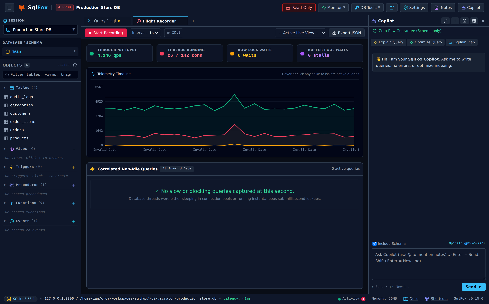

### Cluster & Replication Inspector
Multi-node health dashboard displaying replica lag, I/O and SQL thread statuses, Galera flow control, and failover roles.
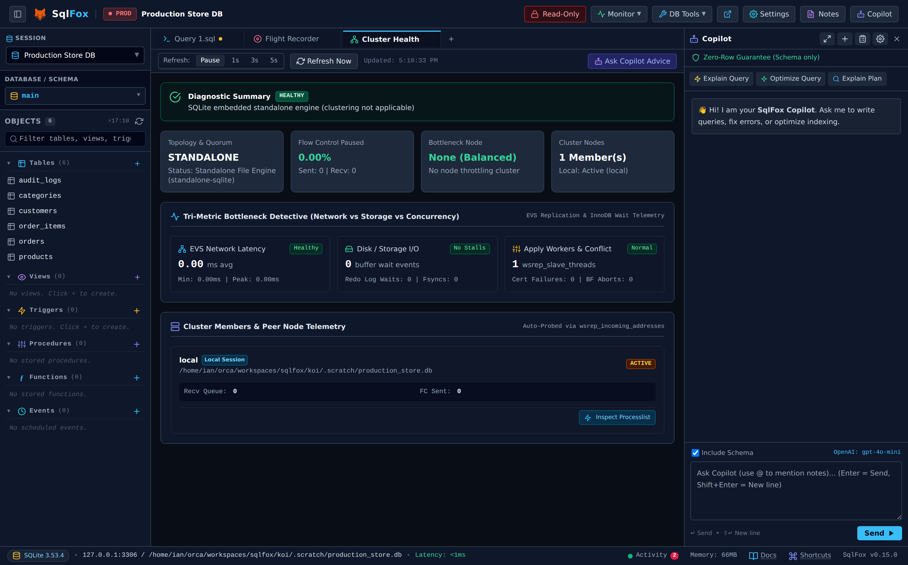

### Lock Contention & Root Blocker Triage
Isolates the root blocker transaction holding row/table locks during lock storms, with dedicated out-of-band kill triggers.
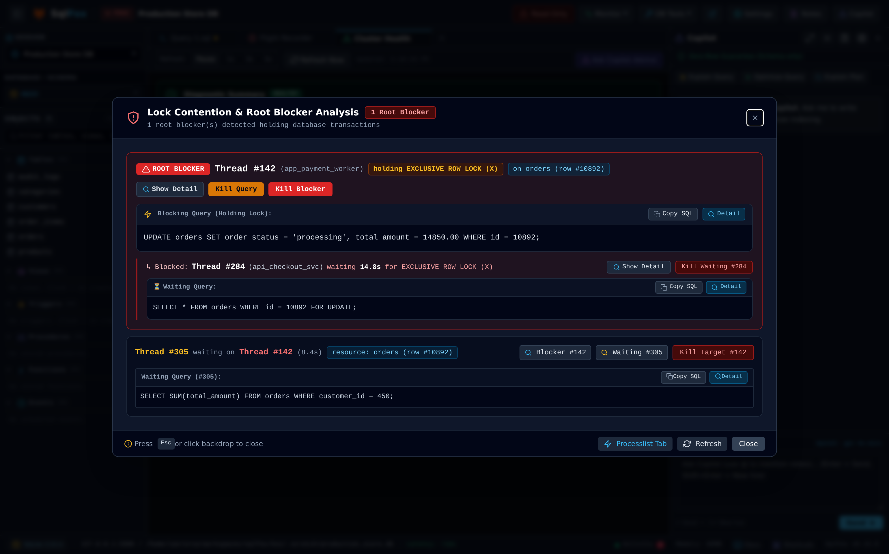

### Real-Time Thread Processlist
Live thread inspection with state filtering, execution timers, slow query alerts, and batch termination safeguards.
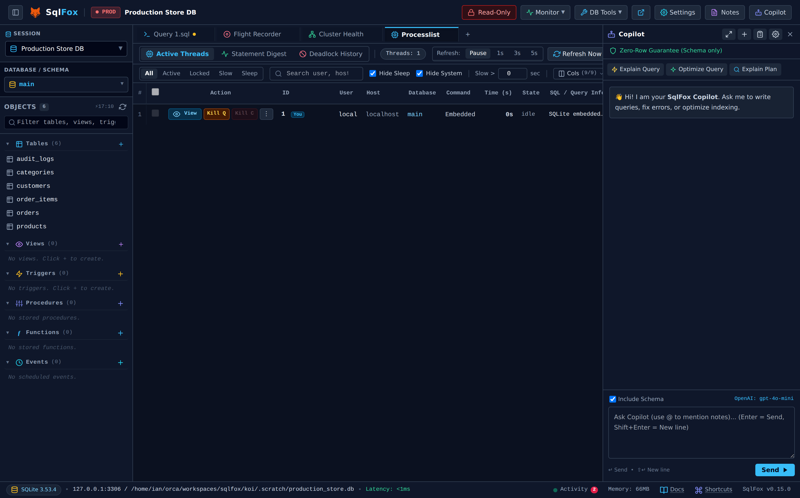

### Storage & Health Diagnostics
Physical disk footprint analysis, data-to-index storage ratios, fragmentation overhead detection, and database health advisors.
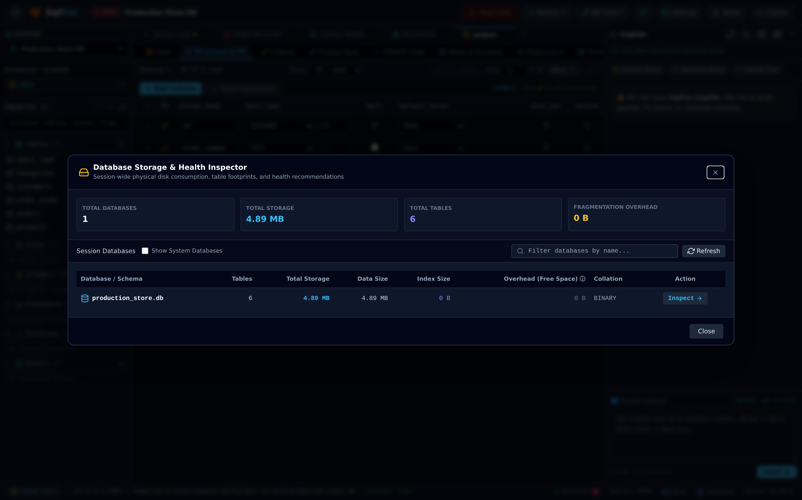

### Server Variables & Tuning Advisor
Inspects thousands of database engine parameters with categorized tuning recommendations for optimal memory and durability.
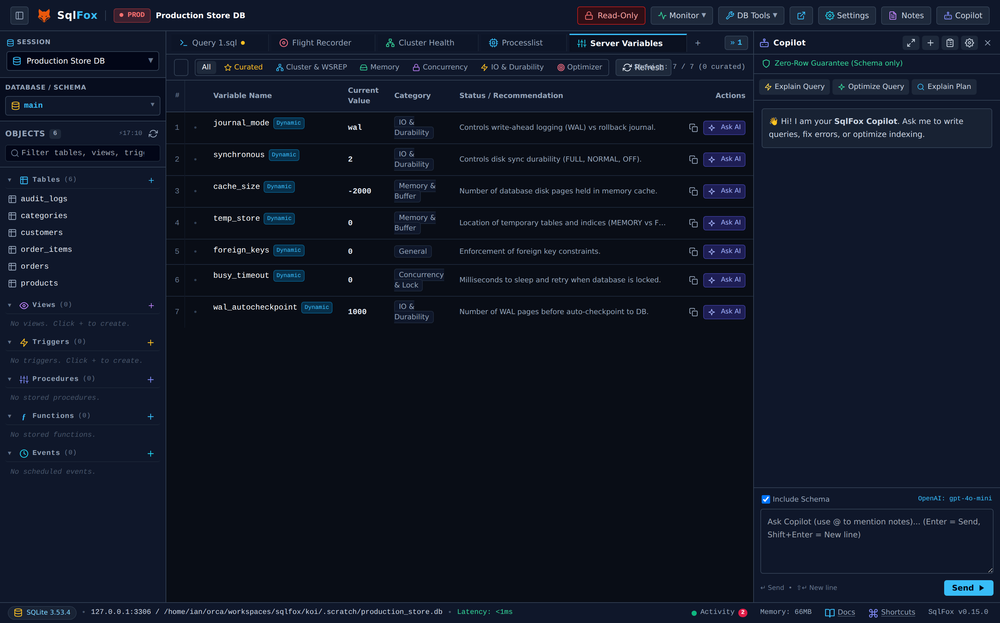

---

## 4. DB Tools & Synchronization Suite

### Export Smart Seed (FK-Aware Topological Slicer)
Exports relational database slices preserving parent-child foreign key integrity without dangling references for dev/staging environments.
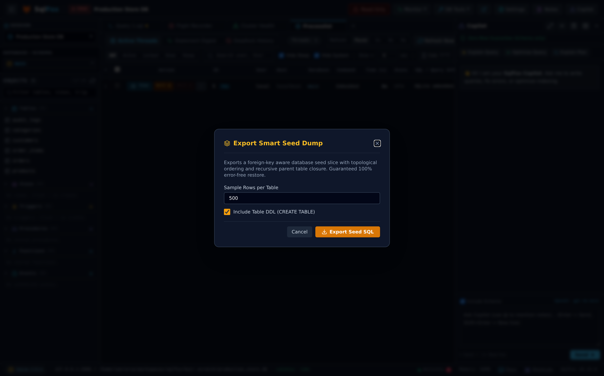

### Structure Sync (AST Schema Diff & Migration Generator)
Compares schemas across databases and environments, generating color-coded DDL diffs and safe, ordered migration scripts.
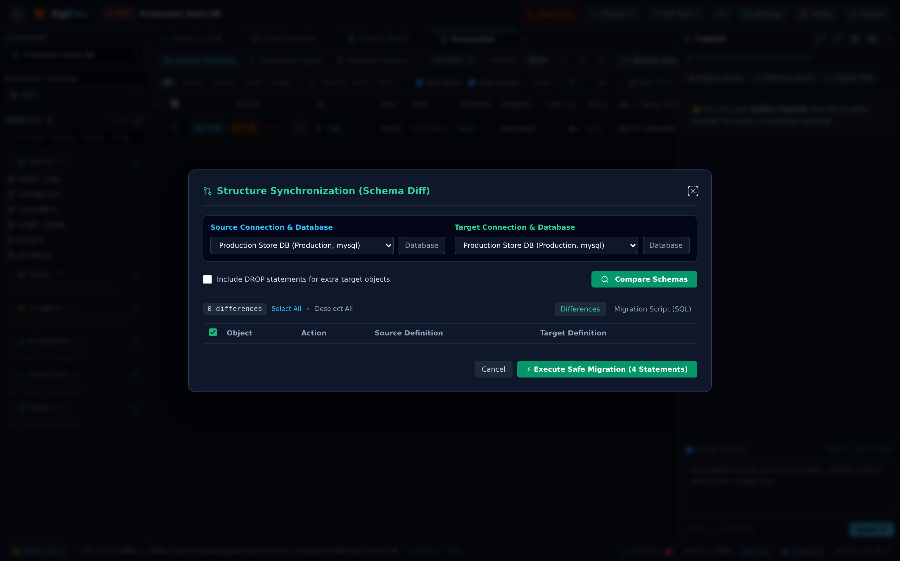

### Cross-Connection Data Transfer
Direct, memory-bounded (<50MB buffer) streaming copy of multiple tables directly between database sessions without intermediate disk dumps.
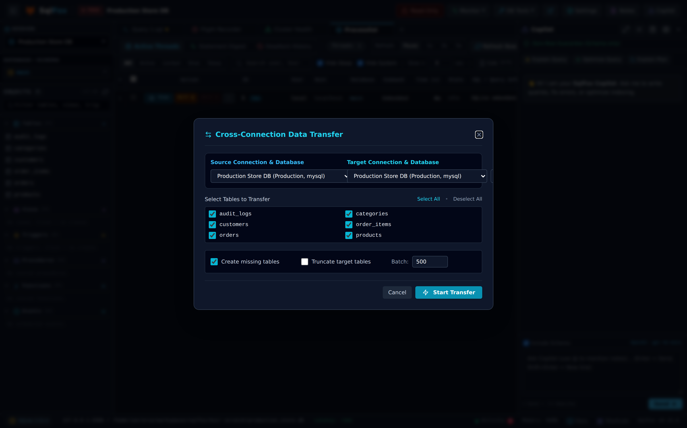

### Row-Level Data Sync (Keyset Delta Reconciler)
Row-by-row reconciliation calculating precise Insert, Update, and Delete deltas based on primary keys.
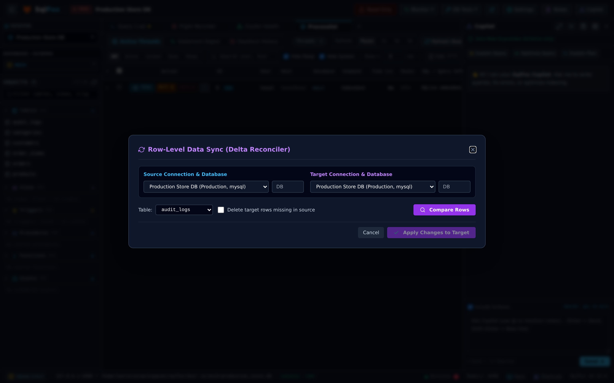

---

## 5. Visual Schema Modeling & Table Designer

### Visual Interactive ERD Canvas
Interactive canvas with smooth SVG Bézier connectors showing foreign key relationships, column types, and cardinality.
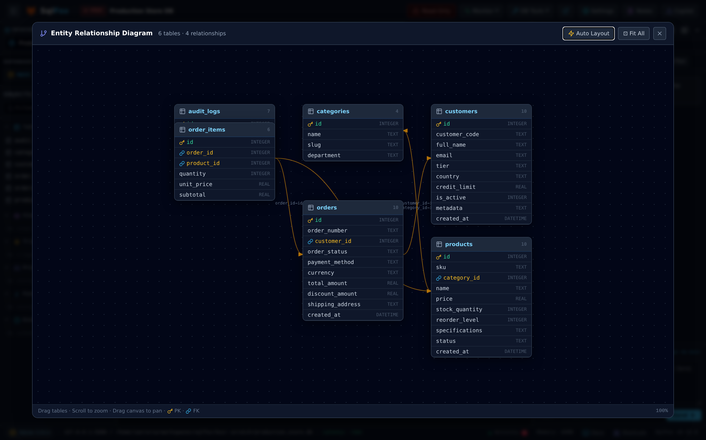

### In-Place Visual Table Designer
Manage table columns, primary keys, nullability, default value presets, and composite indexes without losing typing focus.
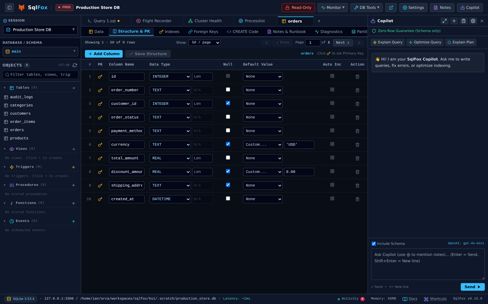

---

## 6. In-Context AI Copilot

### AI Copilot & Query Tuner
Integrated assistant offering schema-aware query optimization, ESR-guided composite index creation, and 1-click `Insert & Run` into the editor.
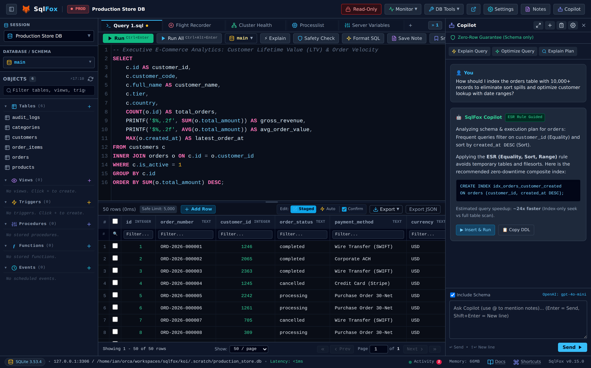
